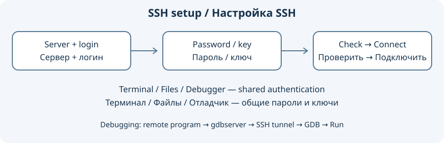
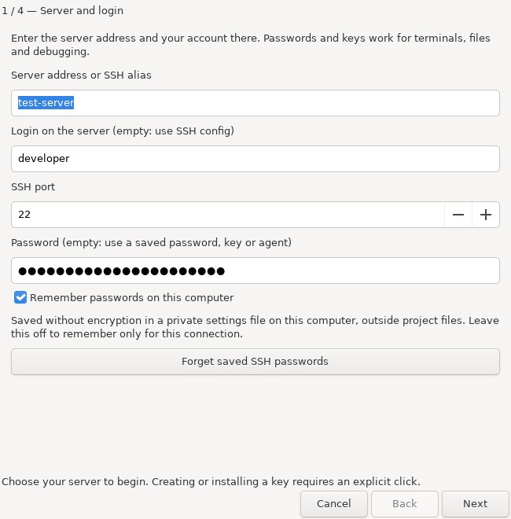
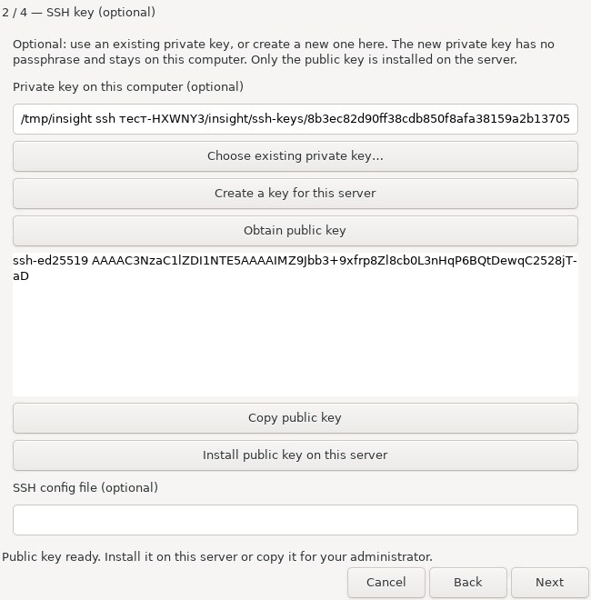
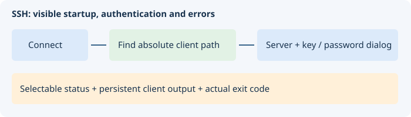
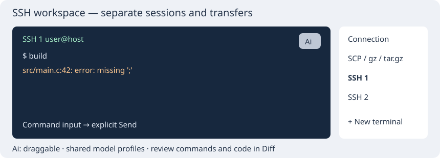

# SSH

## First connection: guided setup

Open **File → SSH files / folders / projects…**, select **Connection**, then **Set up SSH step by step…**.

1. Enter the server address, login and SSH port (usually 22). Enter a password, or leave it empty to use a saved password, key or agent. Keep **Remember passwords on this computer** enabled for future connections.
2. The key step is optional. **Choose existing private key…** selects a key already on your computer. **Create a key for this server** creates an Ed25519 key without overwriting an existing one. The new private key has no passphrase and stays in private application settings; an imported encrypted key may use its saved passphrase.
3. **Obtain public key** derives the public half of a selected private key. **Copy public key** copies only that public half for an administrator. **Install public key on this server** adds it to your remote account's `~/.ssh/authorized_keys`, preserving existing entries and avoiding duplicates. Initial installation needs a working password, agent or another authorized key. Ask the administrator if you have no initial access.
4. Press **Next**, then **Check connection**. Confirm the server fingerprint after checking it with your administrator. Read any error below the form and use **Back** to correct the settings.
5. After a successful check, press **Next → Connect**. A terminal opens using these settings. The same authentication is available to file transfers and the C/C++ debugger.

Passwords and key passphrases are saved **without encryption** in a private per-computer file (`insight/ssh-credentials.conf` under the application's configuration directory), outside project files. POSIX permissions restrict newly written files to their owner. Turning remembering off uses disposable authentication files that are deleted after the connection. **Forget saved SSH passwords** removes the selected account's password and selected key's passphrase. Existing project-stored credentials move into private settings when the local profile is saved/used.

The wizard needs OpenSSH (`ssh` and, for keys, `ssh-keygen`) and the application's `geany-insight-askpass` helper for graphical password prompts. It does not create a server account or install the server's SSH service. The remote key installer expects a POSIX shell and standard `awk`, `mkdir`, `chmod`, `touch` tools.

Production SSH wizard captured in an isolated GTK fixture with a test SSH client. The account and public key are test data; private keys and passwords are not displayed.

Remote files and commands through OpenSSH.

## Connecting from Windows

The same wizard works on Windows. Native OpenSSH clients are resolved from the editor bin directory, then PATH or system Windows OpenSSH. Key setup needs `ssh-keygen.exe`; file transfers use `sftp.exe`/`scp.exe`; graphical password prompts use `geany-insight-askpass.exe`. Bundled clients do not require MSYS2/WSL on the user computer. Key/settings paths may contain spaces and Cyrillic characters. Private settings default to `%APPDATA%\geany\insight`; a custom editor configuration directory takes precedence.

SSH debugging from Windows targets a POSIX server, such as Linux, with `gdbserver`. Windows needs a compatible local GDB and matching local symbols for the target architecture. A Windows server using PowerShell instead of a POSIX shell cannot execute this wizard's automatic server/key-install commands.

## Controls

Set host, user, port and key. Commands open a remote file, folder or project; Save uploads changes. Stop cancels a transfer. Connect/Disconnect controls the shell; Enter sends input and Ctrl+C interrupts. Input and output share one VT100/xterm-compatible terminal screen; screen dimensions follow the panel (see TTY / COM for history settings).

## Short tutorial

Enter your server settings and connect. Open a known remote file. After editing, explicitly save it remotely or enable automatic upload.

The ? button at the upper right opens this page. Help follows the interface language selected in Options.

More: [guide.md](guide.md).

[ИИ-помощник консоли: настройка, разбор ошибок и исправления через Diff/Merge](console-ai.md).

## Connection feedback

Connect starts an OpenSSH client, then the client authenticates with the server. Starting a process is not reported as a completed connection. The selectable status is on its own wrapping row; startup errors, disconnects and exit codes also remain in the console transcript. Read the original client output above a nonzero exit status for the server/network reason.

Clients shipped in the application bin directory are resolved to absolute paths before spawning; PATH and, on Windows, system OpenSSH locations are fallbacks. If the password dialog helper is missing, a visible message explains that only key/agent authentication is available. Password/host-key questions use the separate SSH dialog. Spaces around the host and login are ignored.

SSH-панель разделена на вкладки справа: подключение, доступ к файлам и независимые терминалы. Кнопка «+» добавляет терминал (до 16); у каждого свой процесс, очередь ввода и журнал. Кнопку Ai с непрозрачностью 80% можно перетащить по терминалу; она открывает отдельное окно помощника. Используются общие профили моделей и проверяемые предложения правок через дифф. Явная кнопка выполнения отправляет предложенную команду только в этот терминал.

### Передача файлов отдельно от терминалов

Во вкладке Transfer задайте абсолютные локальный и удалённый пути, File/Folder и упаковку. Send отправляет, Receive получает; для получения укажите новое имя, существующие локальные файлы не перезаписываются. Без упаковки используется отдельный SCP; gz упаковывает один файл, tar.gz — файл или папку. При получении с упаковкой gzip/tar запускается на сервере через отдельный SSH без PTY. Архивы сохраняются как архивы, автоматической распаковки нет. Stop отменяет упаковку/передачу, сохраняя подключения терминалов.

Для локальной упаковки нужен Python 3, для удалённой — gzip/tar на сервере. SCP-пути на сервере ограничены буквами ASCII, цифрами и `/._-`, чтобы оставаться безопасными и на старых клиентах; для остальных имён используйте существующее открытие через SFTP. Перед отправкой проверьте имя назначения: удалённый файл может быть заменён.

## Unified terminal input/output

SSH now uses a single black VT100/xterm input/output screen with colors and native selection instead of a separate command entry. Right-hand icon tabs show a plug, file transfer and numbered terminals, with tooltip names. Local VTE also uses a black background and middle-click selection/clipboard fallback. See [TTY / COM](panel-tty.md) for the serial panel and current limits, including dynamic SSH/TTY dimensions and configurable 10,000-line history.

## Общая группа терминалов и плавающее окно Ai

Нижняя вкладка **Терминалы** объединяет **Локальный / SSH / TTY**. Контекст остаётся отдельной вкладкой. На экране каждого терминала кнопка **Ai** имеет непрозрачность 80%: перетащите её в свободное место; после изменения размеров она остаётся внутри экрана.

Ai открывает отдельное изменяемое по размеру окно с обычными кнопками управления окнами, промптом, ответами, настройками моделей и вложениями. В обычном режиме оно связано с главным окном; в режиме независимых окон не имеет родительского окна. Повторное нажатие поднимает то же окно и обновляет контекст, если запрос сейчас не выполняется. Закрытие исходного терминала закрывает его помощника. Это плавающее системное окно; отдельный внутренний MDI-контейнер не добавлен.

Кнопки **Ошибки → исходник**, **Помощь в шелле**, **Объяснить вывод**, **Помощь с подключением** заполняют редактируемый промпт. Истории и четыре частых запроса разделены по месту применения: локальный терминал, SSH, TTY, произвольная консоль, диагностика, справка программы, справка по исходнику, редактор/проект. Для каждого места хранится до **100 уникальных запросов**; повтор повышает частоту и обновляет дату, самый старый удаляется при добавлении 101-го. Выбор ничего не отправляет: отредактируйте текст и нажмите **Отправить**. **Удалить выбранный** удаляет запись, **Очистить историю** очищает только это место; текущий текст промпта остаётся для редактирования. История ответов отдельная: до 32 ответов в памяти окна.

Запросы сохраняются сразу перед отправкой в каталоге **`<файл-проекта>.ai-history/`** рядом с файлом проекта, отдельный `.conf` для каждого места. Каталог можно хранить вместе с проектом в Git. Без открытого проекта используется `insight/ai-history/` в каталоге настроек. После перезапуска история перечитывается. Открытое окно связано с проектом, при котором оно создано; повторное открытие терминального Ai после смены проекта создаёт окно с историей нового проекта. В подсказке строки управления историей указан путь файла. Хранятся текст запросов, частота и дата, без API-ключей, ответов, вывода терминала и приложенных исходников. Если запись не удалась, запрос не отправляется и показывается ошибка.

Для SSH/TTY берётся выделенный текст либо последние 12 000 символов; локальный терминал предоставляет выделение либо доступный журнал. Итоговый контекст ограничен 60 КиБ и доступен для проверки и редактирования. Исходники прикладываются явно. Предложения кода проверяются в **Diff / Merge**, вставка команды сама её не выполняет. Для TTY учитывайте протокол устройства: команда оболочки может быть неприменима к COM-порту.

## Высота терминала и строка состояния

Локальный, SSH и TTY занимают общую высоту страницы. Справка SSH/TTY и переход к диагностике SSH находятся на правой полосе значков. Статус выводится справа в свободной части ряда «Локальный / SSH / TTY». Корешки имеют приоритет: длинный текст обрезается справа, полностью доступен в тултипе; отдельная строка под терминалом не резервируется.
