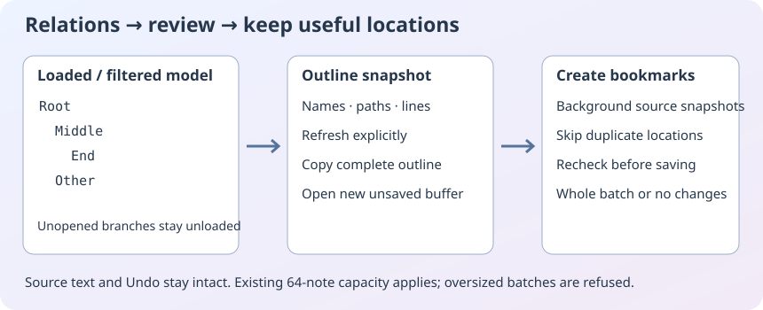

# Relation results: outlines and bookmark batches

Open **Navigate → View Relation Outline…** or **Create Bookmarks from Relation Items…**. The same commands are in the Relations right-click menu and in the two icon buttons beside Search/Stop.

The read-only, selectable outline records the current query, mode, symbol names, paths and lines. It follows the current list filter and sorting. In tree/graph mode it includes the materialized tree, with indentation and loading notices; it never loads unopened branches. Refresh explicitly replaces the snapshot. Copy outline copies the whole snapshot. Open outline buffer creates a new editable, unsaved, unnamed buffer; it does not overwrite a report or source file. Save it with ordinary Save As if needed.

**Create bookmarks** uses the previewed source locations and the currently selected global/project bookmark store. Duplicate exact paths/lines, including already stored bookmarks, are skipped. Names come from the symbol with a unique numbered suffix; existing names and clips are preserved. An empty batch is a no-op.

Source preparation runs in the background. Open buffers use their current decoded contents, including unsaved edits. Closed files are decoded using the normal source reader without opening editor tabs. Bookmarks keep the actual complete source line, allowing the existing text-anchor relocation. Sources, the selection, Undo and disk contents are not edited. Closing the dialog cancels a pending batch; a completed batch remains in Bookmarks.

Before saving, the command rechecks the relation snapshot, project/store identity and contents, open-buffer identities/hashes and closed-file metadata. Stale input is refused: refresh and review again. The existing checked store write either commits the whole candidate or keeps the previous store; a file conflict is reported. This is not a filesystem lock or semantic re-resolution of stale index positions.

Limits: 2000 source items, 4000 visited model rows, 64 tree levels, 1 MiB outline. The existing note store holds 64 notes total, including clips when shared; a batch exceeding the remaining capacity is rejected as a whole. Source snapshots allow 2 MiB per file, 16 MiB combined and 64 KiB per complete bookmarked line. Unsaved/nonabsolute locations and notices cannot become persistent bookmarks. Text Search mode uses its separate Search Results panel; select a relation mode first. Lazy/unloaded descendants and semantically resolved calls are not synthesized.

For example, search for derived types, filter the list to one branch, preview and create its bookmarks. Clear the filter and create the rest: the previously stored locations are skipped. Expand a tree branch and Refresh to include its newly loaded descendants.

Source Insight references: [Create Bookmarks from Relation Items](https://www.sourceinsight.com/doc/v4/userguide/Manual/Command_Reference/Create_Bookmarks_from_Relation_Items.htm), [View Relation Outline](https://www.sourceinsight.com/doc/v4/userguide/Manual/Command_Reference/View_Relation_Outline.htm). The outline here is an explicit snapshot dialog/buffer, not a claim of a live inline textual view or complete semantic parity.
