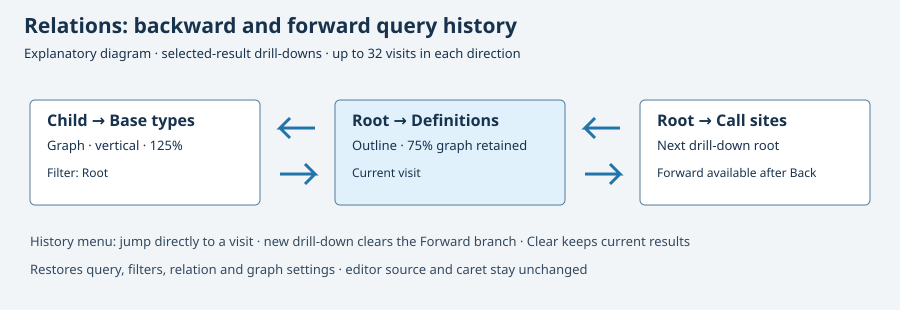
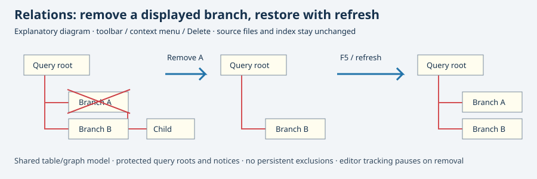

# Calls and function tracking

Open View → Panels → Relation Window, or use the blue connected-nodes toolbar button.

* Calls (current function, lexical): enter a parsed function name from the active file and Search. Shows identifier-plus-parenthesis expressions in its body. Single click previews the call site in Context; double click opens it in the editor.
* Call sites (project, lexical): searches supported source files for the identifier followed by `(`. Current buffer only is available; open unsaved buffers are read through the existing search pipeline.
* Follow symbol in editor + Track enclosing function: follows the smallest containing complete function body, including positions on whitespace. Turning enclosing tracking off restores identifier tracking. The option and relation mode are saved.

This initial implementation uses lexical masks, not semantic call graphs. Calls excludes language control keywords and masked comments/strings; macros are included. Templates, operator calls and indirect function pointers are incomplete. Nested function declarations and prototypes can appear as lexical call sites. Overloads are not resolved; for duplicate definitions in the current file, put the cursor inside the desired body. Calls caps results at 512 and buffers at 2 MiB. Function tracking and lexical Calls support brace languages, Python indentation and Lua end-delimited functions. Nested function declarations can still appear as lexical call sites; aliases, dispatch and overloads are not resolved. Project call-site searches retain existing result/file/work limits and Stop behavior.

Toolbar icons are original Cairo drawings with blue accents and theme-colored outlines; they do not require an external image loader. The internal merge window also has a toolbar shortcut.

Result filtering matches symbol, file and source text using Unicode case folding. It does not rerun the project search. Column sorting remains available. Definitions and Call sites buttons query the selected result, disable editor tracking and clear the display filter. Definition queries show all indexed candidates instead of guessing an overload. Single click still previews, and double click opens the result location.

Back and Forward restore drill-down visits and graph options. The history menu supports direct jumps and clearing; see Relation query history below.

## Graph view

Without Expandable relation tree, enable Graph view in Relations. This shows the existing filtered and sorted result model as a one-level graph under the current query. Horizontal/Vertical controls change layout; zoom ranges from 5% to 200%. The first 128 visible results are drawn; the footer reports the full count and the table remains available for all results. The view choice is saved with workbench settings. Layout and zoom are also saved with workbench settings.

Click a node for Context; double click or Enter opens its location in the editor. Arrow keys, Home and End select and scroll to result nodes. Definitions, Call sites, Back and the result filter use the same selection in either view. Nodes show symbol and file:line; cream cards, turquoise symbol badges, subtle shadows and red connectors are original Cairo drawings. Selected cards use blue with white text.

This flat mode is a graph of search results, not a recursively expanded semantic call tree. Links represent the active relation query, not proven runtime call edges. Existing lexical/tag limitations apply.

Copy image (or Ctrl+C with graph focus) copies the complete currently drawn graph to the clipboard. Save PNG… exports a snapshot taken before the file chooser opens, using the same renderer, scale, selection and model order. Unicode paths use GLib file I/O. Existing files require the usual overwrite confirmation. Images larger than 16384 pixels on either axis or 32 million pixels total are rejected before allocating a raster; reduce zoom or filter the results. Export includes the first 128 results shown by the graph, not the remaining table rows.

Right-click a graph result node for Open in editor, Definitions, Call sites, References, Direct members, Base types or Derived types. The graph-focused shortcuts D/C/R query definitions/call sites/references for the selected node; Ctrl+C still copies the graph image. Menu or Shift+F10 opens the node menu. These actions use the existing drill-down history and turn editor tracking off. They replace the query with results for the selected node; they do not add recursive branches to the current drawing.

## Indexed inheritance chains

In Members, Base types and Derived types, enable **Include indirect inheritance (tags)** to traverse indexed inheritance chains. Members then includes direct members and members in reachable base scopes, retaining overloads and shadowed names. Turn it off for direct members or one inheritance edge, using the same scoped type lookup. The checkbox is saved and included in drill-down Back history.

The traversal resolves C++ `::` and dot-scoped names, searches declaring namespaces from inner to outer, and respects an explicit global `::` base. It uses the active language profile before constructing links. Bare root names are accepted only when unique; duplicate indexed class declarations or ambiguous base names are omitted instead of guessed. Cycles and diamond inheritance do not duplicate results. Indexed nominal typedef/using chains resolve in the alias declaration scope and file, both as query roots and inheritance bases. Cyclic aliases decline with an ambiguity notice; unknown bases are omitted.

Depth is limited to 32 edges; the status reports a depth limit or ambiguity. The table shows at most 2000 eligible results and reports truncation. Filtering/sorting and the existing graph remain available; the graph still displays a single layer of result nodes rather than the inheritance edges. This implements tag-based transitivity, not compiler-level access-control, overload, template instantiation or expression inference.

## Expandable indexed relation outline

Enable **Expandable relation tree** in Members, Base types or Derived types. Expanding a class node loads its immediate indexed relations in a worker; collapsing retains its loaded children. Contains/Members branches show direct scopes only, so inherited fields are not attached to the wrong owner. Definitions/Call sites and Back work from the selected source row; Back restores the tree option and previously expanded branch paths for this session.

The shared result filter retains ancestors of matching loaded nodes; it does not search unloaded descendants. Clearing it restores cached expansion. Expansion itself does not navigate the editor; selecting a source row previews Context, and double-click opens that row. Structural roots/notices do not change Context or open a stale location. Stop cancels branch loading and retains loaded rows. The tree option is persisted; expanded paths are kept for this editor session.

Cycles remain visible as stopped leaf nodes. Limits are 32 relation edges, 200 results per branch and 2000 source/root nodes overall; notices explain truncation and ambiguity. Only unambiguous indexed class relationships are traversed. Enable Graph view together with Expandable relation tree to draw these indexed branches. Recursive call/reference branches are still outstanding.

## Expandable indexed graph

With both **Expandable relation tree** and **Graph view** enabled, the graph draws the same expanded outline, with each connector attached to its actual parent. The +/− control at the right edge (horizontal) or bottom edge (vertical) loads/collapses that node; the query root has the same control. Right/+ and Left/− expand/collapse the selected branch; Up/Down and Home/End select visible source nodes. Enter opens the selected source row. Expansion does not select or navigate a new source location.

Collapsing retains loaded children and cached descendant expansion. Switching back to the outline preserves the same branches, selection, filtering and Back history. Flat and hierarchical graph modes share saved orientation/zoom preferences, including after leaving Graph view. Copy image/Ctrl+C and Save PNG render the full currently drawn hierarchy, with the existing 128 visible-source-node and raster allocation bounds. Structural notice rows are omitted from the drawing. Existing indexed/lexical limitations still apply; this does not introduce semantic call edges.

## Scoped nominal aliases

For example, if `N::Alias` refers to `N::Base` and `N::Child` inherits `Alias`, Bases for Child shows Base, Derived for Alias shows Child, and Members for Alias shows the Base scope. Nested typedef/using, union, enum and namespace rows can also be expanded in the Members outline and graph. Language eligibility is applied before resolving aliases. Lookup follows at most 32 aliases and refuses ambiguous targets or cycles; it does not instantiate template arguments or resolve overloads/includes.

## Graph viewport and navigation

The cream cards, shadows, turquoise badges and red connectors follow the supplied Source Insight visual reference. Rendering is original Cairo code. The illustration above is an explanatory diagram, not an application screenshot.

- **Fit graph / F** fits the currently drawn graph within the explicit 5–200% zoom bounds. At the 5% minimum, a sufficiently large graph still needs scrolling.
- **Center selected node / Space** centers the visible selected node as far as canvas edges allow. Without a visible selection it shows the query root.
- **Actual size / Ctrl+0** restores 100%. Ctrl+plus/minus zooms around the viewport center.
- **Ctrl+wheel** zooms around the point beneath the pointer. An ordinary wheel retains normal GTK scrolling.
- **Middle-button drag** pans without selecting or activating a node. Release, Escape, hiding the panel and destroying the widget release the grab.
- Selecting a visible result in the shared table reveals its graph node. Hover shows the full symbol and file:line, even when a card label is ellipsized.

Existing horizontal/vertical layouts, branch expansion, filtering and sorting retain their data and behavior. The exact zoom percentage is persisted, including Fit's result; resizing does not enable an ongoing auto-fit mode. Clipboard and PNG share the same palette and geometry, including 5% zoom, with the existing 16384-pixel axis and 32-million-pixel allocation limits. The graph still draws at most 128 visible source nodes. These gestures add no semantic call resolution or new relation branches.

## Print the relation graph

Use the printer button, **Print graph…** on a node's context menu, or **Ctrl+P** while the graph canvas has focus. The system print dialog includes a **Graph layout** tab and paper/orientation settings:

- **Fit graph on one page** keeps the complete visible graph on a single sheet, reducing it as needed. Small graphs are not enlarged.
- **Tile at 100%** uses 96 logical graph pixels per inch and splits the graph across sheets, in row order from left to right. Each footer shows page count, tile column/row and the displayed/total result counts. Align the printable areas when joining sheets.

The title uses the query at the time printing starts. Printing captures an immutable vector snapshot before opening the dialog: later indexing, selection changes or closing the graph cannot alter it. Output does not depend on the screen zoom or scroll position. Text remains searchable in PDF output from the system print backend.

Only currently drawn nodes are printed (up to 128); collapsed branches and filtered-out results stay excluded. Expand the required branches first. Tiling is limited to 256 pages; if the selected paper/margins would exceed that limit or leave no room for the graph, printing is cancelled with an explanation in the graph status. Choose fit-to-page or a larger printable area. Cancelling the print dialog does not change the editor or graph options.

This implements the graph printing capability described in the [Source Insight graph-view documentation](https://www.sourceinsight.com/doc/v4/userguide/Manual/Concepts/Outline_and_Graph_Views.htm). Linux validation exports PDFs through GTK without a physical printer; physical printer drivers and other platforms were not tested.

## Relation query history

**Back** and **Forward** revisit drill-down roots reached through Definitions, Call sites or the graph's selected-node relation actions. **Relation query history** lists both directions; choosing a visit jumps directly to it without running searches for the intervening visits.

Each visit captures the query, result filter, relation, buffer/comment/code options, indirect inheritance, tree/graph choice, orientation and exact zoom. Editor tracking stays off while browsing history. Tree branches retain the existing session expansion behavior; scroll position and row selection are not captured.

Each direction keeps at most 32 visits in memory for this session. A new selected-result drill-down after Back discards the old Forward branch. **Clear relation history** clears both stacks while keeping the current query/results. History is not persisted across launches and does not record every cursor movement or manual query edit; editor location history is separate.

Back/Forward root history is described in the [Source Insight release notes](https://www.sourceinsight.com/source-insight-version-4-0-0134/). This implementation extends result drill-down history, rather than claiming parity with every automatic tracking mode.

## Remove nodes from the view

**Remove node from view** is available on the toolbar, the table/outline and graph context menus, and **Delete** with Relations focus. In the expandable tree it removes the whole selected branch, including loaded descendants. The table and its graph share one model; filtering and sorting do not change which source row is removed.

Query roots and notice/loading/limit rows are protected. Removal does not modify files, the index, editor text or query history. It stops the current result search and turns editor symbol tracking off so the next cursor update cannot immediately recreate the node. Pending loads below a removed branch are discarded when their row references become invalid.

**Restore nodes (refresh)** or **F5** reruns the current query with the same filters/options, so removed nodes can reappear after recalculation. Exclusions are not persisted across queries or launches. Collapsing/reopening an already loaded branch alone does not recalculate it. The display-only removal behavior follows the [Source Insight release description](https://www.sourceinsight.com/source-insight-version-4-0-0134/); restoration here uses an explicit query refresh.
