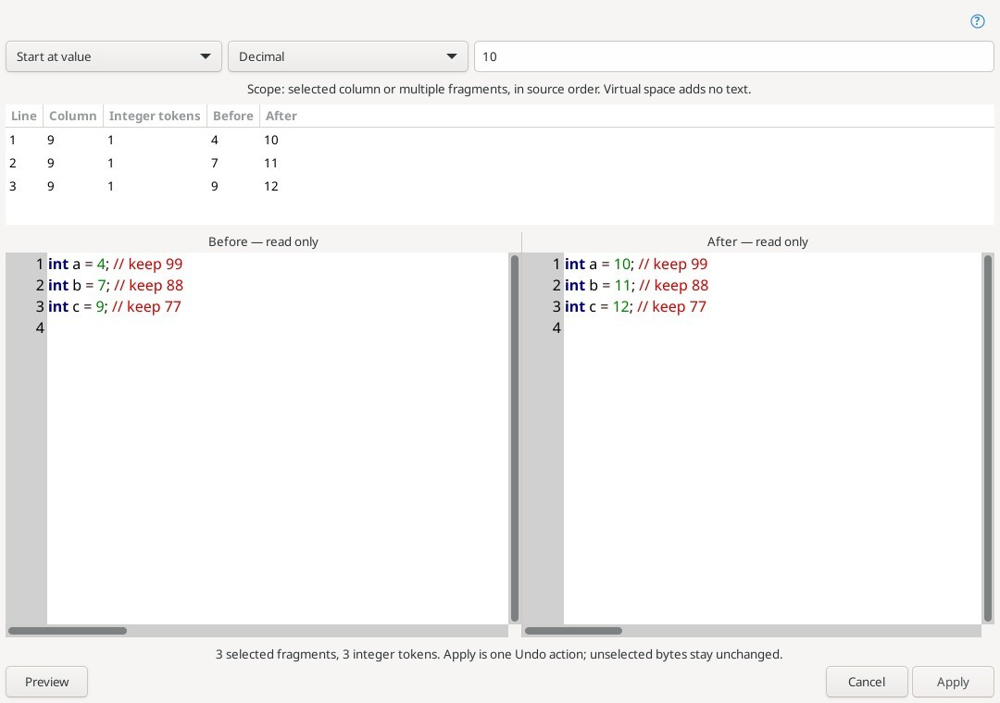

# Renumber — перенумерация

**Edit → Insert and clipboard → Renumber…** перенумеровывает целые числа. При обычном выделении обрабатывается его точный текст; одиночный курсор без выделения означает весь документ. Preview не меняет редактор, Apply объединяет изменения в один Undo, Cancel оставляет исходник без изменений.

- **Auto** начинает последовательность с первого найденного числа; **Start at value** — с заданного значения; **Offset** прибавляет значение к каждому исходному числу.
- Система счисления результата: исходная для каждого числа, десятичная, шестнадцатеричная (`0x`) или восьмеричная (ведущий ноль). Значение Start/Offset также принимает десятичную, `0x` или восьмеричную запись и знак.
- Изменяются самостоятельные целые числа. Идентификаторы, дроби, экспоненты, суффиксы и ошибочная запись чисел пропускаются. Это текстовая операция: числа в строках и комментариях тоже включены. Выделение считается самостоятельным текстом — выбирайте числа полностью.
- Значения должны помещаться в знаковое 64-битное целое. Переполнение отменяет весь план. Вход и результат ограничены 8 МиБ. Прежний диалог обычного выделения показывает первые 8000 байт; начальные нули, явный плюс и регистр hex нормализуются.
- Обычный диалог работает с одним стандартным выделением без виртуального пространства. Для колонки и нескольких выделений используется новое окно ниже. Readonly-буферы исключены; изменение текста/выделения, другой текущий документ или закрытый источник отменяет Apply.

## Колонка и несколько выделений

Вызовите ту же команду **Renumber…** для прямоугольного/тонкого столбца либо нескольких обычных выделений. Окно **Renumber selected fragments** показывает полный снимок документа до/после с синтаксической подсветкой и номерами строк. В таблице — исходная строка, колонка редактора, число целых чисел и ограниченные фрагменты до/после. Выбор строки подсвечивает соответствующий диапазон в обоих снимках.

Настоящее окно полной Linux-сборки под Xvfb с синтетическим исходником и выделением колонки. Значения 4, 7, 9 становятся 10, 11, 12; числа 99, 88, 77 в комментариях находятся вне области замены.

**Preview** вычисляет весь план. Смена параметров очищает его и отключает Apply. Auto / Start / Offset и четыре системы счисления действуют последовательно по фрагментам в порядке исходника, независимо от порядка создания выделений. Последовательность не начинается заново на каждой строке. Невыделенные байты, отступы, комментарии, Unicode и CRLF/LF/CR сохраняются точно. Выделенные числа в комментариях и строках тоже участвуют; выбирайте целые числовые токены.

Пустой фрагмент не содержит чисел и никогда не означает весь файл. Виртуальное пространство после конца строки не добавляет пробелов: короткие строки остаются короткими. Границы, представленные внутри табуляции, отклоняются — выровняйте их по целым границам TAB. Обычные символы TAB внутри выделенного текста сохраняются.

Apply меняет только отличающиеся фрагменты в обратном порядке, одним Undo/Redo, без сохранения. Числа могут получить разную длину, поэтому результат выделяется несколькими обычными диапазонами, точно покрывающими изменённые фрагменты. Направление каждого диапазона и основная исходная строка сохраняются, расстояния виртуального пространства — нет. На этих выделениях можно сразу повторить Renumber. При отсутствии изменений Apply отключён, записи Undo не создаются.

Полный документ и результат ограничены 8 МиБ, должны быть UTF-8 без NUL; максимум 4096 выделений. Переполнение signed 64-bit в любом фрагменте отклоняет весь план до правок. Изменение текста (даже с последующим Undo), выделения, текущего/закрытого документа или права записи отменяет Apply. Если синхронное расширение редактора меняет исходник либо уничтожает диалог во время применения, оставшиеся правки останавливаются; при частичном применении отмените операцию через Undo. Общего Undo проекта и автосохранения нет. Проверка Windows и Android не заявляется.

Ориентир: [Source Insight Renumber](https://www.sourceinsight.com/doc/v4/userguide/Manual/Command_Reference/Renumber.htm).

Клавишу Renumber можно назначить в категории **Editor**. Меню и клавиша используют одинаковые правила выбора области; стандартная комбинация не назначена.

Проверено на Linux: полная сборка и установка, **75/75 тестов успешно**, [прогон 39625341427](https://github.com/bhgv/geany-insight/actions/runs/39625341427), исходный код `f366a1dd576a56dcedbafccbdf7986c98b14f85b`. Новый снимок получен этим успешным прогоном. Проверены прежняя команда, общая последовательность по диапазонам, Unicode/CRLF/TAB, короткие и виртуальные строки, обратные и основные выделения, меню/клавиша, маркеры, точность внешнего текста, Undo/Redo, изменившийся/readonly/другой/закрытый источник, подмена вставки той же длины через InsertCheck и уничтожение диалога. Windows и Android не запускались.
