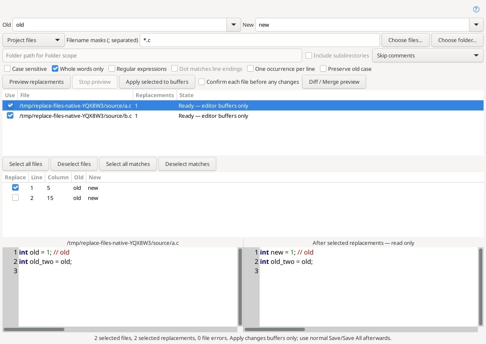
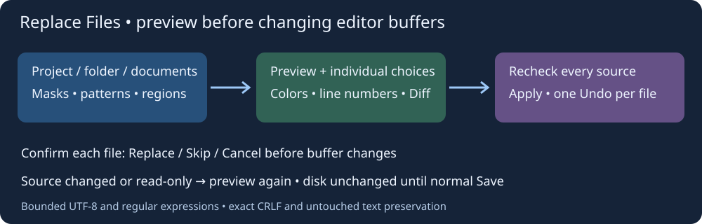
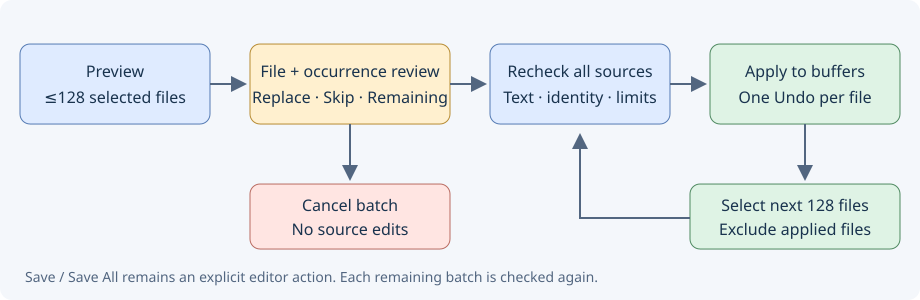

# Замена в нескольких файлах — Replace Files

**Search → Replace Files…** открывает отдельное окно массовой замены. Команда также доступна для назначения клавиши в настройках клавиатуры, категория Editor. Сначала создаётся снимок и предварительный просмотр; **Apply selected to buffers** меняет только буферы редактора. Автоматической записи на диск нет. Для сохранения используйте обычные Save / Save All, а для отмены — Undo в каждом изменённом файле.

Настоящее окно полной Linux-сборки под Xvfb; исходники и проект — синтетический тестовый пример. Вторая замена в `a.c` отключена, комментарий пропущен; видны подсветка и номера строк до/после.

## Область и шаблоны

В **Old** задайте искомый текст или выражение, в **New** — замену. Пустая замена удаляет найденное. После успешного Preview сохраняются до 20 последних Old/New, маски и параметры в приватном `insight-replace-files.conf`; поля позволяют выбирать историю и редактировать её текст. Изменение шаблона, масок, области или параметров отключает Apply до нового Preview.

Области: **Project files** — фактический список проиндексированного проекта; **Open documents** — открытые документы с несохранёнными изменениями; **Current document** — текущий документ; **Chosen files** — выбранные файлы; **Folder** — выбранная папка. Для проекта дождитесь завершения индексации. **Choose files… / Choose folder…** выбирают соответствующую область. Маски имён разделяются `;`, например `*.c;*.h`, и относятся к имени файла, а не всему пути. `*` или пустое поле означает все имена. На Windows имена сравниваются без учёта регистра.

В области Folder **Include subdirectories** включает рекурсию. Каталоги `.git`, `.hg`, `.svn` и символические ссылки не обходятся. Папочная область независима от исключений проекта. Открытый буфер имеет приоритет перед файлом на диске во всех областях.

## Параметры замены

- **Case sensitive**, **Whole words only** и **Preserve old case** задают регистр и границы идентификаторов. Сохранение регистра распознаёт верхний, нижний и начальный заглавный регистр; смешанные имена получают буквальную замену.
- **Regular expressions** использует Perl-совместимые выражения GLib/PCRE. В замене поддержаны `\1`–`\99`, `\g<name>`, `\g<number>`, `\n`, `\r`, `\t`, `\\` и группа 0. Без Regex поле New буквальное. Группы проверяются даже при отсутствии совпадений. **Dot matches line endings** относится к Regex.
- **One occurrence per line** оставляет первое подходящее совпадение каждой логической строки. CRLF считается одним переводом строки; нулевые совпадения внутри CRLF не вставляются. Поиск и результаты сохраняют целые символы UTF-8.
- Области **All text / Code only / Skip comments / Comments only** используют лексическую классификацию C/C++ и C-подобных файлов, JS/TS, Python, Lua и Shell по расширению. Code only исключает также строки. Для неподдерживаемого расширения такой фильтр даёт ошибку файла, а не угадывает язык. Это не препроцессор или компилятор: условно неактивный код не исключается; сложные языковые расширения могут требовать обычного All text.

## Просмотр и выбор

Нажмите **Preview replacements**. Сначала выбираются не более 128 подходящих файлов; остальные остаются в списке для следующих пакетов. После сбора области чтение закрытых файлов и поиск выполняются в отменяемом рабочем потоке; буферы и файлы не меняются. Первичный ограниченный обход папки выполняется в потоке интерфейса: на медленно подключённых каталогах начало построения может задержаться. **Stop preview** отменяет работу; устаревший или отменённый план не применяется.

Верхняя таблица показывает файл, число выбранных замен и состояние. Снимки недоступных, неподдерживаемых и readonly-файлов отмечаются отдельно. Выбирайте файлы флажками; **Select all files / Deselect files** управляют группой. Для выбранного файла нижняя таблица показывает каждое совпадение с номером строки, столбцом и старым/новым текстом. Флажки и **Select all matches / Deselect matches** позволяют подтвердить отдельные замены до применения.

Рядом находятся полные readonly-предпросмотры **до/после** с синтаксической подсветкой и номерами строк. Выбор совпадения перемещает выделение. **Diff / Merge preview** открывает независимый снимок в существующем сравнении; он не изменяет пакет и не применяет правки к исходнику. Для другого результата измените критерии или выбор совпадений в Replace Files.

**Previous match / Next match**, **Shift+F3 / F3** перемещаются по всем совпадениям предпросмотра, включая отключённые, с переходом между файлами и циклическим обходом. **Open source in editor** открывает или активирует исходник, сохраняя окно Replace Files. Позиция используется только при полном совпадении живого текста со снимком; изменённый исходник открывается без устаревшего перехода. Пропущенное совпадение в уже применённом файле открывает начало файла. После ручных правок нужен Preview; автоматического перечитывания при смене фокуса нет.

## Применение и подтверждение

**Confirm each file before any changes** запрашивает Replace / Skip / Cancel для каждого выбранного файла. Решения собираются до изменения буферов: Cancel отменяет весь ещё не применённый пакет. Индивидуальные совпадения подтверждаются флажками таблицы.

**Confirm each replacement before any changes** открывает подтверждение с файлом, строкой, колонкой и ограниченными фрагментами до/после; кандидат выделен в цветном предпросмотре. **Replace occurrence / Skip replacement / Replace remaining / Cancel batch** накапливают решения до изменения исходников. Replace remaining принимает оставшиеся включённые совпадения текущего пакета во всех файлах. Сначала выполняются подтверждения файлов. Cancel отбрасывает все накопленные решения, сохраняя прежние флажки и буферы. Перед применением результат заново проверяется, включая ограничения размера. Параметры подтверждения действуют в текущем окне.

Перед применением проверяются все выбранные источники: идентичность открытого документа, имя, полное содержимое и readonly. Закрытые файлы перечитываются, затем открываются в редакторе; декодированные буферы проверяются ещё раз. Несовпадение до начала изменений отменяет пакет. Открытые вкладки, созданные при подготовке, могут остаться открытыми без изменений.

Правки применяются по одному буферу, **одним Undo для каждого файла**. Это не общий Undo всего проекта и не транзакция файловой системы. Перед каждым буфером выполняется ещё одна проверка; если расширение редактора синхронно меняет другой источник во время применения, оставшаяся часть останавливается и показывается число применённых файлов. Уже изменённые буферы можно отменить отдельно. Успешно изменённые файлы помечаются **Applied — use editor Undo** и больше не выбираются в этом плане, даже если затем отменить их правки в редакторе. **Select next 128 files** выбирает до 128 оставшихся подходящих файлов без повторного поиска в уже изменённых буферах. Каждый следующий пакет заново проверяет свои источники. Новый Preview намеренно строит новый план по текущему тексту; он нужен после изменения критериев или ручной правки оставшегося исходника. Обычное Save может запускать ранее включённые действия редактора, например отправку удалённого файла; сама замена их не запускает.

Readonly-буферы и readonly-файлы не разблокируются. UTF-8 BOM при чтении закрытого файла не попадает в текст сравнения; штатное открытие/сохранение Geany сохраняет информацию о кодировке и BOM. Закрытые файлы должны быть UTF-8; файлы другой кодировки сначала откройте в редакторе.

## Ограничения и проверка

До 2 000 входных файлов, 1 МиБ на исходник/результат, 16 МиБ исходников и 32 МиБ результатов, 100 000 совпадений в пакете, 10 000 совпадений на файл, до 128 файлов за одно Apply. Маски — до 4 КиБ, Old/New — до 8 КиБ. Рекурсия ограничена глубиной 32 и 10 000 просмотренных записей. Превышение не приводит к молчаливому частичному применению: сузьте область/маски или выберите меньше файлов. Regex имеет ограничения работы и глубины.

Нативные Linux-тесты проверяют настоящий проект, меню и клавиши, маски, лексические области, цветные readonly-предпросмотры и номера строк, отдельные совпадения, устаревшие/readonly-источники, Skip/Cancel подтверждений, Undo каждого файла, неизменность диска, рекурсивную папку, историю и отмену просмотра. Отдельный тест ядра проверяет Unicode/CRLF, группы, нулевые совпадения, ограничения Regex и точные границы комментариев. Windows и Android не запускались.

Первая реализация проверена: Linux, полная сборка и установка, **71/71 тестов успешно**, [прогон 39609587088](https://github.com/bhgv/geany-insight/actions/runs/39609587088), код `2ce4631551103cbed25147159c35c4df6a9d2b3a`. Снимок выше получен этим прогоном.

Ориентир: [Source Insight Replace Files](https://www.sourceinsight.com/doc/v4/userguide/Manual/Command_Reference/Replace_Files.htm). Не перенесены автоматическое сохранение и принудительное изменение readonly, Skip Inactive Code и точный старый диалект регулярных выражений Source Insight.
