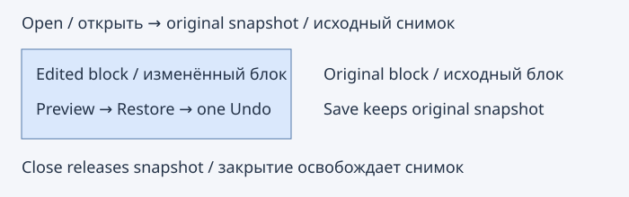
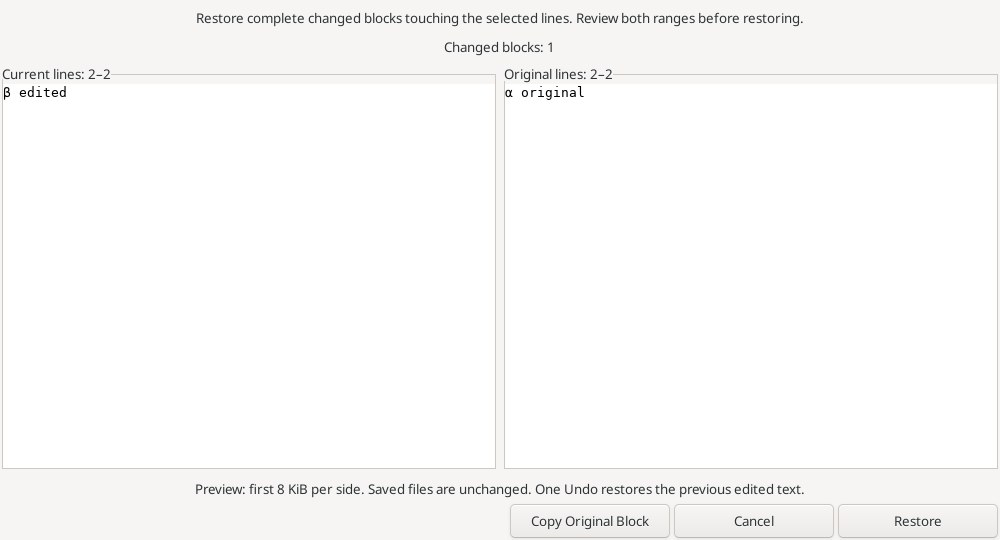
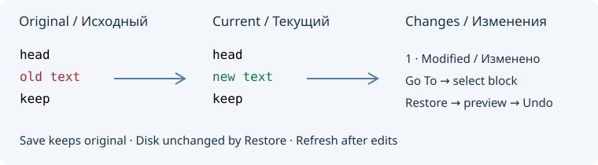
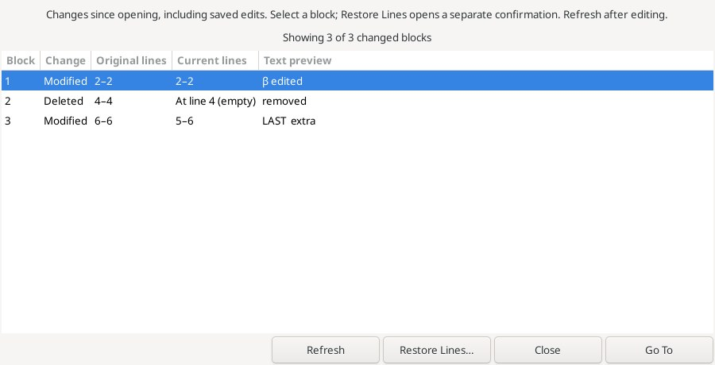
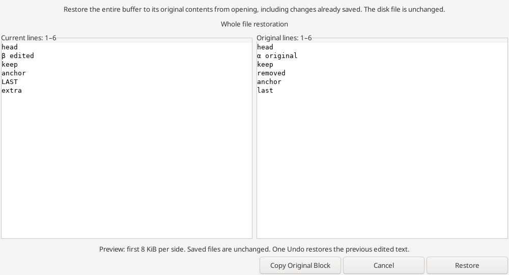

# Restore Lines / Восстановление строк

**Edit → Restore Lines…** previews restoration to the decoded UTF-8 text captured
when this document was opened or created. Saving and Reload do not replace that
baseline. [Checkpoint](checkpoint.md) explicitly replaces it after saving and clears Undo/Redo. Closing releases it; reopening captures a new baseline. Untitled buffers
use their initial template/empty contents. A modified buffer already present at
initialization has no original baseline.

The caret chooses its complete physical line. An ordinary forward/reverse
selection expands to its touched lines, excluding an ending line-start boundary.
Exact line diff selects **complete changed blocks** touching those lines. Adjacent
changed lines can belong to one larger block, so the preview can extend beyond the
original selection. Deleted-line anchors at either selected edge are included.
Both line ranges and the changed-block count are shown before confirmation.

**Restore** replaces that contiguous affected span with the original span in one
Undo/Redo group, preserves text outside it and selects the restored span in the
original direction. Disk contents and clipboard are unchanged. **Copy Original
Block** explicitly copies the complete original span (not just the preview).
Cancel leaves the buffer intact. Read-only buffers can preview/copy but not apply.
Changes to document identity, text generation, selection, active tab or permissions
while the dialog is open cancel Apply. No automatic refresh silently changes the
planned operation; reopen the command to inspect the new state.

**Edit → Original Contents…** opens the full original text in a separate read-only
unsaved editor tab, with exact bytes/EOL and no Undo history or disk write. It uses
the source file type and can be copied or saved with normal explicit commands.
Original Contents views do not capture their own restoration baseline.

Limits: 8 MiB per original/current/final document, 64 MiB total original snapshots,
valid UTF-8 without NUL, one normal selection without virtual space, existing diff
work limits. Preview displays at most 8 KiB per side, with EOL normalized for
viewing; restoration preserves exact original EOL. Snapshots live only in memory.
Unsupported/oversized original files have no snapshot until close/reopen or a successful bounded Checkpoint. These
are line/diff blocks, not AST or semantic changes. Core and GUI limits reject an
operation before any partial edit. Native Preferences offers unassigned Editor
bindings for Restore Lines and Original Contents.

**Правка → Восстановить строки…** показывает текущий и исходный блоки строк,
сохранённые при открытии документа. Save и Reload сохраняют первоначальный снимок;
команда [Checkpoint](checkpoint.md) явно заменяет снимок после сохранения и очищает Undo/Redo. После закрытия и повторного открытия исходным становится новый текст с диска.
Восстанавливаются **целые блоки изменений**, которые могут быть шире выделения:
сначала проверьте диапазоны в окне. Удалённые строки привязаны к границам диапазона.
Правка выполняется одним Undo, текст вне диапазона сохраняется. Файл на диске и
clipboard не меняются; копирование исходного блока выполняется отдельной кнопкой.

**Исходное содержимое…** открывает полный снимок в отдельной вкладке только для
чтения. Лимиты снимков: 8 МиБ на документ, 64 МиБ суммарно; снимки хранятся в памяти
до закрытия. Предпросмотр ограничен 8 КиБ с каждой стороны. Некорректный UTF-8,
нулевые байты, прямоугольные/множественные выделения и виртуальные позиции
отклоняются. Изменение документа, курсора или прав после открытия окна отменяет
применение. Набор не реализует отдельное восстановление части единого diff-блока
или восстановление снимков после перезапуска.

Reference: [Source Insight Restore Lines](https://www.sourceinsight.com/doc/v4/userguide/Manual/Command_Reference/Restore_Lines.htm).

The ordinary editor right-click menu also exposes Restore Lines and Original
Contents. Menu opening updates baseline/selection availability and displays current
user-assigned shortcuts. Read-only sources retain preview/copy; unsupported
selection modes disable Restore while allowing the original-text view.
This entry is in the normal editor popup, not a dedicated revision-margin popup.

Обычное контекстное меню редактора содержит восстановление и исходное содержимое.
При открытии обновляются доступность и подписи пользовательских сочетаний клавиш.
Для прямоугольного/множественного выделения восстановление недоступно, просмотр
исходного текста остаётся доступным. Это обычное меню редактора.

Original Contents copies the decoded UTF-8 text; source encoding and BOM metadata are not copied.
Исходное содержимое — декодированный текст UTF-8; метаданные исходной кодировки и BOM не копируются.

Real production dialog from an isolated native Linux GUI test fixture, captured
in the successful 48-test run; this is not a mockup. The fixture deliberately uses
a small UTF-8/CRLF example.

Настоящее окно из изолированного нативного GUI-теста Linux, прошедшего в составе
48 проверок; это не макет. Пример использует короткий текст UTF-8 с CRLF.

## Whole file and original changes / Весь файл и список изменений

**Edit → Restore File…** previews the complete original/current buffers and restores
all text captured when opening/creating the document, including edits already
saved. The disk is unchanged. Cancel is a no-op; Restore is one Undo/Redo group.
This does not reload the current disk file. It uses the same snapshot limits,
normal-selection guard and stale-document/selection/permissions checks as Restore
Lines. Full-file restoration does not require an exact diff or its work budget.

**Go To Next Change / Go To Previous Change** compare exact physical lines with
the opening snapshot, including saved edits and EOL differences. They move to the
next strictly greater / previous strictly smaller block start relative to the
active caret, without wrapping. Inside a block Previous returns to its start.
Deleted blocks use their surviving boundary (including EOF). Existing selection
collapses unless Extend Mode is enabled; read-only navigation is allowed. Normal
navigation history records the jump for named documents. No syntax-aware or
persisted revision marks are implied.

**Original Changes…** lists block number, insertion/deletion/modification, original
and current physical line ranges, and a 160-byte UTF-8-safe text excerpt. Empty
sides show a deletion/insertion boundary. Go To or double-click selects the block;
Restore Lines opens its normal confirmation, with complete touching-block semantics.
Refresh recomputes only for the same active document. Changed text requires explicit
Refresh before navigation; a switched or closed document cannot be targeted.
Columns resize; first 2000 blocks are listed with shown/total counts. Navigation
commands still inspect all blocks within the exact-diff work/size limits. Four
new shortcuts are unassigned in native Preferences. The ordinary editor popup
contains all four commands; unsupported selection modes disable them.

**Восстановить файл…** показывает весь текущий и исходный текст. Подтверждение
возвращает буфер к состоянию при открытии, даже после Save; диск не меняется.
Один Undo возвращает прежние правки. Полное восстановление не требует diff.
**Следующее/предыдущее изменение** переходят по началу точных блоков без зацикливания,
включая границы удалённых строк и EOF; read-only разрешён, Extend Mode сохраняет
выделение. **Изменения от исходного текста…** показывает тип, диапазоны и фрагмент
текста. Переход выделяет блок; восстановление открывает отдельное подтверждение.
После изменения текста требуется явное обновление. Список ограничен 2000 блоками,
показывает их общее число и не переключается на другой документ автоматически.
Снимки, UTF-8, размеры и режимы выделения ограничены как описано выше.

References: [Restore File](https://www.sourceinsight.com/doc/v4/userguide/Manual/Command_Reference/Restore_File.htm),
[Next Change](https://www.sourceinsight.com/doc/v4/userguide/Manual/Command_Reference/Go_To_Next_Change.htm),
[Previous Change](https://www.sourceinsight.com/doc/v4/userguide/Manual/Command_Reference/Go_To_Previous_Change.htm).

These Edit commands compare with the opening snapshot. The existing View commands
Next/Previous **unsaved** change continue to compare with the saved state.

Команды Правки сравнивают с текстом при открытии; существующие команды Вида
«следующее/предыдущее несохранённое изменение» сравнивают с сохранённым состоянием.

Both screenshots show actual production dialogs from an isolated native Linux
fixture in the successful 49-test run, with a small UTF-8/CRLF example. They are
not mockups. Оба снимка показывают настоящие окна из изолированного нативного
GUI-теста Linux, прошедшего в составе 49 проверок; это не макеты.
