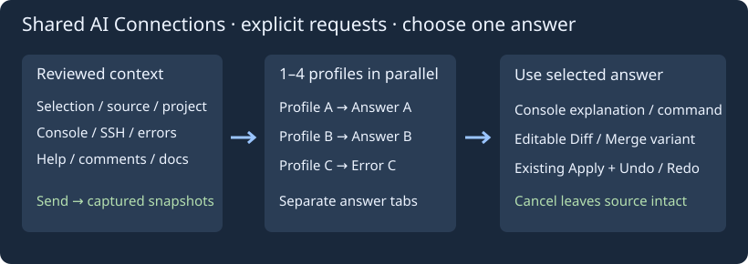

# Общие подключения к ИИ

Откройте **Tools → Подключения ИИ…** или одноимённую кнопку в помощнике. Общие именованные профили используются редактором и проектом, поиском выделения, документированием и комментариями, обычной и SSH-консолями, сообщениями компилятора и справкой программы. Выбор профиля и изменения соединения передаются открытым окнам помощников. Старые endpoint/model/Python импортируются в Default; старый файл остаётся зеркалом без секретов.

Профиль содержит имя, полный URL chat/completions API, идентификатор модели, Python 3, ключ и имя переменной окружения для ключа. Заготовки OpenAI/ChatGPT API, xAI/Grok, DeepSeek, Qwen и локального/совместимого API заполняют URL и имя переменной. Укажите реальные модель и endpoint своего аккаунта. Подключение работает через совместимый API, без входа в веб-аккаунт. Транспорт требует HTTPS, кроме локальных тестовых адресов.

Можно добавить до 16 профилей, менять и удалять их; один должен остаться. Выбор конкретного профиля подключает один ИИ. Если изменить поля подключения в помощнике, Send сохранит их в выбранный общий профиль. Настройки находятся в `insight-ai-profiles.conf`; запросы, контекст, история разговора и ответы туда не пишутся. Смена соединения не отправляет запрос.

По умолчанию ключ хранится в памяти; при пустом поле его можно взять из переменной окружения. Флажок **Сохранять ключ в приватном конфиге (без шифрования)** явно разрешает запись ключа этого профиля обычным текстом в файл, создаваемый с приватными разрешениями платформы. Снимите флажок и нажмите «Обновить профиль», чтобы исключить ключ из следующей сохранённой конфигурации. Это не шифрованное хранилище паролей. Поля ключей скрыты; старое зеркало настроек ключей не содержит.

## Одновременные запросы и выбор ответа

Отметьте от одного до четырёх профилей для параллельного сравнения и обновите их. В помощнике выберите **Сравнить отмеченные профили ИИ**, проверьте запрос, контекст и вложенный исходник и нажмите Send. Запросы идут одновременно; каждый получает одинаковый снимок запроса, контекста, кода и истории. Последующие правки подключений не меняют отправленные снимки.

В окне **Сравнение ответов ИИ** у каждого профиля своя вкладка. Ошибки и ответы независимы. Просмотрите объяснение, команду и предложенный код, скопируйте объяснение либо нажмите **Использовать выбранный ответ**. Остальные запросы отменяются. Кнопка отмены, закрытие сравнения или Cancel родительского помощника отменяют выбор. Ошибочный или незавершённый ответ выбрать нельзя; готовый ответ можно выбрать до завершения остальных.

Выбранный ответ консоли использует существующие вставку команды без Enter и проверку кода в Diff/Merge. Ответ редактора становится вариантом в редактируемом диффе, с накопленными требованиями и Undo/Redo вариантов. Исходник не меняется и команды не запускаются автоматически. Отмена сравнения сохраняет исходник и принятые варианты. Уже полученный провайдером запрос локальная отмена отозвать не может.

## Выделение, ошибки и справка

Пункт **Поиск → Найти и объяснить выделение с ИИ…** есть и в контекстном меню редактора. Он берёт обычное выделение до 64 КиБ или слово под курсором. Текст виден в редактируемом контексте; отправка — только по Send. Это объяснение и поиск по знаниям ИИ, без утверждения о выполненном веб-поиске. Для браузерного поиска используйте Search Web.

Кнопка **Спросить ИИ…** в справке берёт выделенный текст или фрагмент показанной страницы до 64 КиБ. Пункт **Спросить ИИ о сообщениях…** в меню компилятора, сообщений и статуса берёт выбранную строку либо до 200 последних строк в пределах 64 КиБ. Проверьте контекст перед отправкой. Текущий исходник для предложения правок прикрепляется отдельной кнопкой.

Стандартные задачи редактора — документация, комментарии, имена, алгоритмы — работают с теми же профилями. Кнопки обычной и SSH-консоли открывают тот же помощник и выбор подключений. При общих настройках каждый разговор сохраняет отдельные контекст, историю и вложение исходника.
