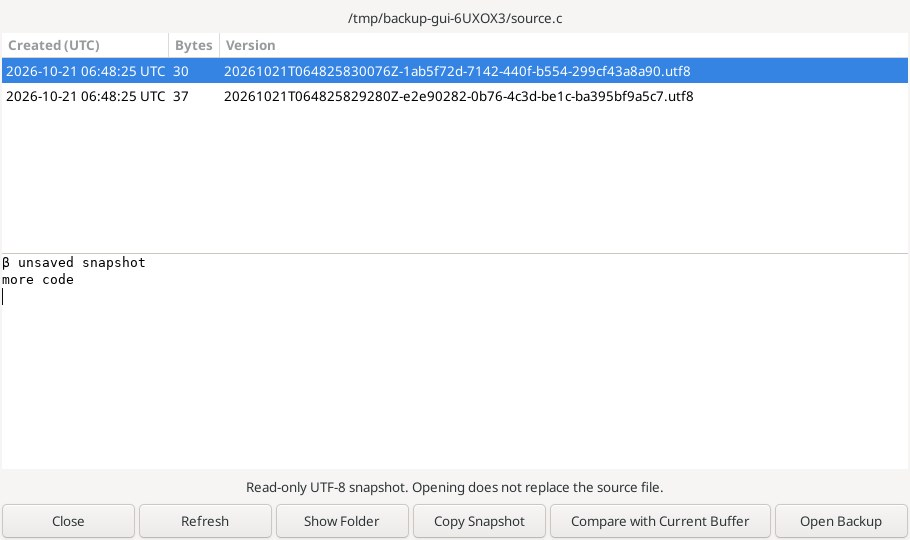
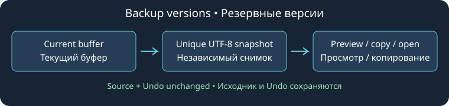

# Резервные версии

**Файл → Создать резервную версию** сохраняет независимый снимок текущего буфера, включая ещё не записанные правки. Имя, текст, выделение, признак изменения, Undo/Redo и исходный файл на диске остаются прежними. Разрешены именованные документы только для чтения. Безымянный документ сначала сохраните под именем.

**Файл → Открыть резервную версию…** показывает версии этого файла от новых к старым: время создания UTC, размер в байтах и уникальное имя. При выборе строки появляется предпросмотр первых 16 КиБ. В предпросмотре переводы строк нормализуются; файл снимка и открытая вкладка сохраняют точные байты. При передаче текста через буфер обмена платформа может нормализовать переводы строк.

- **Открыть копию** — полный снимок в отдельной вкладке только для чтения. Исходник не заменяется и не сохраняется. Нужный текст можно явно скопировать или экспортировать командой «Сохранить копию».
- **Копировать снимок** — скопировать полную выбранную версию, включая текст за пределами предпросмотра.
- **Обновить** — заново прочитать список и выбрать новую версию. Изменённый или удалённый после показа файл нельзя открыть по старым сведениям.
- **Сравнить с текущим буфером** — [сравнить снимки только для чтения](snapshot-comparison.md), включая несохранённый текст исходника (до 1 МиБ на сторону). Команда «Файл → Сравнить с резервной версией» сразу открывает выбор версии для сравнения.
- **Показать папку** — открыть папку версий этого исходника в системном файловом менеджере. Просмотр пустой истории сам папку не создаёт.
- **Закрыть** — действие диалога по умолчанию.

Папка доступна и отдельной командой меню «Файл». Все три команды есть в браузере команд и настройках клавиш редактора; сочетания по умолчанию не назначены. **Справка по резервным версиям** открывает это руководство.

Снимки находятся в `insight-backups/<SHA-256 полного нормализованного пути исходника>/` внутри каталога настроек Geany. Путь нормализуется лексически: `..` сворачивается, но символические ссылки, разный регистр и переименование могут создавать разные истории. Одинаковые имена в разных папках не смешиваются. В текст снимка не дописываются путь или сведения о кодировке. Имя версии содержит время UTC с микросекундами и случайный UUID.

Сохраняются декодированные байты UTF-8 буфера без добавления BOM; уже присутствующий символ U+FEFF сохраняется. Исходная дисковая кодировка и флаг BOM как метаданные не переносятся. Требуется корректный UTF-8 без NUL, не более 8 МиБ. Проверки ограничивают историю одного пути 200 версиями и 64 МиБ; при более чем 1000 элементах сканирование папки завершается ошибкой. Новый снимок, который превысит лимит, отклоняется; прежние версии сохраняются. Ненужные версии удаляются явно через папку. В этой серии нет автоматического удаления, резервирования при каждом Save, расписания или восстановления после аварии.

Запись создаёт приватный временный файл без перезаписи, закрывает его и публикует перемещением без замены существующего файла. Незавершённые `.pending-` записи в список не попадают. Чтение отклоняет ссылки, нестандартные и слишком большие файлы, сверяет размер/etag/идентификатор до и после чтения и проверяет UTF-8. Компоненты папки проверяются без намеренного перехода по символическим ссылкам. Переносимые проверки GIO не блокируют файловую систему: они не исключают конкурентную подмену пути и превышение квоты несколькими одновременно работающими процессами. Изменённый снимок доступен только после обновления списка и повторной проверки.

На Linux проверяются точные UTF-8/U+FEFF/смешанные переводы строк/пустые снимки, разделение путей, уникальность и порядок, устаревшие сведения и ссылки, ограничения числа и объёма, настоящее окно предпросмотра, копирование, вкладки только для чтения, обновление, отказ для безымянных документов и NUL, неизменность исходного диска/Undo/выделения. Скриншот получен из настоящего диалога под Xvfb. Windows и Android не запускались.

Основа: Source Insight 4 — [Save New Backup File](https://www.sourceinsight.com/doc/v4/userguide/Manual/Command_Reference/Save_New_Backup_File.htm) и [Open Backup File](https://www.sourceinsight.com/doc/v4/userguide/Manual/Command_Reference/Open_Backup_File.htm). Организация хранения и отдельная вкладка только для чтения специфичны для этой реализации. [Checkpoint](checkpoint.md) меняет исходный снимок редактирования и очищает историю; резервная версия сохраняет отдельную копию.
