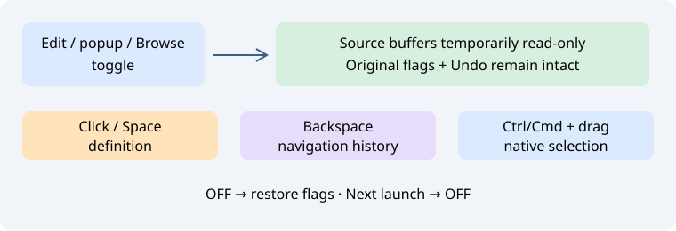

# Режим просмотра кода — Browser Mode

**Правка → Browser Mode**, пункт контекстного меню редактора и компактная кнопка **Browse** в строке состояния включают временный режим чтения исходников. Правый щелчок по кнопке открывает переключатель и эту справку. В штатных настройках клавиш и списке команд есть изначально неназначенная команда **Editor → Browser Mode**.

| Действие в редакторе исходника | Результат |
| --- | --- |
| Обычный левый щелчок по идентификатору в коде | Вызов существующего поиска определения в этой позиции |
| Пробел | Поиск определения под курсором без вставки пробела |
| Backspace | Возврат по штатной истории без удаления текста |
| Ctrl/Cmd + щелчок или перетаскивание | Обычное выделение без прежнего Ctrl+click-перехода |
| Щелчок на поле слева, пробеле, строке или комментарии | Обычная обработка без перехода Browser Mode |

Поля ввода и отдельные окна предпросмотра сохраняют собственные клавиатурные действия. Щелчки с Shift/Alt также обрабатываются штатно. Команды перехода вперёд и истории остаются доступны. Поиск идентификатора требует одного обычного выделения и буфера до 2 МиБ. Используется существующий механизм F12 с его ограничениями языков, индекса и области видимости; нового семантического разрешения перегрузок и отдельного выбора неоднозначностей здесь нет.

## Временная защита и операции с файлами

Все исходные буферы, включая вновь открываемые и создаваемые, становятся доступными только для чтения. При выключении восстанавливаются исходные состояния документа и Scintilla для каждого оставшегося буфера, в том числе ранее защищённого. Ввод, вставка и обычные команды правки используют штатную защиту чтения. Обычный флажок «только чтение» не снимает временную защиту — сначала выключите Browser Mode.

Само переключение не правит, не сохраняет и не перечитывает текст, не меняет кодировку, не сбрасывает несохранённые изменения, Undo/Redo или буфер обмена. Явные команды Save As, Reload и Clone сохраняют свои штатные действия; после них защита просмотра восстанавливается. Новая записываемая копия снова станет записываемой после выхода из режима. Защита возвращается и при ошибке Save As. Сохранение существующего защищённого исходника подчиняется штатному запрету записи; для продолжения обычной правки и сохранения выключите режим.

Browser Mode действует **только до завершения сеанса** и изначально выключен. В сессию записывается настоящий флаг чтения каждого файла, а не временная защита просмотра. Закрытые документы исключаются из учёта. Это режим взаимодействия редактора, а не ограничение прав плагинов или внешних записей в файловую систему.

Эталон: [Source Insight Browser Mode](https://www.sourceinsight.com/doc/v4/userguide/Manual/Command_Reference/Browser_Mode.htm).

История переходов записывает конечную позицию курсора в выделенном символе: Back возвращает сразу к исходному месту, без промежуточной остановки в начале строки определения. Undo/Redo снова доступны после выхода из режима чтения; переключение сохраняет их историю.
