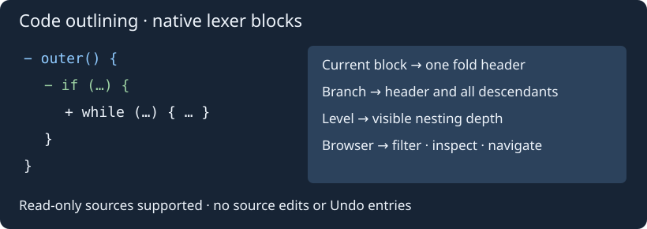

# Сворачивание кода и список блоков

**Вид → Сворачивание кода** и такое же подменю редактора содержат восемь команд: развернуть/свернуть текущий блок; развернуть/свернуть всю вложенную ветку; развернуть/свернуть весь файл; свернуть до уровня; открыть список блоков. Для каждой команды можно назначить сочетание в **Настройки → Комбинации клавиш → Документ**. По умолчанию новые сочетания не назначены.

Текущий блок — заголовок под курсором либо ближайший родительский блок лексера. Операции ветки меняют состояния всех его потомков. Уровень 1 оставляет видимыми внешние заголовки; уровень 2 раскрывает их и сворачивает заголовки следующего уровня. Диапазон выбора — 1–12. Отмена диалога ничего не меняет.

**Список блоков** — немодальное окно с колонками строки, глубины, состояния и исходного текста заголовка. Поиск без учёта регистра фильтрует заголовки; колонки сортируются и меняют ширину. Доступны переход (также двойным щелчком), разворачивание/сворачивание блока и ветки, копирование показанного списка и явное обновление. TSV-копия экранирует управляющие символы. Фильтр сохраняется при обновлении.

Список — снимок текущего документа. После редактирования, смены языка или перехода в другой документ действия отвергаются до **Обновить**. Обновление захватывает текущий документ. Закрытый исходник не переоткрывается автоматически. Команда перехода использует обычную историю навигации; раскрытие скрытого блока следует поведению Scintilla и может переместить курсор к заголовку.

Используются уровни сворачивания текущего лексера Geany, а не семантическое дерево компилятора. Для языка без fold-блоков список пуст. Работа доступна в исходниках только для чтения, не меняет текст, сохранённое состояние, историю Undo или файлы на диске. Нужны штатные возможности folding выбранного языка; опции видимости полей сворачивания остаются в Geany. Пределы: 2 МиБ, 100000 строк, 5000 заголовков и глубина 256. Состояния сворачивания и содержимое окна отдельно не сохраняются.

Эталон: Source Insight [Expand](https://www.sourceinsight.com/doc/v4/userguide/Manual/Command_Reference/Expand.htm), [Expand All](https://www.sourceinsight.com/doc/v4/userguide/Manual/Command_Reference/Expand_All.htm), [Outlining Options](https://www.sourceinsight.com/doc/v4/userguide/Manual/Command_Reference/Outlining_Options.htm). Список блоков и выбор глубины — расширения интерфейса Geany Insight. Команда Source Insight Expand Special относится к деревьям списков и здесь не воспроизводится.
