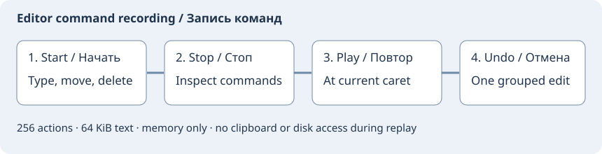

# Запись команд редактора

**Правка → Запись команд**: Начать запись, Остановить запись, Воспроизвести запись,
Записанные команды редактора и Очистить запись. В параметрах клавиатуры доступны
пять новых команд без назначенных сочетаний. Новая запись заменяет прежнюю.
Воспроизведение и просмотр сначала останавливают запись.

Запишите короткую последовательность в исходнике, остановите, установите курсор
в нужное место и воспроизведите. Поддерживаются буквальный ввод UTF-8 и переводов
строк, относительные перемещения по символам, словам и строкам с выделением,
Home/End, края документа, выделить всё, удаления, дублирование строки и смена
регистра. В окне просмотра — точные имена команд Scintilla и фрагменты текста.
Команды применяются к текущему выделению с текущими настройками редактора.
Все выполненные изменения отменяются одним Undo и возвращаются через Redo.
Сама запись от воспроизведения не меняется.

Это ограниченный регистратор команд исходника. Запись всех действий приложения
и язык макросов Source Insight пока не реализованы. Действия меню, проекта,
файловые операции, автодополнение, автопары, автоматические отступы и правки
плагинов не записываются как команды приложения. Записывайте простые действия
клавиатурой и проверяйте список и получившийся текст перед повтором.
Щелчок мышью останавливает запись до перемещения курсора; смена или закрытие
файла тоже останавливает её, сохраняя готовый префикс. Undo/Redo при записи
сбрасывают её. Команды буфера обмена, поиск, абсолютные позиции, прямоугольное
и множественное выделение и прочие неподдерживаемые уведомления полностью
сбрасывают запись, а не пропускаются при повторе.

Хранится одна запись **только в памяти** до очистки, следующего старта или выхода,
в том числе после закрытия исходного файла. В проект и сеанс она не сохраняется.
Воспроизведение не обращается к диску или буферу обмена. Цели только для чтения,
прямоугольные/множественные выделения и виртуальные позиции не поддерживаются.
Для повтора фокус должен быть в исходнике; для старта требуется обычное выделение
с разрешённой правкой. Пределы: 256 команд, 64 КиБ буквального текста, документ
до 1 МиБ, суммарная работа повтора до 16 МиБ. Консервативная проверка роста может
остановить последовательность раньше; это отмечается в статусе. Выполненную
часть можно отменить одним Undo. Автоотката и циклов повторения нет.

[Повтор набранного текста](typing-replay.md) остаётся отдельной возможностью.

Образец: [Source Insight Start Recording](https://www.sourceinsight.com/doc/v3/ad921370.htm).
