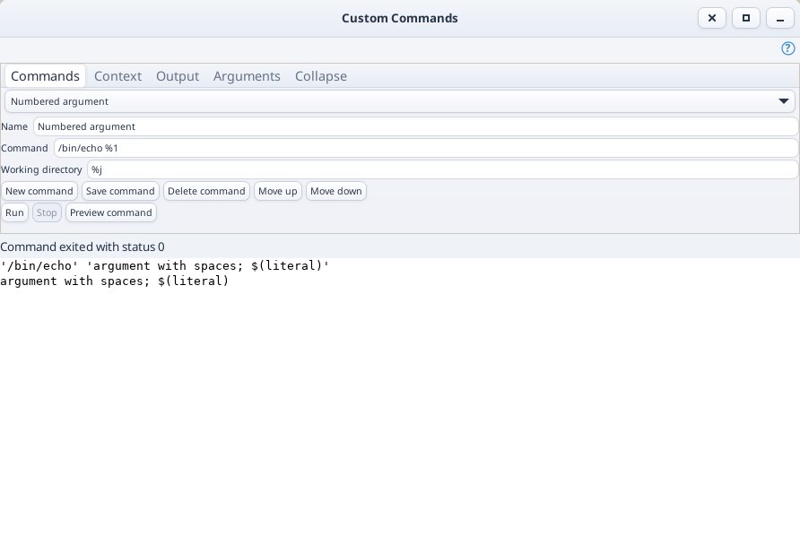
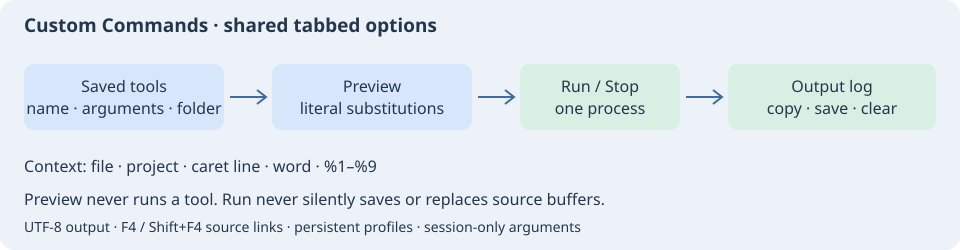

# Пользовательские команды

Откройте **Инструменты → Пользовательские команды…**. В немодальном окне доступны сохранённые внешние инструменты, подстановки контекста редактора, предпросмотр запуска, рабочий каталог, нумерованные аргументы и выделяемый журнал вывода. Сверху используется общий компактный блок вкладок с командой «Свернуть». Для команды можно назначить сочетание клавиш в группе «Редактор»; готовое сочетание не переопределяется.





1. Нажмите «Новая команда», введите имя, программу с аргументами и рабочий каталог.
2. «Сохранить команду» сохраняет профиль между запусками редактора. «Вверх/Вниз» меняют сохранённый порядок; «Удалить команду» удаляет выбранную запись. Сохраняйте изменения перед выбором другого профиля или закрытием окна.
3. Во вкладке «Аргументы» заполните `%1`–`%9`, если они нужны. Эти значения живут только в окне и не сохраняются в профиле.
4. «Предпросмотр команды» показывает аргументы, каталог и доступные переменные. При нажатии «Запустить» контекст текущего редактора/проекта считывается заново; предпросмотр ничего не запускает.
5. В журнал поступают stdout и stderr. «Остановить» завершает непосредственно запущенный процесс. Вывод можно копировать, сохранить в файл или очистить только в этом окне.

| Подстановка | Значение |
| --- | --- |
| `%f`, `%n`, `%b`, `%e` | Полный путь текущего файла, имя файла, имя без расширения, расширение без точки. Нужен именованный файл. |
| `%r`, `%d` | Путь относительно корня исходников (для внешнего файла — абсолютный), каталог текущего файла. Без именованного файла `%d` означает домашний каталог. |
| `%j`, `%J` | Корень исходников, каталог файла проекта. Без проекта `%j` использует каталог текущего файла или домашний каталог. `%J` требует открытого проекта. |
| `%p`, `%o` | Путь проекта без расширения, имя проекта без пути и расширения. |
| `%l`, `%w` | Номер строки курсора с единицы; первое слово обычного выделения до пробельного символа либо слово под курсором. Предел захвата слова — 4096 байтов. |
| `%a`, `%t` | Местная дата `YYYY-MM-DD` и время `HH:MM:SS`. |
| `%1`–`%9` | Поля вкладки «Аргументы»; пустое поле даёт пустой аргумент. |
| `%%` | Буквальный знак процента. |
| `%PROJECT_SOURCE_DIR%`, `%PROJECT_DATA_DIR%`, `%PROJECT_NAME%` | Длинные имена переменных проекта, без учёта регистра. |
| `%PROGRAM_DIR%`, `%TEMP_DIR%`, `%APPDATA_DIR%`, `%LOCAL_APPDATA_DIR%`, `%DESKTOP_DIR%`, `%MYDOCUMENTS_DIR%` | Системные каталоги из существующего механизма путей проекта. На Windows дополнительно доступны `%PROGRAMFILES_DIR%`, `%PROGRAMFILESX86_DIR%`, `%WINDOWS_DIR%`. Недоступная переменная отменяет запуск. |

## Аргументы

Сначала шаблон разбирается на аргументы, затем внутри каждого выполняется однократная подстановка. Пробелы, кавычки, `$` и `;` внутри имени файла не создают новых аргументов или программ. Буквальные аргументы с пробелами заключайте в кавычки. Конвейеры и перенаправления не выполняются автоматически — для них явно запускайте нужную оболочку. При явном запуске оболочки передавайте подстановки отдельными аргументами и используйте их в кавычках, например `"$1"`, вместо вставки прямо в текст скрипта. В тексте shell-скрипта буквальные проценты, в том числе форматы printf, пишите как `%%`. Кавычки предпросмотра служат отображению; эта строка не исполняется и сокращается после 8192 байтов.

Примеры:

```text
cc -fsyntax-only %f
python3 -m py_compile %f
git -C %j diff -- %r
python3 %1 %f
```

Утилита работает с файлами на диске: редактор не сохраняет буфер автоматически, не заменяет исходник выводом и не меняет Undo. Внешняя программа имеет обычные права пользователя и сама может менять файлы. Рабочий каталог после подстановок должен быть существующим абсолютным путём; пустое поле использует `%j`. Открытие окна и предпросмотр не запускают индексирование или изменение состава проекта.

## Ограничения

До 64 профилей атомарно сохраняются в `insight/custom-commands.conf` профиля редактора. Имя — до 128 байтов, шаблон — до 16384, файл настроек — до 1 МиБ; до 128 аргументов, один раскрытый аргумент — до 65536 байтов, все вместе — до 256 КиБ. Неизвестные переменные, некорректный UTF-8, переводы строк и недоступный контекст отклоняются.

Вывод декодируется как UTF-8 с учётом границ чтения. Ошибочные байты заменяются, NUL виден как `␀`. При достижении 4 МиБ, 50000 строк или 64 КиБ в одной строке процесс останавливается. Это журнал, а не терминал: интерактивный ввод и VT-последовательности не поддерживаются. «Остановить» и закрытие окна завершают непосредственный процесс и отменяют чтение; отдельно порождённые потомки не гарантированно завершаются. Загрузка настроек и открытие проекта ничего автоматически не запускают.

Модификаторы Source Insight для всех открытых/изменённых файлов, `%s` с временным файлом выделения, ShellExecute и отдельные хоткеи каждому профилю пока не реализованы. Для `%1`–`%9` используются явные поля, а не модальные вопросы. GUI проверяется на Linux; выполнение и синтаксис оболочки Windows требуют отдельной проверки.

Основание: [Custom Commands в Source Insight](https://www.sourceinsight.com/doc/v4/userguide/Manual/Command_Reference/Custom_Commands1.htm).

## Переходы из диагностик в исходники

Во вкладке **«Диагностика» → «Разобрать ссылки на исходники»** снимок вывода последней команды преобразуется в сортируемую таблицу «Файл / Строка / Колонка / Сообщение» — до 1000 записей. Строка с самой запускаемой командой исключается. Распознаются обычные форматы GCC/Clang `file:line[:column]: message`, MSVC `file(line[,column]): message` и traceback Python `File "name", line N`; при разборе удаляются цветовые ANSI SGR-коды. Разбор не читает исходники и не меняет состав проекта.

Двойной щелчок или «Открыть исходник» открывают файл на указанной строке, сохраняя окно инструментов. Есть первая, предыдущая и следующая ссылки, а также **F4 / Shift+F4** внутри этого окна. Переходы включаются в обычную историю навигации редактора. Колонка отображается как метаданные диагностики; переход выполняется к началу строки. Недоступный файл и номер строки за пределами текущего буфера выводятся сообщением. Текст исходника и Undo при навигации не изменяются.

Относительные пути считаются от **каталога, захваченного при запуске**, даже если затем открыт другой проект. Внутренний `chdir` утилиты, пути удалённых машин и пользовательские регулярные выражения не угадываются. Пути Windows с буквой диска или UNC отклоняются на других ОС. Виртуальные stdin/URI и некорректные координаты пропускаются. Новый запуск и очистка вывода сбрасывают старую таблицу; новые сообщения появляются после следующего явного разбора. Копирование и сохранение вывода сохраняют полный журнал.

Реализован ограниченный набор встроенных форматов, а не все пользовательские шаблоны Source Insight. Основание: [Parse Source Links](https://www.sourceinsight.com/doc/v4/userguide/Manual/Command_Reference/Parse_Source_Links.htm).
