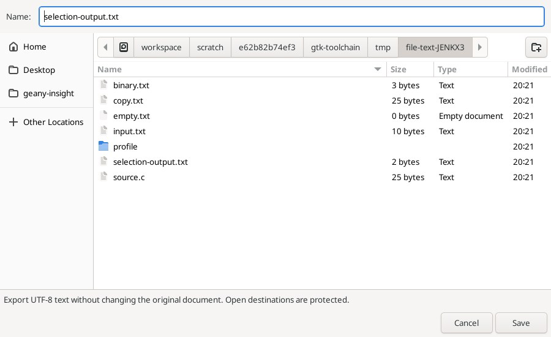
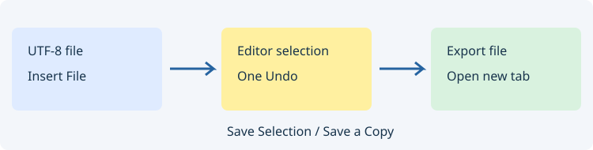

# Вставка и экспорт текста файлов

В **Edit → Insert and clipboard** доступны **Insert File…**, **Save Selection…** и **Save a Copy…**.

| Команда | Действие |
| --- | --- |
| Insert File | Выберите локальный текстовый файл. Его содержимое заменит текущее выделение или вставится у курсора одним шагом Undo. |
| Save Selection | Сохранит точный выделенный фрагмент и откроет результат отдельной вкладкой. |
| Save a Copy | Сохранит весь текущий текст и откроет копию отдельной вкладкой. |

## Insert File

Принимаются обычные UTF-8-файлы без NUL до 8 МиБ. Начальный UTF-8 BOM удаляется. Остальные байты, включая отступы, LF/CRLF/CR и отсутствие финального перевода строки, сохраняются без интеллектуальной подстройки. Пустой файл заменяет выделение пустым текстом; без выделения текст не добавляется. Изменение отменяется обычным Undo.

Нужны разрешённая запись и одно обычное выделение без виртуальных позиций. Пока открыт диалог, правка текста отменяет запрос; при подтверждении исходный документ и его выделение должны оставаться текущими. Закрытие документа или включённый read-only также запрещают вставку. Двоичные данные, другие кодировки, каталоги и символические ссылки отклоняются.

## Save Selection / Save a Copy

Экспортирует текст буфера как UTF-8 без добавления BOM, с исходными переводами строк и без добавления финального EOL. Исходные имя файла, Undo и признак сохранённости остаются прежними. Разрешён экспорт из read-only. Для Save Selection требуется непустое обычное выделение, включая обратное; предел экспортируемого текста — 8 МиБ.

Выберите имя в стандартном диалоге Save. Для существующего закрытого файла появится запрос перезаписи. Путь любого открытого документа, включая исходный файл и обнаруженные файловые псевдонимы, защищён от перезаписи: сначала закройте назначение. Дописывание в открытый буфер пока не поддержано.

Если исходный текст изменился за время диалога, запись не производится. Для Save Selection проверяется и исходное выделение. Cancel оставляет документ и назначение без изменений. Новый результат открывается как обычный документ редактора; ошибки записи показываются в строке состояния.

Новые файлы сначала записываются во временный файл рядом с назначением и перемещаются без перезаписи внезапно появившегося пути. Существующий обычный файл заменяется условно по etag. Файловые проверки не являются блокировкой файловой системы; метаданные и исходная кодировка не копируются. Обзор через project-wide и маски Source Insight пока заменён стандартным локальным диалогом выбора файла.

Эталон: [Insert File](https://www.sourceinsight.com/doc/v4/userguide/Manual/Command_Reference/Insert_File.htm), [Save Selection](https://www.sourceinsight.com/doc/v4/userguide/Manual/Command_Reference/Save_Selection.htm), [Save A Copy](https://www.sourceinsight.com/doc/v4/userguide/Manual/Command_Reference/Save_A_Copy.htm).
