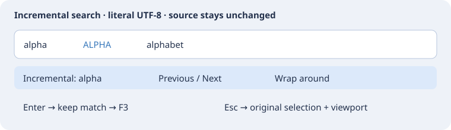

# Инкрементальный поиск

**Поиск/замена → Incremental Search / Incremental Search Backward** открывает временную компактную строку снизу главного окна. Исходник остаётся видимым, а обычное поле GTK принимает Unicode, вставку и ввод через системные методы ввода. Две команды в группе клавиш Search изначально не назначены; существующий переход к определению по F12 сохраняется.

| Действие | Результат |
| --- | --- |
| Ввод / Backspace | Уточнить буквальный запрос от исходного курсора; неудачный поиск сохраняет последнее выделение |
| Previous / Next или повтор назначенной команды | Искать в указанном направлении от текущего совпадения; пустое поле загружает последний успешный запрос |
| Wrap around | Разрешить один переход через границу файла; по умолчанию включён, хранится только до выхода из программы |
| Enter / Accept | Оставить совпадение и передать последний успешный буквальный запрос обычному поиску F3 |
| Esc / Cancel | Вернуть исходные anchor, курсор, горизонтальное смещение и верхнюю строку; не менять шаблон обычного поиска |
| Клавиша команды | Принять поиск и вернуть фокус исходнику перед штатной командой; комбинации буфера обмена поля и Backspace продолжают редактировать запрос |

Запрос без заглавных букв не учитывает регистр. Любая заглавная буква Unicode включает точный регистр. Поиск буквальный, по подстроке, включая начальный `~`; регулярные выражения, нечёткое совпадение и фильтр целого слова не применяются. Удаление всего запроса сохраняет последнее выделение. Новый вызов начинает с пустого поля, повтор команды возвращает последний успешный запрос, в том числе после отмены. Запрос и режим обхода границы между запусками не сохраняются.

Поддерживается один обычный потоковый диапазон без виртуальных пробелов, UTF-8 без NUL, исходник до 8 МиБ и однострочный запрос до 1024 символов / 4096 байт. Правка исходника, смена или закрытие документа завершают режим без восстановления устаревших позиций. Перенос фокуса за пределы строки принимает поиск. Неудачный запрос не заменяет сохранённый успешный. Текст, Undo и буфер обмена не меняются; чтения файлов и обращений к индексу проекта нет. Работает с read-only и Browser Mode. Найденная строка раскрывается штатным способом; отмена не восстанавливает прежнее дерево свёрток. Связанные окна могут следовать за прокруткой.

Автоматическая проверка Linux использует полное приложение, штатные сигналы редактирования поля, настроенные клавиши, редактор и меню. Ручная проверка системных раскладок/IME не заявляется. Эталон: [Incremental Search](https://www.sourceinsight.com/doc/v4/userguide/Manual/Command_Reference/Incremental_Search.htm), [Incremental Search Mode](https://www.sourceinsight.com/doc/v4/userguide/Manual/Command_Reference/Incremental_Search_Mode.htm).
