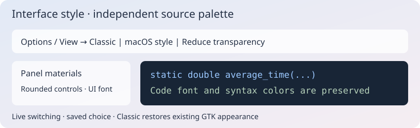
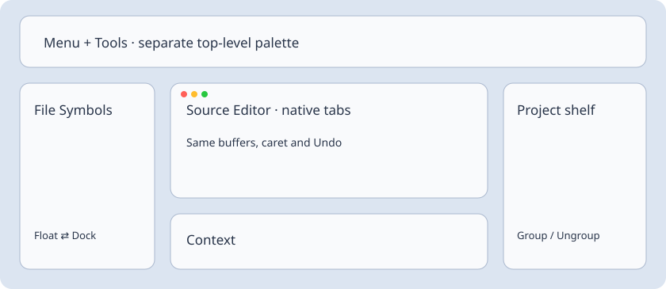

# Классический и macOS-подобный стиль

Откройте **Параметры → Стиль интерфейса** или **Вид → Стиль интерфейса**. Выберите **Классический** или **Стиль macOS**. Переключение сразу действует на открытые окна редактора и последующие окна, включая Context, список окон, ИИ и Diff/Merge. Оба меню синхронизированы; перезапуск не нужен. Выбор сохраняется между запусками.

Стиль macOS добавляет светлые поверхности с мягким градиентом, полупрозрачные слои панелей, скруглённые поля, кнопки и вкладки, тонкие разделители, спокойные полосы прокрутки и синий акцент. Активный таб по-прежнему выделен жирным; компактные настройки Diff/Merge сохраняются. Для интерфейса выбирается первый доступный шрифт: SF Pro Text, Helvetica Neue, Segoe UI, Noto Sans, системный sans-serif. Шрифты Apple не поставляются с программой.

**Уменьшить прозрачность** делает основные поверхности непрозрачными. Полупрозрачность — смешивание RGBA-слоёв внутри окна. Размытия рабочего стола за окном, системного Liquid Glass, изменения расположения системных кнопок и нативной рамки окна этот переносимый GTK-стиль не добавляет. Рамку и системные диалоги определяет ОС. Функции и размещение панелей сохраняются.

Стиль интерфейса независим от **Визуальной темы** исходника. Он не изменяет Scintilla-шрифт, цвета синтаксиса, текст, выделение, сохранённое состояние и Undo. Можно сочетать светлую оболочку с тёмным исходником. Явные настройки «Шрифт и цвет» панели сохраняют приоритет. **Классический** убирает слой оформления и возвращает текущий GTK-вид без сброса цветовой темы и других настроек.

Настройки находятся в `insight/interface-style.conf` каталога конфигурации. Сохранение атомарное; при ошибке записи прежний стиль остаётся активным. Начальный стиль нового профиля — macOS; ранее сохранённый выбор сохраняется. CSS установлен в `styles/appearance-macos.css`; он ограничен классом `insight-macos` и не меняет системную GTK-тему. Окна оформляются при показе; фоновые таймеры для перерисовки не используются.

## Реальный вид приложения

[Реальные снимки классического и macOS-подобного оформления доступны в артефакте успешного GUI-прогона](https://github.com/bhgv/geany-insight/actions/runs/39900274485/artifacts/12479155454): `interface-classic.jpg` и `interface-macos.jpg`. Это работающий GTK-редактор из изолированной Linux/Xvfb-проверки с одинаковым демонстрационным исходником и шириной панелей, а не макеты и не запуск под macOS.

Проверено на Linux: [108 тестов полного редактора](https://github.com/bhgv/geany-insight/actions/runs/39900274485), включая переключение, запуск с сохранённым стилем, откат ошибки записи, новые окна и независимость палитры/шрифтов кода. Сборки Autotools и GTK 3.22 / GLib 2.56 также прошли. Windows и macOS GUI в этом этапе не запускались.

## Компактные меню и независимые окна

В «Вид / Параметры → Стиль интерфейса» добавлен **macOS — независимые окна**. Меню и инструменты находятся в отдельной верхней палитре, символы файла, полка проекта и контекст — в самостоятельных окнах GTK. Исходные вкладки остаются в штатном окне редактора: это не дочерние окна MDI. Сохраняются кнопки соединения/отсоединения панелей и группировка вкладок проекта.

Выбор обычного macOS или классики восстанавливает компоновку до входа в режим. Закрытие верхней палитры тоже соединяет окна и выбирает обычный macOS. Закрытие панели использует её штатную стыковку. Выбранный стиль сохраняется при перезапуске; при входе окна размещаются в рабочей области монитора. Отдельного сохранения позиций этого режима пока нет: для собственной расстановки используйте именованные компоновки Layout. Палитра — окно приложения, не глобальное меню ОС. Пересозданная панель инструментов возвращается в палитру.

Высота строк меню теперь явно ограничивается компактными отступами, без больших минимальных размеров системной темы. Шрифт меню — 10pt. Ряд гарнитур: SF Pro Text, Helvetica Neue, Inter, Segoe UI, Noto Sans, sans-serif; фактическая замена зависит от установленных шрифтов. Apple-шрифты и SF Symbols не распространяются. Доступные именованные и штатные значки заменяются symbolic-вариантами 16px; в классике восстанавливаются исходные изображения. Специальные значки приложения сохраняют свой рисунок.

Новые плавающие окна получают клиентские заголовки GTK с круглыми кнопками закрытия, сворачивания и разворачивания слева, скруглением декораций и мягкими тенями CSS. Внешняя рамка и видимость тени зависят от платформы, оконного менеджера и композитора. Уже созданное окно редактора сохраняет системную рамку; размытие рабочего стола не добавляется. Шрифт исходника, подсветка, выделение и Undo не меняются.

В macOS вкладки используют подписи 9pt, минимальную высоту содержимого 16px, небольшое скругление, уменьшенные поля, ненавязчивые кнопки закрытия и светлый фон выбранной вкладки. Имя активного исходника остаётся жирным, неактивных — обычным. В классике сохраняется прежнее оформление вкладок.

## Compact menus / Компактные меню

Menu rows use a 16 px icon slot instead of the former 40 px reservation. Unknown
commands have no placeholder icon; check/radio rows retain their native indicator.
The native accelerator label and shortcuts stay intact. In macOS styles all ordinary
rows use compact spacing, including Find Next, Find in Files and Replace. Menu width
is determined by the longest label and shortcut, with a small icon/arrow allowance.
Menus have a soft shadow and a layered blue/lilac gradient. Reduce transparency
removes the material gradients and makes menus and chrome opaque; unticking restores
the translucent layers immediately. Source text remains opaque. RGBA visuals are
selected for composited popup windows before realization; opaque editors retain their native visual; desktop blending and outer shadows depend on
the desktop compositor. No desktop blur or global fading of source text is used.

Строки меню используют место под значок 16 px вместо прежних 40 px. Для неизвестных
команд нет значка-заглушки; чекбоксы и радиокнопки используют собственный индикатор.
Пункты «Найти следующее», «Найти в файлах» и «Заменить» имеют одинаковые компактные
отступы. Ширина определяется самым длинным названием и сочетанием клавиш.
Мягкая тень и голубовато-сиреневый градиент оформляют меню. «Уменьшить прозрачность»
сразу убирает градиент материала и делает поверхности непрозрачными, снятие отметки
возвращает слои. Исходник остаётся непрозрачным. Смешивание с рабочим столом и внешние
тени зависят от композитора ОС; размытие рабочего стола не применяется.

Всплывающие подсказки сохраняют штатное оформление и геометрию GTK. Приложение не меняет их шрифт, visual, значки и готовые подписи во время показа; текст переводится на исходной кнопке или поле. Меню и обычные окна сохраняют выбранный стиль интерфейса.
