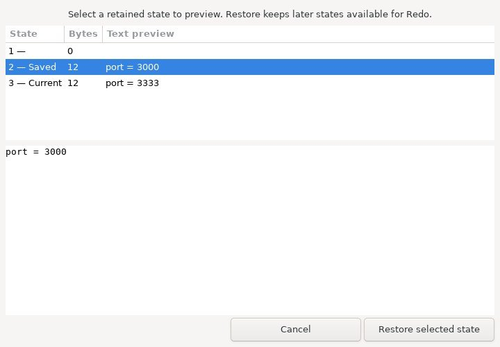
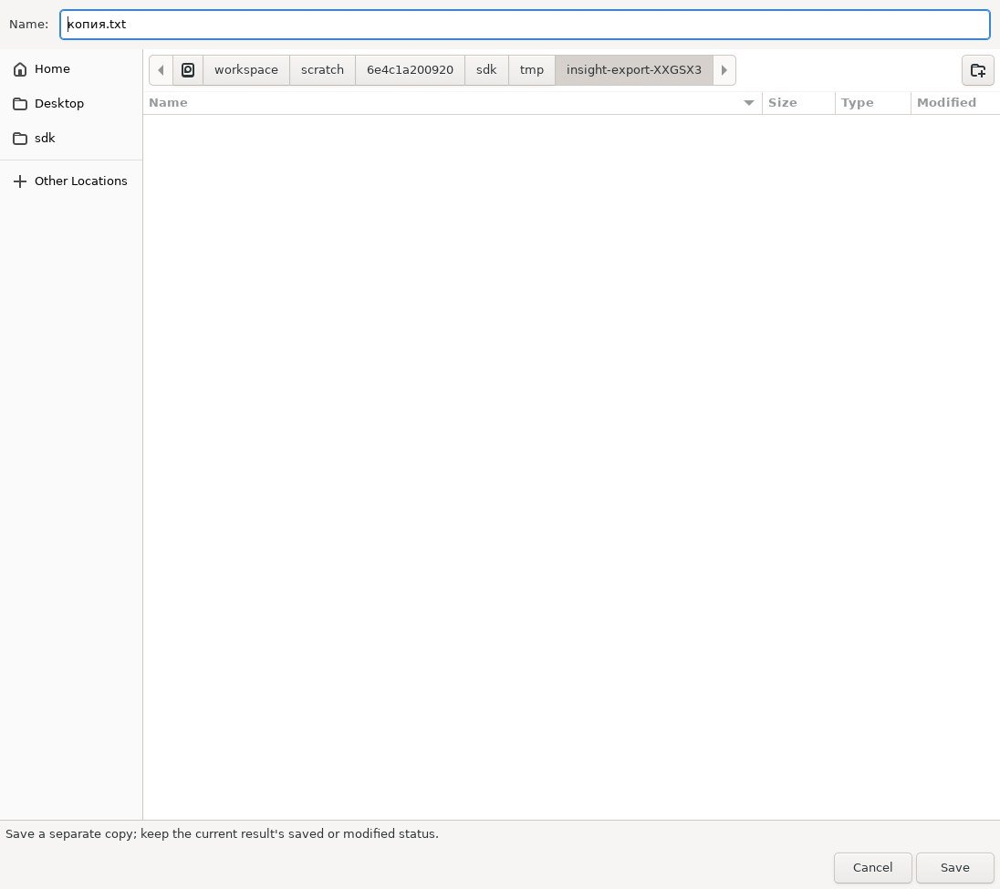
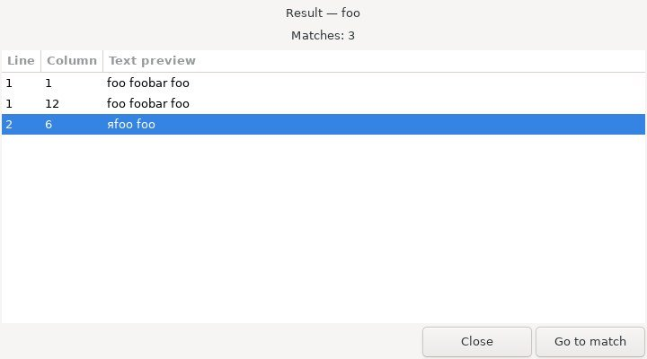

# Внутреннее сравнение и сведение

Откройте **Инструменты → Сравнение / Сведение…**, кнопку на основной панели или
команду в заголовке Контекста. Выберите два файла и нажмите **Сравнить**. Слева
и справа показаны исходники только для чтения. Результат сначала содержит левый
файл и допускает ручные правки. **Принять слева / Принять справа** заменяют
выбранный блок в результате. Исходные файлы автоматически не сохраняются.

## Блоки и навигация

**Предыдущее различие / Следующее различие**, Ctrl+↑ / Ctrl+↓ выбирают блок и
показывают его во всех трёх областях. На концах списка переход останавливается.
Без выделения следующий переход выбирает первый блок, предыдущий — последний.
Щелчок по изменённому месту исходника тоже выбирает блок; статус показывает его
номер. Список описывает исходные файлы, а не новое сравнение результата.

**Список различий** скрывает и показывает список, сохраняя переходы клавишами.
**Перенос строк** действует во всех областях. **Номера строк** показывает поля
номеров логических строк: экранный перенос не создаёт новый номер. При правках
результата номера обновляются; в копируемый текст они не попадают.

**Связанная прокрутка исходников** включена изначально. Неизменённые участки
сопоставляются по логическим строкам, внутри изменённого блока выбирается начало
противоположного блока. Опцию можно отключить. Результат прокручивается отдельно.
Пустые строки для визуального выравнивания не добавляются, точное совпадение
пикселей при переносе длинных строк не гарантируется. Настройки живут до закрытия окна.

## Параметры сравнения

**Игнорировать пробелы и табуляцию** исключает горизонтальные ASCII-пробелы
(пробел, табуляцию, вертикальную табуляцию и перевод страницы) внутри строки.
Unicode-пробелы и границы строк сохраняют значение. **Игнорировать тип окончания
строк** приравнивает CR, LF и CRLF; отсутствие последнего окончания остаётся
различием. Чтобы применить опции, нажмите **Сравнить**. По умолчанию сравнение точное.

Блоки всегда ссылаются на исходные байты. Игнорируемые различия вне выбранного
блока сохраняют левый вариант; принятие справа копирует байты правого блока.
Если сочетание CR и LF на границе может склеить две строки, блок включает
соседнюю равную строку. Пересекающиеся блоки объединяются.

## Поиск

Выберите **Слева / Справа / Результат** в строке поиска. Ctrl+F выбирает область,
в которой был фокус, и активирует запрос. Enter или F3 ищут следующее буквальное
Unicode-совпадение, Shift+F3 — предыдущее. **Учитывать регистр** включает точное
сравнение регистра. Поиск переходит через конец/начало и сообщает об этом либо
об отсутствии текста. Escape возвращает фокус выбранной области. Поиск меняет
только выделение; блок для принятия определяется выбором в списке различий.

## Отмена и сохранение

Ctrl+Z / Ctrl+Shift+Z / Ctrl+Y и кнопки отменяют и повторяют принятие блока или
ручную правку. Замена блока — одна операция. Новая правка после отмены удаляет
ветку повтора. История хранит полные снимки в пределах примерно 32 МиБ; последний
снимок сохраняется всегда. **Сохранить результат…** выбирает путь и подтверждает
перезапись. Новое сравнение и закрытие спрашивают перед отбрасыванием правок.

Чтение, проверка UTF-8 и расчёт LCS работают в GTask-потоке. **Отменить сравнение**
сохраняет прежние исходники, результат и Undo. Ошибка чтения, неверный UTF-8 и
превышение лимита также оставляют их на месте. Пока идёт расчёт, выбор исходников,
параметры сравнения и редактирование результата заблокированы. Закрытие отменяет
задание; поздний ответ не обращается к уничтоженному окну. Публикация текста и
строк GTK по-прежнему выполняется в UI-потоке, поэтому полное отсутствие пауз
не заявляется.

**Внешний KDiff3 (необязательно)** явно запускает `kdiff3` из PATH с выбранными
файлами. Отсутствие KDiff3 не мешает встроенному сравнению. История внешнего
редактора независима от этого окна.

## Ограничения и проверка

Двухстороннее построчное сравнение: обычные UTF-8 файлы до 1 МиБ без NUL.
CR, LF, CRLF и отсутствие последнего окончания сохраняются побайтно. Матрица
ограничена четырьмя миллионами ячеек; чистая вставка/удаление после обрезки общих
краёв обходится без матрицы. Пока нет трёхстороннего сведения, автоматического
разрешения конфликтов и внутристочной подсветки. Если ручная правка убрала
несколько границ блоков, повторите сравнение для восстановления списка.

Это настоящее производственное окно на Linux/Xvfb с искусственными файлами в
изолированном тесте, а не снимок полного редактора. Проверены переходы, щелчок
по блоку, принятие/Undo/Redo, Unicode-поиск, регистр, циклический поиск, фокус,
номера, параметры, отмена, отказ каталога, закрытие с работающим заданием и работа
таймера главного цикла при расчёте почти четырёхмиллионной матрицы.

Проверка ядра: `python3 insight/tests/diff_test.py`: 3000 точных случайных
реконструкций, 2000 проверок нормализованного сравнения, отображение строк,
границы UTF-8, отмена и лимиты. GTK-тест Meson: **Insight isolated Diff Merge GUI**.
Он использует реальные виджеты и заглушки справки/перевода host. Windows и Android
в этой серии не запускались.

Дополнительно проверены прокрутка после вставки 20 строк, отключение связи,
неверный UTF-8 и превышение размера на один байт. GTK-тест проходит UBSan с
фатальными GLib criticals. ASan дошёл до проверок, но проверка утечек не смогла
завершиться из-за недоступности `/proc/task`; чистый результат ASan не заявляется.
Linux CI включает тесты ядра и производственных виджетов.

Нумерация включает последнюю пустую строку после окончания. Сохранение отключено
на время нового сравнения, чтобы диалог сохранения не пересекался со сменой
результата. Доступность кнопки проверяется GTK-тестом.

[Directory Compare — compare directory trees and open a selected pair](directory-compare.md).

## Принять все блоки

**Все слева / Все справа** заменяет все блоки в отдельном результате одной
операцией Undo. Ручные правки вне блоков сохраняются. Уже совпадающий вариант
не добавляет историю. Undo/Redo восстанавливает текст и метки блоков.

Alt+Left / Alt+Right принимает выбранный левый/правый блок; с Shift — все блоки.
Изменяется только результат. Если ручная правка соединила или пересекла границы
блоков, массовое принятие отказывается от операции и предлагает повторить
сравнение. Частичное принятие не выполняется. GTK-тест проверяет один Undo,
отсутствие лишней истории, внешний ручной текст, схлопнутые границы, клавиши и
150 случайных точных реконструкций с UTF-8, пустыми источниками и смешанными EOL.

При замене сравнения сигналы выбора списка игнорируются до готовности новых
меток и строк. Старый идентификатор выбора больше не читает незаполненный массив.
Тест массового принятия повторяет 150 сравнений в одном производственном окне.

## Отображение и масштаб

**Options… / Ctrl+Q** открывает единый диалог отображения File Compare. Apply применяет выбранные параметры вместе, Cancel сохраняет прежний вид. **Mono Font View**, **Vertical scrollbars** и **Scale (%)** действуют на все три панели. Масштаб ограничен 50–250% от базового шрифта в 10 пунктов; Ctrl+колесо меняет его на десять пунктов. При смене шрифта обновляются поля номеров строк. Настройки отображения сохраняют байты источников, результат слияния и историю Undo.

**Overview** добавляет обзорную полосу справа от каждого источника. Оранжевые и зелёные отметки показывают блоки различий, выбранный блок — синий. Контур обозначает видимую область; при переносе строк её пропорции приблизительны. Щелчок по отметке выбирает блок в общем списке, щелчок вне отметок прокручивает источник к соответствующей логической строке. Совместная прокрутка управляется Scroll sources together. Кэш отметок строится за один последовательный проход по каждому источнику с учётом CR/LF/CRLF и вставок нулевой длины.

## Команды контекстного меню источников

Щёлкните источник правой кнопкой для **Edit File — Ctrl+E**, **Copy selected difference**, переключателей отображения и Options. Edit File открывает источник завершённого сравнения в редакторе на строке курсора, используя уже открытый документ при наличии. Правка полей путей не меняет адрес перехода. Файл на диске мог измениться после сравнения. В буфер копируются исходные байты выбранного блока, включая окончания строк; результат и история не меняются. Панель результата сохраняет обычное текстовое меню GTK. Пути преобразуются между UTF-8 полей ввода и кодировкой имён файлов и фиксируются как абсолютные при запуске Compare.

В конфигурации рабочего окружения запоминаются моноширинный режим, номера строк, список различий, перенос, совместная прокрутка, полосы прокрутки, Overview, масштаб, текстовые опции сравнения и размер окна. Новое окно получает настройки последнего закрытого; при выходе из редактора сохраняется последнее открытое из ещё существующих окон. Открытые окна независимы. Некорректные значения заменяются стандартными. Восстановление не загружает источники, не запускает сравнение и не восстанавливает несохранённый результат; имена файлов и история слияния не сохраняются. Явные текстовые опции пары из Directory Compare имеют приоритет над запомненными.

Диалог снят с рабочих GTK-виджетов в изолированном Linux-тесте с заглушками справки и перевода хоста. Отдельный тест полного редактора проверяет Ctrl+Q, применение масштаба и Overview, переход Ctrl+E к строке источника и сохранение параметров в рабочем окружении. Синтаксическое оформление и линии вложенности кода пока не реализованы в этом GTK-окне сравнения.

### Поиск в панелях сравнения

Ctrl+F выбирает активную панель и подставляет однострочное выделение до 4096 символов. «Whole words only» учитывает границы идентификаторов: буквы Unicode, цифры, комбинируемые знаки и подчёркивания входят в слово. «Wrap around» разрешает один повтор поиска с противоположного конца; отключите его для остановки на границе файла. F3 и Shift+F3 сохраняют направление. Параметры поиска действуют в текущем окне, поиск не меняет текст результата и историю слияния. Регулярные выражения не поддерживаются.

### Переход к строке и переключение панелей

Ctrl+G выбирает активную панель и подставляет номер строки курсора. Введите логический номер и нажмите Enter или «Go». Номер за концом файла переводит на последнюю строку; пустой файл содержит строку 1. «Select line text» выделяет содержимое без перевода строки. «First line» и «Last line» работают в выбранной панели. Escape возвращает фокус из номера строки в панель. Команда доступна и в контекстном меню.

F6 переключает Left → Right → Result, Shift+F6 — обратно. Поиск сохраняет собственный выбор панели. Переходы не меняют текст, выбранное различие и историю слияния; во время сравнения переход к строке заблокирован. Номера логические и не зависят от визуального переноса длинных строк. Снимок виджета выше показывает панель навигации.

### Замена в результате слияния

Ctrl+H переводит поиск на Result и фокусирует поле замены. Введите искомый текст в строке поиска выше и новый текст в «Replace in Result»; пустое значение удаляет совпадения. Учитываются регистр и целые слова. «Result selection only» ограничивает работу текущим выделением результата, «One occurrence per line» — первым совпадением на каждой логической строке. Без ограничения выделением обрабатывается весь результат, независимо от позиции курсора и режима поиска по кругу.

«Preview count» заново подсчитывает фактические изменения, не меняя текст. «Replace all in Result» заново проверяет текущие параметры и применяет пакет одним действием Undo/Redo. Одинаковый текст пропускается. Предел — 100000 изменений и 1 МиБ результата: превышение при предварительном расчёте отменяет весь пакет до правок. Во время сравнения замена заблокирована. Замены буквальные; регулярные выражения и замена в исходных файлах здесь не реализованы. Поля запроса и замены не сохраняются в настройках. Снимок выше показывает строку замены рабочего GTK-виджета.

### Сохранение и преобразование регистра

«Preserve old case» вычисляет новый текст отдельно для каждого совпадения. Буквы Unicode учитываются, цифры, знаки и подчёркивания не задают регистр. Для смешанного регистра букв используется буквальное значение поля замены. Режим начальной заглавной буквы меняет первую букву замены после приведения остальных к нижнему регистру. Предпросмотр и проверка лимита учитывают фактические строки, включая расширения вроде `ß → SS`. Параметр действует в текущем окне и не сохраняется.

| Старое совпадение | Введённая замена | Результат |
|---|---|---|
| `foo` | `bAr` | `bar` |
| `FOO` | `bAr` | `BAR` |
| `Foo` | `bAr` | `Bar` |
| `fooBar` | `bAr` | `bAr` |
| `ЁЖ` | `straße` | `STRASSE` |

В контекстном меню Result доступны «Uppercase selection», «Lowercase selection» и «Toggle selection case». Команды работают с выделением, сохраняют переводы строк и выделяют полученный текст. Преобразование Unicode может менять число символов. Каждая команда отменяется одним Undo; пустое выделение, неизменившийся текст и работающий процесс сравнения не создают правок. Если итог превысит 1 МиБ, преобразование полностью отклоняется. В меню исходных панелей эти команды отсутствуют.

### Правка строк результата

Кнопка «Result menu» открывает команды результата; те же команды доступны в его контекстном меню. Они обрабатывают строки выделения или строку курсора, если выделения нет. Если выделение заканчивается в начале следующей строки, эта строка не включается. Пустые строки и строки, начинающиеся с `#`, не получают дополнительный отступ.

| Команда | Действие |
|---|---|
| Indent result lines | Добавляет пробелы шириной одной табуляции |
| Outdent result lines | Удаляет начальную табуляцию или до заданного числа пробелов |
| Tabs to spaces in result lines | Раскрывает табуляции до следующей границы табуляции |
| Trim trailing spaces in result lines | Удаляет конечные ASCII-пробелы и табуляции |

«Edit tab width» задаёт ширину для этих команд: 1–16, по умолчанию 4. При раскрытии табуляций каждый символ Unicode считается одной логической колонкой; это не измерение ширины глифа и не настройка отображения табуляций. Переводы CR, LF и CRLF сохраняются. Каждая операция — один Undo/Redo; неизменившийся текст не создаёт записи истории. До правок проверяются пределы 100000 отдельных изменений и 1 МиБ результата; превышение отклоняет пакет целиком. Во время сравнения команды заблокированы. Ширина действует только в текущем окне.

### История результата

«Result History…» открывает список сохранённых состояний результата. Выбор строки показывает полный текст в доступном только для чтения предпросмотре. Таблица содержит размер UTF-8 в байтах, краткий фрагмент и отметки Current/Saved. Saved означает совпадение текста с последним сохранённым результатом, а не наличие отдельного файла у каждой записи. До первого сохранения это исходное состояние результата из левой панели. Cancel не меняет результат. «Restore selected state» восстанавливает текст и позиции блоков; последующие состояния остаются доступны через Redo. Новая правка после возврата удаляет ветку Redo. Если история изменилась во время просмотра, устаревший выбор не применяется.

В Result menu доступны «Undo All retained changes» и «Redo All retained changes»: переход к самому раннему и последнему доступному состоянию. История ограничена 512 состояниями и приблизительно 32 МиБ снимков; для очень большого единственного снимка сохраняется хотя бы одно состояние. Поэтому самое раннее доступное состояние после вытеснения может отличаться от первоначального результата. Новое успешное сравнение начинает историю заново; закрытие окна удаляет её. История не записывается в настройки. Сохранение результата не очищает доступные состояния. Во время сравнения просмотр и отмена заблокированы.

### Копия результата и сохранение выделения

В Result menu доступны «Save a copy of Result…» и «Save Result selection…». Первая команда записывает весь текущий результат, вторая — точное выделение результата, без добавления перевода строки или BOM. Используется UTF-8; CR, LF и CRLF сохраняются. Файл выделения после успешной записи открывается в основном редакторе, если доступен переход к исходникам. Копия автоматически не открывается.

| Команда | Изменяет отметку сохранения результата | Меняет историю |
|---|---|---|
| Save result… | Да | Нет |
| Save a copy of Result… | Нет | Нет |
| Save Result selection… | Нет | Нет |

Текст фиксируется перед выбором файла. Если за время диалога результат изменился, началось сравнение или окно было закрыто, запись не выполняется. Отмена не создаёт файл. GTK запрашивает подтверждение перезаписи существующего назначения. Это экспорт в отдельный файл: дописывание в открытый буфер не реализовано. Команда выделения недоступна без выделения; все три команды заблокированы во время сравнения.

### Видимые пробелы и окончания строк

«Visible tabs and spaces» показывает ASCII-пробелы знаком `·`, табуляции — `→`. «Visible line endings» показывает `¶` для CR, LF или пары CRLF; пара получает один знак. Эти символы — графический слой во всех трёх панелях. Они не попадают в поиск, выделение, копирование, экспорт и сохранённые файлы, не меняют историю слияния.

Оба режима доступны на панели, в Options и в контекстном меню. Apply применяет изменения, Cancel сохраняет прежний режим; значения сохраняются с настройками окна сравнения. Масштаб и перенос строк учитываются при отрисовке. Для ограничения работы за кадр проверяется не более 20000 символов от начала видимой области; при экстремально длинных строках часть маркеров может не отобразиться. Это не меняет текст и результаты сравнения. Снимок основного окна выше показывает включённые маркеры.

### Поиск идентификатора и список совпадений

Контекстное меню каждой панели содержит «Load Search String», поиск идентификатора вперёд/назад и «Find all matches in pane». Загрузка берёт идентификатор под курсором или первый идентификатор выделения и задаёт панель поиска, сохраняя позицию. Идентификаторы здесь определяются буквами/цифрами Unicode, комбинируемыми знаками и подчёркиванием, без языкового разбора. Слишком длинные слова (обход более 4096 символов) не загружаются.

Ctrl+F3 ищет следующее вхождение идентификатора, Ctrl+Shift+F3 — предыдущее; эти команды включают «Whole words only» и учитывают текущие регистр и поиск по кругу. «Find all…» ищет во всей панели, выбранной в строке поиска. Ctrl+Shift+F использует панель в фокусе или текущую панель поиска, если фокус в элементах управления. Это локальный поиск в панели сравнения.

Список содержит до 5000 совпадений с логическими строками и колонками (нумерация с 1) и фрагментом текста. При превышении лимита показано уведомление. «Go to match» или двойной щелчок выделяет точный диапазон; Close ничего не меняет. Изменение текста или новое сравнение делает прежние позиции недействительными — переход отклоняется. Запрос, список и позиции не сохраняются. Команды не меняют текст или историю слияния и недоступны во время сравнения.

