# Профили языков и привязка файлов

Откройте **Параметры → Профили языков…** для редактирования профилей. В контекстном меню редактора команда **Язык файла / профиль…** открывает тот же диалог с включённой принудительной привязкой текущего файла.

Выберите профиль. Измените имя языка, базовый парсер/лексер Geany, свои расширения и совместимые расширения. Для создания собственного профиля выберите подходящий исходный профиль и задайте новое имя. Базовый парсер определяет синтаксис и извлечение определений: переименование профиля не создаёт новый компилятор или парсер.

Расширения разделяются точкой с запятой, например `c;c++;C;cpp;cxx;h;hpp;hxx;h++`. Регистр учитывается на всех платформах: `s` и `S` можно задать отдельно. Совместимые расширения добавляют файлы для поиска, но не меняют их собственный парсер. Профиль C/C++ по умолчанию совместим с C/C++ и ASM/S. В явно настроенном профиле определения, ссылки и текстовый поиск используют только свои/совместимые расширения и файлы, принудительно привязанные к этому профилю. Остальные файлы остаются в проекте, но не участвуют в этих поисках.

**Force this profile…** назначает профиль конкретному файлу независимо от расширения и shebang. Для именованного файла привязка сохраняется после перезапуска. Для нового буфера она действует в сеансе, а после сохранения записывается для его пути. **Сбросить привязку файла** убирает привязку и возвращает автоматическое распознавание. Привязка относится к пути файла, поэтому после внешнего переименования назначьте её заново.

## Цвета, шрифты и слова

Вкладка **Предопределённые слова** задаёт первичный набор ключевых слов через пробелы. Пустое поле сохраняет слова базового парсера. Этот набор влияет на подсветку и исключает слова из ссылок Контекст; он не добавляет определений в индекс.

На вкладке **Шрифты и CSS** выберите текущую тему Geany или начальный светлый/тёмный набор. Выбор набора заменяет текст CSS в диалоге; фактические изменения выполняются только по **Применить**. Для категории выберите шрифт, размер, Жирный/Курсив и цвет, затем **Добавить правило CSS**. Добавленная в конец CSS запись перекрывает предыдущие правила этой категории. `editor` задаёт основной шрифт, `.keyword` — ключевые слова, `.comment` — комментарии. Семантические категории сопоставляются именованным стилям базового лексера; `.style-N` адресует конкретный номер Scintilla для любого лексера.

```css
editor { font-family: "Monospace"; font-size: 12pt; }
.keyword { font-weight: bold; font-size: 14pt; color: #2456a8; }
.comment { font-style: italic; color: #68756b; }
.string { color: #8e421c; }
```

Поддерживаются селекторы `editor`, `.keyword`, `.comment`, `.string`, `.number`, `.operator`, `.type`, `.preprocessor`, `.style-0` … `.style-255` и свойства `font-family`, `font-size`, `font-weight`, `font-style`, `color`, `background-color`. Размер задавайте в `pt`, от 4 до 96. Это поднабор CSS для Scintilla, без каскада веб-страницы, вложенных селекторов и анимации. Неподдерживаемые селекторы и свойства отклоняются при Применить.

## Файлы настроек

Профили лежат в `languages/<имя языка>/` внутри каталога конфигурации Geany (в переносной сборке — `config/languages/`). `language.conf` содержит имя, парсер, расширения, слова, выбранный набор и список привязанных путей; `style.css` — оформление. Папка переименовывается при изменении имени профиля. Недопустимые для путей символы в имени не принимаются.

При первом запуске отсутствующие стандартные профили заполняются расширениями, ключевыми словами, цветами и начертаниями из текущих настроек Geany и основным шрифтом редактора. Для C/C++/ASM добавляются начальные совместимые расширения. Существующие `language.conf` и CSS не перезаписываются. Пользовательские профили имеют приоритет над первоначальными стандартными; конфликт своих расширений между двумя пользовательскими профилями требует исправления в диалоге.

Можно править файлы вручную. **Перечитать профили** перечитывает их; **Применить** сохраняет диалог, перечитывает профили, обновляет открытые документы и запускает переиндексацию рабочей папки. Неверный парсер или CSS исключает профиль из загрузки. Настройки не записывают и не меняют исходный текст открытых файлов.

Режимы отображения отделены от CSS профиля: [Синтаксическое оформление](syntax-formatting.md) описывает моноширинный режим, только цвета, оттенки серого и обычный текст.

## File Filter: имена и маски / filename filters

`File filters` дополняет прежние расширения именами (`Buildfile`, `cmd.inc`) и
масками (`*.inc`, `Т?ст.h`). Разделители: пробел, запятая, точка с запятой. Только
имена, без каталогов/дисков/кавычек; до 4096 байт UTF-8, 256 фильтров по 255 байт.
`?` соответствует одному символу Unicode. В Windows регистр не учитывается,
на остальных платформах учитывается. Пустое новое поле сохраняет прежние
расширения и настройки профиля.

Приоритет: привязка к точному пути → точное имя профиля → штатное точное имя
Geany → маски/расширения профилей → штатные типы → запасная одиночная `*`.
При одинаковом уровне пользовательские профили идут перед исходными, затем
используется порядок имён профилей. Для исключения из широкой маски задайте
точное имя в нужном профиле. Изменение профилей очищает кэш распознавания.
Маски участвуют в совместимых списках/поиске и снимке известных типов для MFL;
явные привязки к пути сохраняют преимущество.

The optional `file-filters` key supplements legacy extensions with basename
filters. Explicit path bindings win, then exact profile/native filenames, then
profile globs/extensions; bare `*` is a last resort after native types. Profiles
within a tier retain deterministic custom-first/name order. The dialog validates
before writing, so invalid filters leave the prior profile intact. Stored
profiles without this key retain extension-based matching. Filters also enter
language eligibility snapshots and known MFL types. Full Include when adding
to project and remaining File Type Options are separate work.
Reference: https://www.sourceinsight.com/doc/v4/userguide/Manual/Command_Reference/File_Type_Options.htm


## Параметры типа файла: редактирование

Откройте **Параметры → Параметры типа файла…** или одноимённую команду контекстного меню редактора. Выбирается профиль текущего файла. На вкладке **Параметры редактирования** есть явный флажок включения: старые профили сохраняют настройки документа, пока он выключен. Принудительная привязка файла к профилю остаётся отдельным выбором.

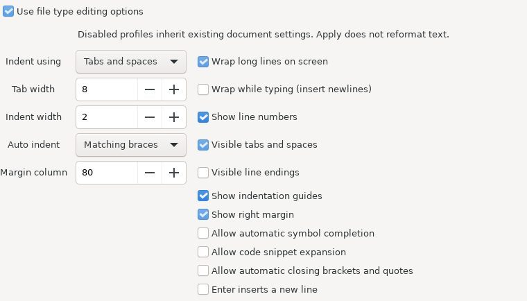

Настоящая рабочая GTK-вкладка, снятая в изолированной GUI-проверке; пример настроек показан на английском.

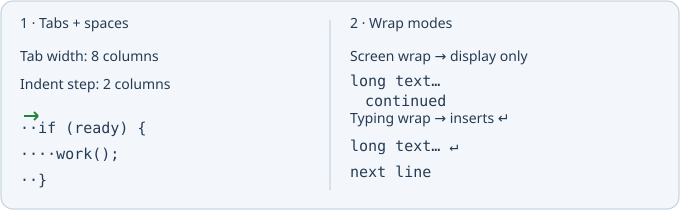

Доступны пробелы, табуляции или смешанный отступ, ширина табуляции и шаг отступа (1–32 колонки), четыре режима автоотступа, экранный перенос, перенос при наборе, номера строк, видимые пробелы/табуляции/окончания строк, направляющие и правая граница (20–500 колонок). Для отступа только табуляциями шаг равен ширине табуляции; смешанный режим позволяет задать их независимо.

Экранный перенос меняет только отображение. Перенос при наборе использует колонку границы и вставляет настоящие переводы строк в набираемый далее текст. Apply не переформатирует существующий текст, не перемещает каретку и не очищает Undo. Настройки действуют на подходящие открытые и вновь открываемые файлы. Отключение возвращает отступы, переносы и отображение документа, сохранённые перед включением профиля; этот исходный снимок действует в пределах сеанса. После отключения можно применить новые общие настройки.

Параметры сохраняются в `language.conf` профиля, в секции `[editing]` с версией. Отсутствующая секция сохраняет наследование. При повреждённых значениях весь блок переопределения отключается, а парсер и CSS профиля остаются доступны. Закрытие без Apply отменяет правки диалога. Перезагрузка профилей и привязка файлов продолжают работать. Печать и включение типа при автодобавлении в проект остаются отдельными работами; разрешения ввода описаны ниже.

### Разрешения ввода для типа файла

На вкладке Editing добавлены разрешения автоматического дополнения символов, раскрытия snippets, автоматического закрытия скобок/кавычек (включая XML-теги) и поведение Enter. Они действуют при включённой группе настроек редактирования. Старые профили по умолчанию разрешают все четыре возможности.

Разрешающий флаг не включает глобально отключённое дополнение или автозакрытие. Запрет автоматического дополнения сохраняет явную команду дополнения. Запрет snippets блокирует раскрытие Geany snippets, назначенные им клавиши и дополнение имён шаблонов проекта; явная вставка из панели Clips остаётся доступной. Применение ограничивающего профиля закрывает уже показанный список дополнения.

Если **Enter inserts a new line** выключен, обычный Return или Enter цифровой клавиатуры переводит курсор в начало следующей строки, не меняя текст и Undo. На последней строке — в её начало. Enter с модификаторами, несколько выделений и принятие активной подсказки сохраняют штатную обработку. Вставка из буфера и явные команды вставки новой строки не меняются.

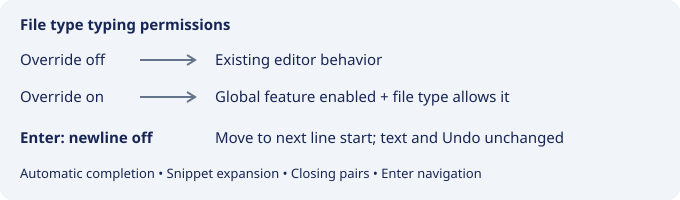

Intelligent paste, печать и Include when adding остаются отдельной работой. Использовано существующее редактирование парных символов; полный набор таких приёмов Source Insight не объявляется перенесённым.

### Редактирование созданных скобок и кавычек

При включённой группе настроек типа файла и **Allow automatic closing brackets and quotes** ввод закрывающего символа перед созданной редактором `)`, `]`, `}`, одинарной или двойной кавычкой переводит курсор за неё без дублирования. Backspace внутри пустой созданной пары удаляет оба символа одним действием Undo. Ввод `(`, `[` или `{` непосредственно перед существующим блоком с такой же открывающей скобкой оборачивает блок новой парой, если этот вид автозакрытия разрешён глобально.

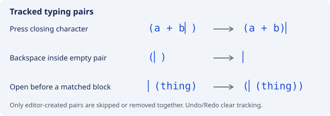

Вложенные пары и UTF-8-вставки перед ними/внутри них отслеживаются по байтовым позициям. Отметки временные: до 128 пар на редактор; Undo/Redo и отключение группы/разрешения сбрасывают их. Ручные пары остаются обычным текстом. Для read-only, выделения, нескольких курсоров, модифицированных клавиш редактирования и активных подсказок действует штатная обработка. Созданные кавычки отслеживаются, но оборачивание готовых строк в кавычках и весь набор shortcuts Source Insight не объявляются реализованными. Парное удаление XML-тегов не добавлено.

### Расширенный список автодополнения

**Options → Detailed completion window** включает расширенный список символов (по умолчанию включён). Используются прежние поиск кандидатов и порог появления: в настройках автодополнения Geany можно задать 3 или 4 символа. Цветом выделены имя, тип/возвращаемый тип, параметры функции и область видимости; рядом показаны значок и категория символа. Выбранная строка использует цвета выделения темы; расположение объявления показано внизу и во всплывающей подсказке. Отсутствующие сведения парсера оставлены пустыми.

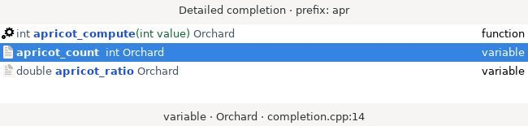

Дальнейший ввод сужает список; Backspace обновляет кандидатов и может снова расширить его. Up/Down и PageUp/PageDown выбирают строку, Enter/Tab вставляют только **имя**, Escape закрывает окно без правки. Наведение мыши выбирает строку, левый щелчок принимает её. Фокус клавиатуры остаётся в редакторе. Окно располагается возле курсора, у нижней границы монитора — над ним; закрывается при навигации, прокрутке, потере фокуса, Undo/Redo и устаревшем выборе. Вставка — одно действие Undo, с учётом прежней настройки замены остатка слова.

Переключатель сохраняется в `insight-completion.conf`; отключение возвращает обычный список. Разрешение типа файла и общий флаг автодополнения продолжают управлять автоматическим показом; явная команда дополнения доступна. Списки слов документа, внешних плагинов и snippets сохраняют прежний интерфейс. Точность кандидатов зависит от существующего парсера; автоматическая вставка параметров функции и полный паритет автодополнения Source Insight остаются отдельной работой.

### Диалог настроек автодополнения

Откройте **Options → Completion options…**. Cancel отменяет неприменённые правки, Apply сохраняет их без закрытия окна, OK сохраняет и закрывает. Настройки восстанавливаются после перезапуска; переключатель расширенного вида в меню изменяет тот же файл, сохраняя остальные параметры.

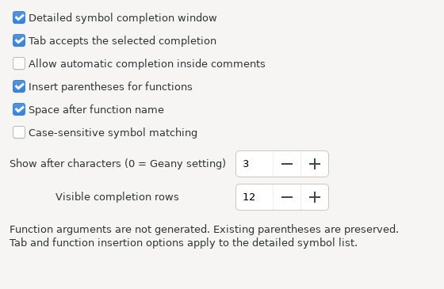

| Настройка | По умолчанию | Действие |
| --- | --- | --- |
| Расширенный список | Включён | Цветные сведения о символе; отключение возвращает обычный список |
| Принятие по Tab | Включено | При отключении действует обычный Tab редактора; Enter принимает вариант |
| Внутри комментариев | Выключено | Разрешает автоматические предложения в комментариях с учётом общих/языковых разрешений; строки остаются исключены |
| Вставка скобок | Выключена | Добавляет `()` только для функций/методов/прототипов |
| Пробел после имени | Выключен | При добавлении скобок получается `name ()` |
| Порог появления | 0 | 0 наследует Geany; 1–12 задают порог обычного префикса |
| Видимые строки | 9 | 3–20 строк до прокрутки |

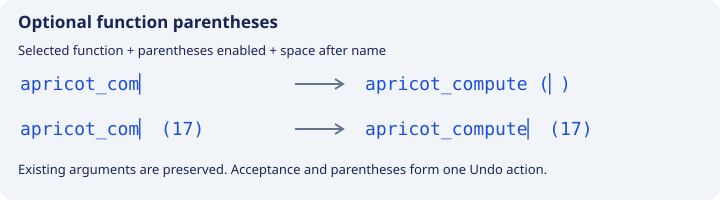

Скобки добавляются, если справа после пробелов/табуляций ещё нет открывающей скобки. Набранные аргументы и пробелы сохраняются. Курсор помещается внутрь новой пары; принятие — одно действие Undo. Аргументы и типы по объявлению не генерируются. При вставке в середину слова с сохранением его остатка скобки не добавляются; длинный неопределённый хвост пробелов также подавляет их вставку. Принятие по Tab и вставка скобок относятся к расширенному списку; порог и разрешение комментариев действуют и на обычное символьное дополнение. У дополнения членов сохраняются прежние контекстные триггеры.

Старые файлы `insight-completion.conf`, содержащие только `detailed`, сохраняют поведение. Для отсутствующих ключей действуют значения по умолчанию; ошибочное значение отклоняет группу настроек и возвращает defaults. Неизвестные корректные ключи/группы сохраняются при записи. Перед принятием с клавиатуры выполняется ожидающее обновление: быстрые Backspace и Enter используют актуальный префикс.

### Учёт регистра при дополнении символов

**Completion options → Case-sensitive symbol matching** по умолчанию включён, в том числе для старых файлов настроек. Отключите его, чтобы искать имена с набранным префиксом независимо от регистра. Параметр действует на обычный поиск символов, дополнение членов, расширенный и обычный символьные списки. Совпадения с набранным регистром сохраняются и предпочитаются при начальном выборе; вставляется исходное написание имени. При дальнейшей фильтрации выбранный кандидат сохраняется, если по-прежнему соответствует набранному регистру.

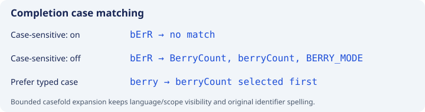

Механизм сопоставления поддерживает Unicode casefold: например, `STRASS` совпадает с `Straße`. Разные Unicode-представления не нормализуются. Пределы: 512 байтов UTF-8 для префикса и 4096 для имени кандидата. Выделение набираемого слова и доступность метаданных продолжают зависеть от существующей поддержки конкретного языка.

Дополнительный поиск без регистра просматривает до 100000 записей тегов, включая повторные проходы видимости. Первоначальные совпадения с точным регистром сохраняются; общий предел числа вариантов также действует. При неполном расширении внизу подробного списка показано **Case-insensitive search limit reached**. Сохраняются прежние правила локальных переменных, scope/строки, подключённых файлов, проекта/глобальных источников, совместимости языков и устранения одинаковых имён. На очень больших индексах бюджет просмотра может ограничить дополнительные совпадения. Фильтры имён файлов сохраняют собственные правила регистра. Выбор сохраняется вместе с другими настройками дополнения и восстанавливается после перезапуска.

### Интеллектуальная вставка целых строк

Включите **Options → Intelligent paste**. По умолчанию режим выключен и сохраняется в `insight-paste.conf`. В активном профиле File Type Options → Editing флажок **Allow intelligent paste** разрешает этот режим; старые профили разрешают его, выключенная группа наследует общее поведение.

При обычной команде Paste (меню, Ctrl+V) и вставке из Clips текст, заканчивающийся переводом строки, считается целыми строками. С курсором внутри строки блок вставляется над ней, в конце непустой строки — под ней. В последней строке без перевода добавляется разделяющее окончание строки. Полностью выделенные строки заменяются блоком; частичное выделение сохраняет штатную замену.

Общий минимальный отступ непустых строк удаляется, затем добавляется отступ строки назначения. Относительная вложенность сохраняется, табуляция считается по ширине документа; результат использует его режим tabs/spaces и LF/CRLF/CR. Пустые строки не заполняются пробелами. Это обработка отступов текста, а не синтаксическое переформатирование. Весь блок вставляется одним действием Undo/Redo.

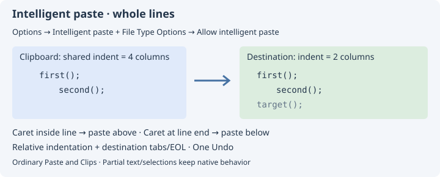

Прямоугольные/множественные выделения, виртуальные позиции, частичный текст, некорректный UTF-8 и превышение пределов используют прежнюю вставку. Пределы преобразования: 1 MiB входа, 4 MiB выхода, 10000 строк, 4096 колонок отступа, ширина табуляции 1–32. При ожидании буфера обмена проверяются документ, изменения текста, выделение и позиция курсора; изменение назначения отменяет ожидающую вставку. Read-only не обходится. Перетаскивание, Drag Line Up/Down, отдельный Paste Line и выбор выделения после вставки в этой серии не перенесены. Текстовые поля диалогов сохраняют штатное поведение.

### Paste Line и перемещение строк

В **Edit → Line operations** добавлены **Paste Line**, **Drag Line Up/Down** и **Drag Line Up/Down More**. Paste Line снимает обычное выделение, переводит курсор в начало его текущей строки и выполняет Paste. Частичный текст также вставляется в начало строки; целые строки при включённом интеллектуальном режиме получают её отступ. За время ожидания clipboard действуют те же проверки назначения.

Drag Line Up/Down перемещают текущую строку или строки, затронутые обычным выделением. Конец выделения в начале следующей строки не включает эту следующую строку. **More** переносит до пяти строк и останавливается у границы документа. При включённом Options → Intelligent paste и разрешении типа файла блок получает отступ последней пересечённой строки, сохраняя внутреннюю вложенность. Без разрешения сохраняется штатное перемещение без подстройки отступов. Применяются прежние ограничения преобразования отступов; при отказе выполняется штатный перенос.

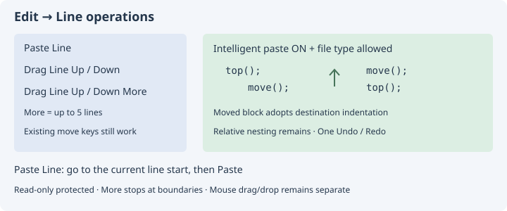

Существующие **Move line(s) up/down** и назначенные им клавиши (по умолчанию Alt+Page Up/Down) также используют этот режим. Для новых пунктов More и Paste Line отдельные клавиши в этой серии не назначены. Один перенос, включая пять шагов и отступы, отменяется одним Undo/Redo. В интеллектуальном режиме выделенный блок остаётся выделенным с прежним направлением, курсор без выделения следует за текстом строки; внутри изменяемого отступа курсор переходит к началу текста. Read-only защищён; новые команды меню требуют одного обычного выделения без виртуальных позиций. Обычные прежние команды сохраняют штатную обработку иных режимов.

Это команды перемещения строк; перетаскивание мышью (drag/drop) остаётся отдельным открытым пунктом. Настройка выделения после интеллектуальной вставки описана ниже. Обработка отступов не является синтаксическим переформатированием.

### Буфер обмена: строки и части строк

В **Edit → Line operations** добавлены команды Source Insight:

| Команда | Действие |
| --- | --- |
| Copy Line | Расширяет выделение до целых затронутых строк и копирует его. Повтор при уже полном выделении добавляет следующую строку. |
| Cut Line | Вырезает текущую строку активного курсора, включая её EOL, если он есть. Даже при выделении нескольких строк это одна текущая строка. |
| Copy Line Right | Копирует от курсора до конца текста строки, сохраняя текущее выделение. |
| Cut Line Left / Right | Вырезает текст от начала строки до курсора / от курсора до конца строки. Перевод строки сохраняется. |
| Cut Selection or Paste | При выделении вырезает его, без выделения выполняет Paste. Для целых строк действует включённая интеллектуальная вставка. |

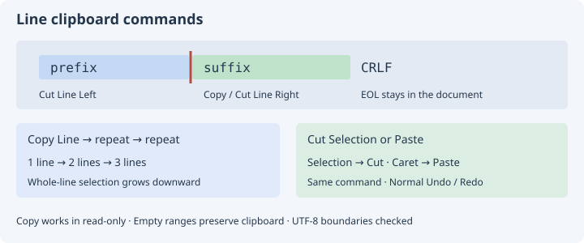

Существующие **Copy/Cut Current Line(s)** и их клавиши (обычно Ctrl+Shift+C / Ctrl+Shift+X) в исходном редакторе выполняют эти же Copy Line/Cut Line. Расширение Copy Line определяется текущим полным выделением, поэтому вручную выделенный блок целых строк также расширяется при вызове. Конец выделения в начале следующей строки не включает её при первоначальном расширении частичного выделения. В конце документа рост останавливается. Последняя строка без EOL копируется без добавления перевода.

Вырезание создаёт одно действие Undo/Redo; Copy Line и Copy Line Right не меняют текст и не создают Undo. Copy разрешён в read-only, Cut/Paste — нет. Пустая часть строки и последняя пустая строка не очищают прежний clipboard. Копируемый/вырезаемый диапазон ограничен 1 MiB, проверяется целостность UTF-8 и отсутствие NUL; отказ сохраняет текст и clipboard. Новые пункты меню требуют одного обычного выделения без виртуальных позиций. Прежние команды Geany в других режимах выделения и сторонних Scintilla-виджетах сохраняют штатную обработку. Работа с частями строки использует активный курсор, даже если есть выделение. Для новых команд частей строки и Cut Selection or Paste отдельные клавиши пока не назначены.

GTK/платформа могут нормализовать окончания строк при передаче текста через clipboard; окончания строк исходного документа при этом не преобразуются.

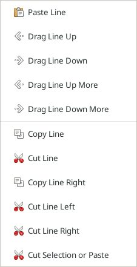

### Выделение и навигация, Extend Mode

В **Edit → Selection and navigation** добавлены **Toggle Extend Mode**, **Beginning/End of Selection**, **Blank Line Up/Down**, **Select Word**, **Select Line**, выделение до конца строки / начала / конца файла и переходы Top/Bottom of File.

При включённом Extend Mode обычные движения Scintilla (стрелки, слова, Home/End, Page Up/Down) расширяют выделение от его anchor. Переходы через Geany `sci_goto_line`, `sci_goto_pos` и `sci_set_current_position` с прокруткой также сохраняют anchor. Новые переходы к пустым строкам и краям файла учитывают режим. Без режима переход ставит обычный курсор. **Escape** выключает режим, оставляя выделенный текст; сначала действует обработчик видимого окна автодополнения. Beginning/End of Selection сворачивают существующее выделение к его границе и завершают режим; без выделения ничего не меняют.

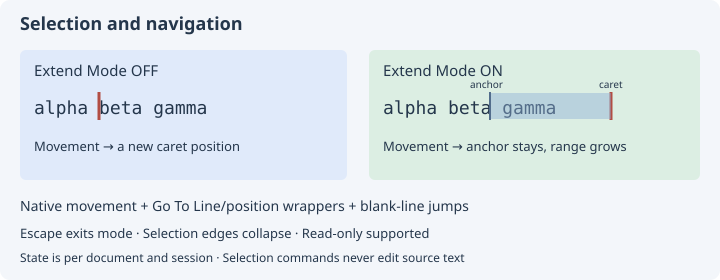

Select Word использует правила слов текущего редактора; Select Line выделяет текущую строку с её EOL, если он есть. Явные команды Select To… сохраняют текущий anchor. Пустой считается строка без текста либо только с пробелами/табуляциями; поиск начинает со следующей/предыдущей строки и не перескакивает к границе файла, если совпадений нет. Завершающая пустая строка после EOL тоже доступна. Поиск ограничен 100000 строками и 4 MiB смещения; при достижении предела курсор не перемещается.

Режим относится к Scintilla-виджету документа и не сохраняется в профиль. При переключении документов флажок меню обновляется. Изменение текста и щелчок мышью в редакторе завершают режим; состояние восстанавливается при активации документа. Прямые `SCI_GOTOPOS/SCI_GOTOLINE` внешних плагинов и непрокручивающий `sci_set_current_position` сохраняют прежнюю семантику; глобальное перехватывание всех API не заявляется. Дополнительные клавиши для новых команд пока не назначены, прежние движения сохраняют свои назначения.

Команды доступны и в read-only, не меняют текст и Undo. Новые пункты требуют одного обычного выделения без виртуальных позиций. Полные Source Insight Select Block/Match, символические области, Extend Mode во всех внешних/плагинных переходах и мышиные selection shortcuts остаются отдельными пунктами переноса.

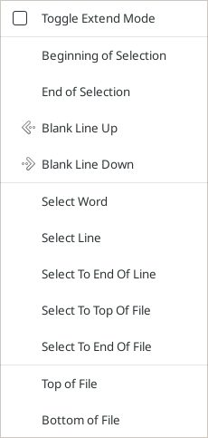

### Выделение после интеллектуальной вставки

В **Options → После интеллектуальной вставки** доступны три сохраняемых режима: **Курсор в конце вставленного текста** (по умолчанию), **Курсор в начале вставленного текста** и **Выделить вставленный текст**. Настройка действует при успешной интеллектуальной вставке целых строк через обычную вставку, Paste Line и Clips. Выделенный блок можно сразу копировать, перемещать или заменять.

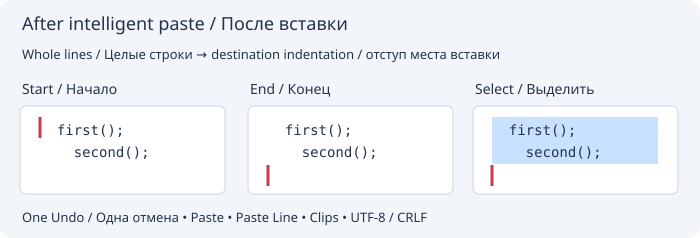

Границы рассчитываются по преобразованному блоку с отступом и переводами строк места вставки. При вставке в конец файла без перевода строки добавленный разделитель прежней строки не входит в выделение. Вставка остаётся одной операцией Undo. Настройка сохраняется в `insight-paste.conf`; отсутствующее или недопустимое значение означает режим по умолчанию. При ошибке сохранения восстанавливается прежний пункт меню и выводится сообщение.

Эта серия охватывает интеллектуальную вставку целых строк. Обычная вставка фрагментов, множественные и прямоугольные выделения, запрет интеллектуальной вставки для типа файла и перетаскивание мышью сохраняют прежнее поведение. Отдельный принудительный режим выделения целых строк и общая политика выделения при нативной вставке фрагментов остаются задачами переноса Source Insight.

## Смена языка и общая таблица надписей

«Параметры → Язык интерфейса» переключает активную таблицу английских/русских
надписей и обновляет открытые окна, корешки вкладок, скрытые меню, списки выбора,
счётчики, подписи и подсказки с разметкой, ячейки статусов. За элементами сохранены
исходные ключи надписей. Пути, код, ввод пользователя, значения моделей и ID
пунктов списков остаются данными.

`insight/locale/insight.tsv` — единая редактируемая таблица надписей Insight.
`native.tsv` генерируется из `po/ru.po` для стандартных надписей Geany; при загрузке
они объединяются в одном реестре. Старая отдельная таблица `insight.pairs` удалена
с сохранением её переводов. `python3 insight/tools/build_i18n.py --check` проверяет
таблицы; без `--check` скрипт обновляет только каталог стандартных надписей.

Для собственных подписей создайте `insight/interface-texts.tsv` в каталоге настроек
Geany. Строка UTF-8: постоянный английский ключ, символ табуляции и русская надпись.
Три столбца позволяют заменить и английскую, и русскую надпись:

```text
Before<TAB>Earlier<TAB>Ранее
After<TAB>Later<TAB>Позже
```

Вместо `<TAB>` нужны настоящие табуляции. Внутри полей `\n`, `\t`, `\\` обозначают
перевод строки, табуляцию и обратную косую черту. Сохраняйте типы printf-параметров
и подстановки `{value}`. Команда «Параметры → Язык интерфейса → Перечитать надписи
интерфейса» перечитывает таблицы и обновляет интерфейс без перезапуска. Ошибка UTF-8,
формата строки или типов printf оставляет прежний каталог. Удаление файла и
перечитывание возвращает штатные надписи. Для новых стандартных диалогов сохраняется
механизм gettext. Содержимое редактора, терминалов и ответов ИИ не переводится.

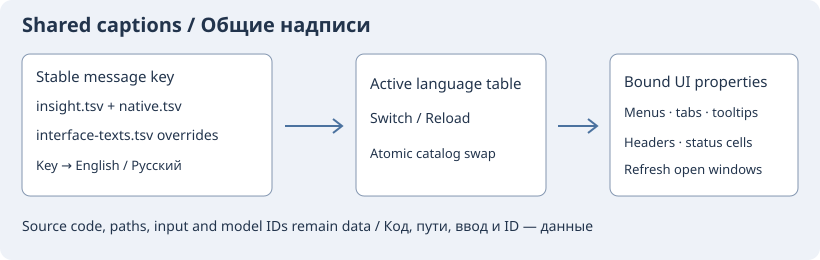
