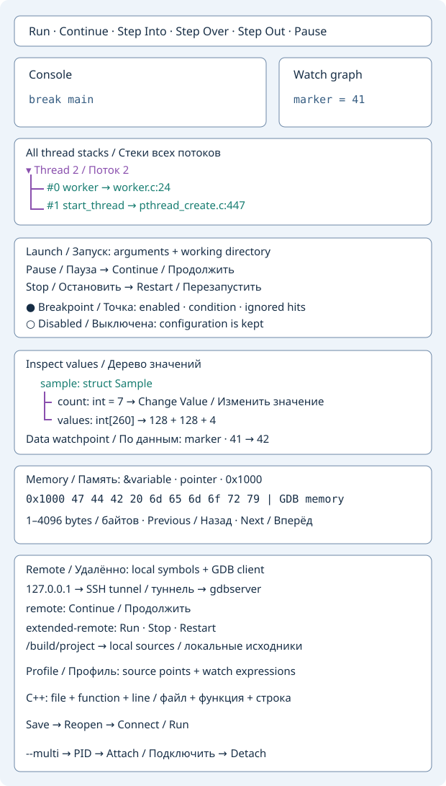

# Отладка C/C++ с GDB

На паузе откройте **Потоки и стек**. Верхний список переключает поток GDB.
Таблица показывает до 64 кадров выбранного потока. Выбор кадра обновляет
переменные и наблюдения. Двойной щелчок открывает исходник, если GDB
вернул полный путь и номер строки.

На каждой остановке вкладка **Переменные** показывает локальные переменные
и аргументы текущего кадра GDB. Эти значения видны и в **Графе наблюдения**.
Наведите курсор на имя в открытом исходнике текущей остановки, чтобы увидеть
значение из кадра. Для произвольного выражения используйте **Наблюдения**.

Во время отладки поставьте курсор на строку исходника и нажмите **F2** или
**Поставить или удалить точку останова** на главной панели. Тот же результат
даёт двойной щелчок по номеру строки или команда из его контекстного меню.
Главная панель показывает доступные команды активного отладчика. При нескольких
сеансах переключайте активный сеанс фокусом его окна.

Соберите программу с отладочными символами, например
`cc -g -Og main.c -o app` или `c++ -g -Og main.cpp -o app`.
GDB должен быть доступен в `PATH` до запуска Geany.

Выберите **Инструменты → C/C++ → Отладить исполняемый файл C/C++…**
и укажите собранную программу. Рабочим каталогом сеанса будет каталог
исполняемого файла.

- Введите `main` или `file.cpp:42`, нажмите **Add Breakpoint**, затем **Run**.
- **Step Into**, **Step Over**, **Step Out**, **Continue** и **Pause** управляют
  выполнением. **Open Source** открывает строку остановки.
- **Stack** и **Locals** выводят информацию во вкладку **Stack and locals**.
  В консоли можно вводить команды GDB, например `print value` и `set args one two`.
  Для ввода в саму программу настройте отдельный терминал в GDB.

В **Watches** добавляйте выражения через **Add Watch**. На остановке GDB
обновляет до 32 выражений. Для удаления введите то же выражение и нажмите
**Remove Watch**. В **Watch graph** можно закреплять карточки и видеть
изменения значений между остановками.

**Load Lua Observer…** загружает скрипт, возвращающий `function(event)`.
Для остановок на точках останова приходит событие `native-point` с полями
`event.file`, `event.line`, `event.name`, `event.locals.breakpoint` и
`event.locals.reason`. Функция `log()` пишет в журнал и консоль,
`watch()` публикует значение в списке и графе. Верните `false`, чтобы
продолжить выполнение, или `true`, чтобы оставить программу на паузе.

## Стеки всех потоков

На паузе откройте **Стеки всех потоков**: каждый поток — раскрываемая ветвь,
внутри которой находятся его кадры. Кнопки **Развернуть всё** и **Свернуть всё**
управляют ветвями. Номера кадров, функции и строки исходников выделены разными
цветами. Двойной щелчок по кадру выбирает его поток и кадр, открывает исходник,
обновляет переменные, наблюдения и граф в выбранном контексте.

Показываются до 64 потоков и до 64 кадров каждого потока. Стеки обновляются
при остановках, пока вкладка открыта. Во время выполнения остаётся снимок
предыдущей остановки с соответствующей подписью. Если стек прочитать нельзя,
поток помечается **Стек недоступен**. Для перехода к исходнику GDB должен вернуть
путь и номер строки; оптимизация может скрывать переменные и позиции исходника.

## Запуск, пауза, остановка и перезапуск

Перед запуском откройте **Настройки запуска**. Укажите **Аргументы программы**
(значения с пробелами заключайте в кавычки) и существующий **Рабочий каталог**
с абсолютным путём. Пустое поле означает запуск без аргументов. При неверном
каталоге или незакрытой кавычке вкладка покажет объяснение; запуск не произойдёт.

**Запустить** запускает неактивную программу. **Пауза** прерывает выполнение,
сохраняя состояние, **Продолжить** возобновляет его. **Остановить** завершает
программу, оставляя отладчик открытым. **Перезапустить** завершает выполняющуюся
или приостановленную программу и запускает новый процесс с заданными настройками.
Точки, их условия, наблюдения и Lua-наблюдатель сохраняются. После завершения
процесса переменные, стеки и подсветка строки остановки очищаются. Команда
**Остановить** также доступна на главной панели для активного сеанса C/C++.

## Управление точками останова

Вкладка **Точки останова C/C++** показывает снимок GDB, включая точки,
добавленные кнопкой, F2, через поля редактора и команды консоли. В таблице видны
номер, состояние, условие, число попаданий и число пропускаемых попаданий.
Выберите строку и используйте **Включить / выключить**, **Удалить точку останова**,
**Условие точки останова** или **Пропуск первых попаданий**. Пустое условие
делает точку безусловной; ноль пропусков означает остановку при следующем
подходящем попадании. Условие — выражение C/C++, которое вычисляет GDB.
Неверное выражение приводит к сообщению GDB; прежнее условие сохраняется.

Двойной щелчок по разрешённой точке открывает исходник. Включённая точка отмечена
красным кружком, выключенная — серым, текущая строка остановки подсвечивается.
При остановке с координатами исходника редактор открывается автоматически.
Неразрешённые точки остаются в списке до появления определения, например после
загрузки разделяемой библиотеки. Для перехода и кружка нужен полный путь и номер
строки от GDB. При закрытии сеанса удаляются только его собственные метки.

Для перегрузок и шаблонов C++ показываются все подпозиции GDB (`1.1`, `1.2`, …)
с координатами исходников. Условие и счётчики наследуются от родительской точки.
**Включить / выключить** меняет отдельную подпозицию, но она действует только
при включённой родительской точке. Условие, пропуск попаданий и удаление относятся
ко всей родительской точке со всеми позициями. Если несколько позиций находятся
на одной строке, кружок красный, когда хотя бы одна из них действует.
