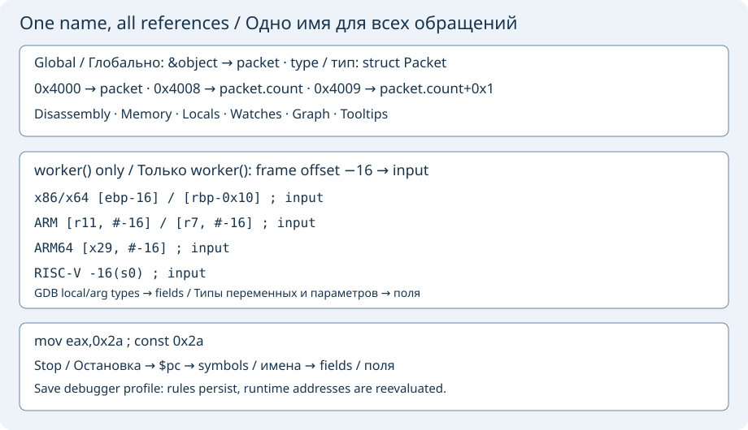
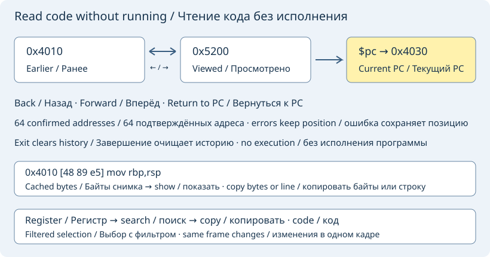

# Дизассемблер и навигация по коду

Приостановите программу и откройте **Машинные инструкции**. Введите `$pc` для
счётчика команд выбранного кадра, имя функции, например `main`, либо адрес `0x1000`.
**Прочитать инструкции** (или Enter) читает до 128 байтов и показывает адреса,
функции, смещения и ассемблер. У недоступной границы кода окно уменьшается
не более чем за семь повторов, чтобы короткая читаемая функция не пропадала. Это снимок: обновляйте его после шага, смены кадра
или перезапуска. Неверный/недоступный адрес вызывает сообщение GDB без продолжения.

Ответ принимается только как полный снимок: до 256 инструкций, 8192 байтов
на кортеж MI и 64 КиБ форматированного текста. Превышение любого лимита,
включая слишком большую последнюю инструкцию, отменяет весь ответ.
Неполный список не объявляется успешным чтением и не сдвигает историю адресов.

**Шаг с заходом по инструкции** выполняет одну машинную инструкцию с заходом в вызов.
**Шаг без захода по инструкции** перешагивает вызов. Обе команды работают с выбранным
потоком GDB только на паузе; обычные точки останова продолжают действовать.
Команды работают и через подключённый gdbserver, в том числе без строк исходника.

### Символы, константы и ручные имена

На x86/x64 включается **Intel-синтаксис**. На ARM, ARM64 и RISC-V 32/64 используется
родной синтаксис GDB для цели; выбранная сборка GDB должна поддерживать её
архитектуру. Правила имён работают локально и через gdbserver. Исходные инструкции
и числовые адреса остаются видимыми рядом с подписями. Настоящие символы разрешает
GDB; непосредственные операнды без имени помечаются `const`. По одной инструкции
нельзя достоверно отличить произвольное целое от указателя.

Раскройте **Имена, смещения кадра и типы данных**:

- **Имя адреса…**: задайте выражение, например `&object`, и имя `packet`.
  Выделенный числовой адрес из дизассемблера подставляется в поле автоматически.
  При ASLR используйте выражение символа вместо абсолютного адреса конкретного процесса.
- **Имя в кадре…**: задайте знаковое смещение, например `-0x20`, имя, регистр базы
  (`fp`, `sp`, `rbp`, `ebp`, `x29`, `r11`, `r7`, `s0`) и точное имя функции из GDB.
  Правило действует только в этой функции, включая обращения через регистры с тем
  же значением на текущей остановке.
- **Тип данных…**: задайте `&object`, имя `packet` и существующий тип C/C++, например
  `struct Packet`. Размеры и смещения полей, включая вложенные структуры, получает
  GDB; адрес внутри поля отображается как `packet.field+смещение`. Для структуры
  в стеке задайте `(char*)$fp-0x20` (или другой регистр базы) и область функции.
  Привязка вне своей функции пропускается, а не применяется к чужому кадру.
- **Изменить имя…** и **Удалить имя** работают с выбранным правилом. Повторное
  добавление того же правила заменяет имя. Ручное имя важнее автоматического;
  более точное поле важнее охватывающей его структуры.

После добавления, изменения или удаления правила имена обновляются автоматически
на паузе. **Прочитать инструкции** повторяет разрешение по запросу. GDB также предоставляет
адресуемые параметры и локальные переменные выбранного кадра, включая вложенные
поля и элементы массивов, когда известны их типы и адреса. Указатели автоматически
именуются без перехода к их данным. Ручные имена сохраняют приоритет.
Оптимизированные, находящиеся только в регистрах значения и неизвестная область
функции не получают вымышленных адресов.
Распознаются формы Intel x86, скобки ARM/ARM64 и `смещение(регистр)` RISC-V;
Простые обращения через другие регистры общего назначения тоже используют
их значения на этой остановке: `[rax+8]`, `[x0,#8]`, `8(a0)` могут показывать поля
структуры. Это снимок остановки, а не символьное исполнение будущих инструкций.
Индексируемые выражения остаются без изменений; смещения и числа внутри строк
не превращаются в самостоятельные абсолютные адреса. Знак отрицательных констант
сохраняется. Обращения относительно FS/GS не сопоставляются с плоскими адресами
без подтверждённой базы сегмента. Для переменных другой функции
сначала выберите её кадр.

Глобальные имена также подписывают указатели в переменных, деревьях значений, наблюдениях, графах,
подсказках исходника и адреса памяти. Исходные значения и байты программы не
изменяются. При выполнении разрешённые адреса сбрасываются; следующее чтение
вычисляет их заново. **Сохранить имена в профиле отладчика** сохраняет ручные
правила для проекта и программы; адреса текущего процесса и автоматические имена
не записываются. При смене потока/кадра локальные разрешения сбрасываются,
а глобальные имена остаются доступными в пределах этого процесса.

Сбор ограничен 128 адресами данных, 64 запросами символов числовых операндов,
64 полями одного агрегата и тремя уровнями вложенности. По указателям полей
перехода нет. Неизвестные типы, недоступные адреса и битовые поля без адреса
отмечаются как неразрешённые запросы. Отсутствующие отладочные данные не угадываются.

### Следование за текущей инструкцией

Включите **Следовать за выбранным кадром при каждой остановке** на странице
инструкций: `$pc`, символы и имена полей обновляются после подтверждённой остановки,
шага по инструкции и выбора потока/кадра. Обновление ждёт загрузки переменных и
наблюдений, не прерывает выполнение и работает только на видимой странице.
Ожидающие команды продолжения, остановки, перезапуска и отсоединения имеют приоритет.

Ручное чтение адресов остаётся доступным. На следующей остановке режим слежения
возвращает поле адреса к `$pc`. Выключите переключатель, чтобы оставить ручной снимок.

Выбор режима слежения сохраняется в профиле отладчика. Старый профиль без этого
параметра сохраняет текущее положение переключателя.

### Снимки регистров

Раскройте **Регистры на момент последнего чтения инструкций**. Таблица получает
имена и порядок регистров у GDB для текущей цели. Регистры общего назначения
показываются в hex и беззнаковом десятичном виде с разрешёнными именами адресов
и полей. Нажмите **Регистр** для сортировки по имени. Изменения относительно
предыдущего чтения выделяются оранжевым; при выборе другого потока/кадра или
перезапуске программы сравнение начинается заново.

Выберите строку и нажмите **Наблюдать выбранный регистр**, чтобы добавить
`$регистр` в наблюдения, либо **Открыть адрес регистра в памяти** для просмотра
содержащегося в нём адреса. Используется выбранный кадр GDB. Это тот же снимок,
что и список инструкций: включите слежение либо повторите чтение для обновления.

### Действия со строкой инструкции

Поставьте программу на паузу, откройте **Машинные инструкции** и прочитайте
`$pc` или функцию. Установите курсор на строку инструкции.
**Переключить точку на инструкции (F2)** или F2 внутри списка инструкций
добавляет/удаляет точку по числовому адресу. Подтверждённая точка появляется
и в общем списке **Точки останова**: красная ● означает включённую точку,
серая ○ — отключённую. Точки исходников/функций тоже отмечаются; F2 удаляет
только отдельную адресную точку, сохраняя правила для исходников.

Подсветка ▶ обозначает подтверждённый счётчик команд выбранного кадра,
а не обязательно первую показанную инструкцию. При выполнении и смене кадра
она исчезает до следующего чтения инструкций. Включите слежение за выбранным
кадром на остановках для обновления видимого снимка.

**Открыть адрес инструкции в памяти** показывает байты по адресу строки.
**Выполнить до инструкции** использует GDB `until *адрес` для выбранного
потока/кадра: другие точки или сигналы могут остановить программу раньше;
выход из кадра также может завершить операцию до достижения адреса.
Выбор текущего PC оставляет программу на паузе. Действия доступны на паузе
после завершения ожидающих команд и работают с удалённым gdbserver по SSH.
Числовые адресные точки относятся к текущему сеансу GDB и не сохраняются
в качестве переносимых позиций профиля.

### Меню инструкции и аппаратные точки

Щёлкните правой кнопкой по строке инструкции либо вызовите контекстное меню
с клавиатуры в позиции курсора. В стандартном текстовом меню появятся действия
инструкции. Адрес строки сохраняется при открытии меню.
**Копировать адрес инструкции** копирует только числовой адрес.
**Задать имя адресу инструкции…** открывает общий редактор имён с заполненным
адресом, не меняя отлаживаемую программу. Для сохранения правил сохраните
профиль отладчика. При ASLR числовой адрес может измениться после перезапуска;
для переносимого имени лучше выражение с символом.

Двойной щелчок по начальному адресу либо маркеру точки/PC переключает адресную
точку. Двойной щелчок по операндам сохраняет обычное выделение текста.
Пункт **Добавить аппаратную точку на инструкции** соответствует GDB `hbreak`.
Поддержка и число аппаратных точек зависят от цели и удалённого сервера.
Ошибка GDB остаётся видимой; программная точка взамен не добавляется.

Для подтверждённой адресной точки пункты включения/отключения, условия
и пропуска первых срабатываний используют общие редакторы и список точек.
Они меняют только адресную точку, сохраняя правила исходников и функций
по тому же адресу. Если пункты недоступны, сначала создайте адресную точку.
Редактирование и выполнение доступны на свободной паузе; адрес старого снимка
можно копировать и во время выполнения. Меню работает и с gdbserver через SSH.

### Исходник инструкции

Выберите **Открыть исходник инструкции** в меню строки. Точный файл и строку
возвращает GDB; переход сохраняет позицию остановки исполнения. При отсутствии
отладочной информации или локального файла показывается сообщение. Для SSH
предварительно настройте каталоги исходников GDB или сопоставление путей.

[Назад к руководству отладчика](native-debugger.md)

## История адресов и явное выделение

**Назад по истории кода** и **Вперёд по истории кода** возвращают подтверждённые
числовые адреса, включая снимки `$pc`. Старое выражение `$pc` не вычисляется
заново с новым значением. Хранятся до 64 записей. Повторное чтение текущего
адреса не создаёт дубликат. Новый переход после возврата удаляет ветку
«Вперёд». Ошибка чтения сохраняет позицию истории. При завершении программы
или отключении история очищается: ASLR может изменить адреса после перезапуска.
История не сохраняется в профиле отладчика.

**Вернуться к счётчику команд** читает текущий `$pc` выбранного кадра.
**Открыть выделенный адрес как код** принимает одно явно выделенное
шестнадцатеричное число в тексте инструкций. Выделите только адрес, без маркеров,
имён и окружающих операндов. Отладчик не угадывает, обозначает число код
или данные. Для недоступного адреса показывается ошибка чтения GDB.
Действия доступны только на свободной паузе и не запускают программу.

В тексте инструкций **Alt+Left** и **Alt+Right** вызывают переходы назад и вперёд.

## Машинные байты

**Показывать байты инструкций** добавляет столбец `[байты]` перед ассемблером.
Байты приходят от GDB и сохраняют его порядок группировки; отладчик не
переставляет их под другую архитектуру. `??` означает отсутствие корректных
байтов. Переключатель меняет готовый снимок без запросов к программе;
сохраните профиль отладчика для сохранения настройки.

Меню строки содержит **Копировать байты инструкции** и **Копировать строку
инструкции**. Копируется снимок строки при открытии меню, даже если затем
переместить курсор. Строка включает адрес, имена, видимые байты и комментарии,
но не маркеры остановки. При отсутствии байтов их копирование недоступно.

## Поиск и действия с регистрами

Поле поиска проверяет имя регистра, его hex-адрес и подпись без учёта регистра,
включая Unicode. **Только изменившиеся регистры** использует сравнение с
предыдущим снимком того же потока и кадра. На первом снимке изменений ещё нет.
Поиск и сортировка заголовком работают вместе; очистка поиска возвращает строки.
При смене потока или кадра старые строки убираются до следующего чтения.

Выберите строку, затем используйте **Копировать регистр…** для выражения `$имя`,
hex-значения, беззнакового десятичного значения или всей строки с подписью.
Копируются значения готового снимка. **Открыть адрес регистра как код** читает
текущее выражение регистра выбранного кадра через GDB и добавляет просмотр
в историю кода. Это не запуск программы и не изменение регистра. Для значений,
не указывающих на доступную память, GDB покажет ошибку чтения. В таблице теперь
доступны и счётчики команд цели (`pc`, `rip`, `eip`, когда GDB их предоставляет).

PC-relative операнды не вычисляются из PC выбранного кадра: для них требуется
адрес и поправка конкретной инструкции. PC также не принимается как база имени кадра.

Полный hex-запрос, например `0x42`, ищет числовое значение, включая
`0x0000000000000042`. Остальные запросы ищут текст без учёта регистра.
**Порядок определения регистров** возвращает порядок цели/GDB, сохраняя фильтры.
**Копировать видимую таблицу регистров** экспортирует отфильтрованный и
отсортированный снимок в UTF-8 TSV с заголовками, без чтения или исполнения цели.
Табуляция, переносы строк и обратная косая черта внутри ячеек экранируются.
Копируются целые строки: до 128 строк и 128 КиБ; усечение отмечается в статусе.

В списке ручных имён можно искать выражение адреса, имя, тип или функцию без
учёта регистра, включая Unicode. Нажатие на заголовок сортирует столбец;
двойной щелчок или Enter открывает редактирование правила. Редактирование и
удаление сохраняют привязку к исходному правилу после поиска и сортировки.
**Копировать адрес или смещение правила** копирует выбранное выражение или
знаковое смещение кадра без вычисления. После переименования строка может
исчезнуть из результатов: очистите поиск, чтобы увидеть все правила.
Для сохранения правил запишите профиль отладчика.

При смене потока или кадра кэш регистров и маркер текущей инструкции очищаются
до перерисовки, в том числе когда GDB не знает имя функции. Косвенные операнды
не подписываются по регистрам прежнего кадра; явные глобальные адреса сохраняют имена.
