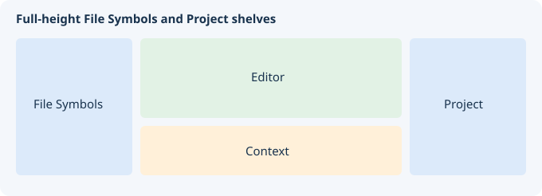

# Контекст

Предпросмотр определений без перемещения основного редактора.

## Управление

Одиночный щелчок по распознанной ссылке меняет только Контекст. Двойной щелчок открывает показанный файл и центрирует строку в редакторе. История, список определений, следование за курсором, перенос строк и поиск управляют предпросмотром. Diff/Merge находится на главной панели инструментов и в меню «Инструменты».

## Короткий урок

Выберите символ в списке. В Контексте щёлкните ссылку на другое определение: редактор останется на месте. Двойным щелчком перенесите просмотренную строку в редактор.

Кнопка «?» справа вверху открывает эту страницу. Язык справки следует настройке интерфейса в Options.

Подробнее: [context-bookmarks.md](context-bookmarks.md).

Ссылки на определения членов и Follow cursor учитывают цепочки C/C++ typedef/using, scope объявления alias, this и квалифицированные namespace. Namespace aliases C++ (`namespace Short = Existing;`) импортируются в native-индекс вместе с целевым именем, включая цепочки и явно глобальные цели. Вложенный nominal-владелец также может проходить через alias: `Alias::Nested` и вложенные aliases внутри него; тип цели разрешается в scope объявления. Общий предел — 32 раскрытия alias и 64 уровня разрешения. Повторное использование alias владельца разрешено, цикл активных раскрытий останавливает переход. Циклы и неоднозначности останавливают переход. Разрешаются также унаследованные члены из индекса и цепочки полей `object.child->value`, `this->child->value`, `Alias::shared->value`. Собственное объявление скрывает имя в своей ветви базовых классов; совпадения из разных scope останавливают переход, перегрузки внутри одного scope остаются в списке. Повторные пути к одному scope ведут к одному месту объявления. Неизвестные базы, циклы и пределы (32 уровня наследования/полей, 4096 scope или одноимённых кандидатов) останавливают поиск. Разрешаются также результаты C-подобных вызовов `factory()->value`, `object.get()->value` и статических методов через alias, если все видимые callable-кандидаты имеют один индексированный nominal-тип результата. Унаследованный метод без явного получателя проверяется раньше функций внешнего namespace; локальные callable-объекты/указатели на функции и индексированные макросы не вычисляются. Строки и комментарии маскируются от начала снимка исходника; Context переиспользует маску. Обратный просмотр вызова ограничен 4096 байтами и стеком из 256 скобок: длинный комментарий не создаёт ложное имя функции. Снимок редактора ограничен 2 МиБ; недоступный или некорректный снимок останавливает переход. Используется снимок профиля C/C++/CUDA, в том числе для нестандартного расширения. Выбор перегрузки по аргументам, подстановка шаблонов, проверка доступа, результаты callable-объектов и индексированный получатель остаются открытыми.

Если изменение текста/каретки поступило до получения фокуса редактором, Follow возобновляется при последующем получении фокуса даже без нового движения каретки. Ручное отключение Follow сохраняется при возврате к неизменившейся каретке без промежуточного редактирования.

Явно квалифицированный вложенный тип может наследоваться: `Derived::Nested`, унаследованный alias через alias владельца и результаты функций с такими типами ведут к индексированному объявлению. Собственное вложенное объявление скрывает базы. Один тип, достигнутый по ромбу, имеет одну цель; разные объявления, скрытие нетиповым именем, неизвестные базы, циклы и пределы останавливают поиск. Aliases баз разрешаются в scope объявления владельца, языковая допустимость проверяется до выбора владельца. Пределы: 4096 посещений владельцев, 256 баз у одного владельца, общий стек 64 и 32 раскрытия alias. Неквалифицированное nominal-имя сначала ищется в ближайшем классе и его базах, затем во внешних scope. Прямое локальное объявление типа имеет приоритет; скрытое или неопределённое унаследованное имя останавливает поиск. Квалифицированная цепочка выбирает ближайший первый компонент и остаётся внутри него: неизвестный/скрытый член не запускает поиск в другом внешнем владельце. Повторные объявления namespace объединяются как одна nominal-область; члены namespace сохраняют предпочтение файла использования, члены класса — контекст объявления. Лимит работы учитывает все попытки раскрытия alias; завершённые неуспешные пробы не завышают отображаемый счётчик. Подстановка шаблонов, доступ, include/ODR semantics и точный позиционный scope при нескольких функциях в одной строке остаются открытыми.

Переменные C++, начинающиеся с глобальной квалификации `::`, индексируются с сохранением этого префикса в типе. Правило действует для глобальных, членов и локальных объявлений; квалифицированные вызовы и присваивания не превращаются в объявления переменных.

Для результатов функций nominal-поиск учитывает собственные параметры шаблона: зависимый `T` не выбирает одноимённый глобальный класс. Явный `::T` и обычные результаты разрешаются в контексте объявления; параметры-значения и локальные aliases тела не меняют тип результата. Выведение аргументов шаблонов и выбор перегрузки пока не выполняются.

Полная справка: [Режимы поиска/замены и языки запросов](search-replace.md).

## Компактная правая панель Context

Поиск и список кандидатов определений при запуске скрыты. Значки справа от
исходника расположены вертикально; полное название команды появляется в
подсказке при наведении. При небольшой высоте панель значков прокручивается.

| Значок | Назначение |
| --- | --- |
| Стрелка влево / вправо | Предыдущая / следующая позиция истории Context |
| Открыть документ | Открыть показанную строку в основном редакторе; также Enter |
| Лупа | Показать/скрыть поиск по предпросмотру; Ctrl+F в Context открывает его и фокусирует поле |
| Список | Показать/скрыть кандидатов определений; выбор меняет только Context |
| Прицел | Включить/выключить Follow: слежение за кареткой основного редактора |
| Выравнивание строк | Включить/выключить перенос длинных строк предпросмотра |
| Копировать | Скопировать адрес каретки предпросмотра `файл:строка` |
| Знак вопроса | Открыть эту справку |

Скрытие поиска или списка не очищает запрос/кандидатов и не меняет положение
редактора. Повторное нажатие раскрывает тот же элемент. F3/Shift+F3 повторяют
поиск; Enter в исходнике открывает строку, F12 следует определению только в
Context. Двойной щелчок открывает файл в редакторе.

При первом запуске боковые области открыты примерно на 100 логических пикселей,
Context занимает около четверти рабочей высоты. Разделители можно двигать до
узкой полосы; последние положения восстанавливаются после перезапуска.

## Проверенная навигация Python

Границы функций/классов определяются по отступам из снимка текста, включая
вложенные функции и возврат во внешнюю область после их окончания. Локальные
имена и параметры не выбираются из соседней функции; видимые имена замыканий
сохраняются. `self`/`cls` как первый параметр метода разрешаются в его
индексированном классе; одноимённые поля другого класса не подставляются.
Вложенные замыкания сохраняют этот получатель, пока его не затеняет ближайший
параметр или локальное присваивание, в том числе расположенное ниже обращения.
Первый параметр обычной вложенной функции сам по себе не считается получателем
класса.
Поддержаны непосредственно названные классы и индексированные аннотированные
получатели. Предпросмотр, F12 и автоматический Follow используют эти правила.
`global имя` ограничивает поиск текущим модулем; `nonlocal имя` выбирает
привязку внешней функции, пропуская модуль и промежуточные члены классов.
Объявления действуют на всю область функции. Локальное имя тоже привязано во
всей функции: переход может вести к присваиванию ниже обращения, а не к чужому
внешнему определению. Не найденный `nonlocal` не подменяется именем модуля.
Поддержаны списки через запятую, точка с запятой и явные продолжения строки;
комментарии и строки игнорируются. Некорректные/конфликтующие объявления и
превышение ограничений (64 оператора привязки, включая импорты, 4096 имён объявлений,
бюджет сканирования 32 МиБ)
отключают предположения. Кэш объявлений обновляется вместе со снимком текста
и индекса.

Явные импорты разрешаются по индексированным модулям: `from models import work
as task`, `import models as mod` с обращением `mod.work`, импорт класса
`from models import Thing as Alias` с обращением `Alias.field`. Учитываются
локальные импорты вложенных функций и привязки `global`/`nonlocal`. Для
абсолютного модуля требуется единственный индексированный путь с суффиксом
`models.py` или `models/__init__.py`. Относительный модуль `.models` привязан к
каталогу исходного файла; дополнительные начальные точки поднимают каталог.
Модули не исполняются и автоматически не добавляются в индекс. Неоднозначный
путь, конфликт псевдонимов и отсутствующее определение не подменяются чужим
одноимённым символом. Параметры и присваивания затеняют импорт; порядок
исполнения и динамические типы не выводятся. Поддержаны списки, псевдонимы,
скобки и явные продолжения строки, до 256 имён импорта в операторе.

Ссылки, F12 и Follow используют одно разрешение. В определении выделяется
настоящее имя, даже если обращение использует псевдоним. Обновление индекса Python
обновляет Follow без движения курсора: перенос определения в другом открытом
буфере отражается в Context. Кэш путей модулей действует только для текущего
снимка индекса.

Это ограниченное лексическое разрешение, а не исполнение Python: динамические
атрибуты, произвольные цепочки/результаты вызовов, импорты со звёздочкой,
цепочки реэкспорта, декораторы и полное выведение типов не вычисляются.
Правила исполнения пакетов/`sys.path` не разрешаются. Непривязанное имя другого Python-файла
не считается импортом. Неопределённый получатель не переключается на случайное
одноимённое поле. Строки и комментарии не являются ссылками.

Простые присваивания `self.field = ...` и `cls.field = ...` в непосредственном
методе класса создают в индексе определения его полей. Аннотация сохраняется:
`self.field: Type = value`. Получатель должен быть первым формальным параметром
этого метода; имя параметра может быть любым. Произвольные объекты, цепочки
атрибутов и обычные вложенные функции не создают предполагаемых полей класса. Обычный `@staticmethod` распознаётся даже при выключенном выводе
метаданных декораторов: его параметр не считается неявным экземпляром и не
объявляет поля класса. Остальная семантика декораторов и общее выведение типов по потоку исполнения
пока не реализованы.

Получатель, однократно присвоенный как `obj = LocalClass(...)`, может использовать
этот индексированный класс из того же файла для переходов к полям. Аргументы
могут занимать несколько строк, но правая часть должна состоять из одного вызова.
Повторные присваивания, конкурирующие привязки, переприсваивание параметра,
фабрики, произвольные псевдонимы конструкторов и составные выражения не выводятся.
Это номинальное правило по исходнику, без выполнения `__new__` и анализа потока.
Результат привязан к снимку текста и индекса: изменение конструктора обновляет
Context даже при прежних именах и строках объявлений.

Объявления без присваивания (`name: Type`, поля класса и `self.field: Type`)
тоже индексируются. Это определение/тип для навигации; оно не означает, что
Python создал значение или атрибут во время исполнения.

Первый формальный параметр непосредственного метода может иметь любое имя,
например `me`: получатель определяется позицией и классом объявления.
`builtins.staticmethod` и обычный `staticmethod` отключают его, в том числе
в стеке с многострочными вызовами декораторов. Произвольные преобразования
декораторов не вычисляются.

Прямые обращения `LocalClass(...).field` и `factory(...).field` поддержаны
для однозначного определения в том же файле и простой аннотации результата
с индексированным классом. Тип результата ищется в области объявления, а не
среди локальных имён вызывающей функции. Неизвестные результаты, async-функции,
сложные/объединённые типы и цепочки методов не выводятся; аргументы не типизируются.

Составные импорты поддерживают `pkg.mod.function`, `pkg.mod.Class.field` и
`alias.Class.field`, в том числе индексированные вложенные классы. Несколько
модулей могут иметь общий импортированный корень. Выбирается самый длинный явно
импортированный префикс; неимпортированный подмодуль не считается загруженным.
Префикс атрибутов ограничен 16 компонентами и должен обозначать классы,
а не произвольные объекты.

Поля импортированного класса разрешаются через простую аннотацию переменной или параметра, единственное присваивание конструктора и прямые вызовы `Alias().field` / `mod.Class().field`. Поиск ограничен файлом импортированного класса. Аннотация параметра разрешается вне тела функции. Типы результатов импортированных фабрик и сложные аннотации пока не выводятся.

Кеш навигации относится к одному неизменяемому снимку текста, пути и индекса. Правки и публикация индекса обновляют Follow. При поиске конструктора текущий фильтр доступных символов проверяется и для сохранённого результата; прежний отказ фильтра не скрывает класс после его разрешения. Кеш с другим исходником или изменённым индексом отклоняется.

Лексическое имя под курсором и поиск вхождений целого имени используют XID start/continue Unicode 15.0. Неразрывные пробелы, emoji и пунктуация разделяют имена; combining marks могут продолжать корректное имя. Позиции и колонки остаются байтовыми. Имена сравниваются точно, без Unicode-нормализации. Это лексическое сопоставление, а не семантический анализ языка.

Аннотации Python разрешаются в окружении объявления. Тип параметра ищется вне
тела функции: одноимённая локальная переменная в теле его не меняет. Поддержаны
пути вложенных классов того же файла, например `Holder.Inner`, в том числе
аннотации в кавычках; предел — 16 компонентов. Конкурирующие привязки и сложные
аннотации останавливают переход вместо выбора случайного поля. Фильтр доступных
символов не открывает скрытую внешнюю привязку. Аннотация результата функции
относится к `make().field`, но не к `make.field`: последнее — атрибут объекта
функции, динамические атрибуты которого не выводятся.

## Управление окном панели

В заголовке: **Открепить / Закрепить** и **Развернуть / Восстановить**.
Разворачивание доступно в плавающем окне. Закрепление возвращает панель
на штатное место и выбирает вкладку; системное закрытие также закрепляет её.
Размеры и развёрнутое состояние отдельных панелей сохраняются в раскладках A–D. Произвольные места закрепления пока не поддерживаются.

### Полоса свёрнутых окон (Tab Tray)

Кнопка сворачивания переносит плавающую панель в нижнюю полосу. Нажмите её имя,
чтобы восстановить окно. View → Panels → Tab Tray скрывает/показывает полосу,
оставляя панели свёрнутыми. Restore minimized panels восстанавливает все
свёрнутые панели. Пустая полоса скрывается автоматически. Раскладки и настройки
сеанса запоминают свёрнутые панели и видимость полосы. Отдельное окно Window List
и целая группа Project Window в эту полосу пока не включены.

Окно настоящего приложения Linux в автоматическом сценарии проверки:

## Компактный интерфейс

При сужении окна левая панель сохраняет свою область; редактор и Context уступают место по ширине. Левые края панелей остаются внутри окна.

Кнопки Context, включая отсоединение, находятся справа. Свернуть и развернуть доступны только в отдельном окне. Уменьшенную строку файла и статуса можно выделять и копировать. Список определений остаётся слева от кнопок. В меню правой кнопки в редакторе, Context и списке файлов есть **Show in file manager**: проводник Windows и совместимые с FileManager1 рабочие столы Linux выделяют файл; в остальных случаях Linux открывает папку.

Табы компактнее; имя активного таба и имена файлов проекта выделены жирным. В новом профиле и однократно при обновлении прежней настройки «всегда включено» карта файла скрыта: вернуть её можно правой кнопкой в редакторе. Изменённые строки отмечены оранжевым, после сохранения — светло-зелёным. Цвета повторяются на карте файла. Последующий выбор видимости карты сохраняется.

Настоящее окно редактора в Linux шириной 792 px, снятое в автоматической GUI-проверке после отсоединения и возврата панелей.

## Подсветка и стабильное обновление

Context использует язык исходника, синтаксическую палитру и настроенный профиль языка, в том числе для файлов, не открытых в редакторе. Первичная подсветка выполняется до индексации ссылок на символы. Монохромный режим по-прежнему доступен в настройках форматирования.

При следовании за тем же исходником сохраняются текст, стили, ссылки и неизменившийся список определений. Перемещение курсора не очищает и не строит их заново. Правки текста, новый снимок индекса и изменение языка обновляют соответствующие данные предпросмотра.

При запуске автоматически восстанавливаются старые неизменённые профили, в которых ошибка первой загрузки унаследованного лексера сохранила стили обычного текста. Заменяется только точный автоматически созданный набор стилей; шрифт и пользовательские профили сохраняются.

Левая полка File Symbols занимает всю высоту рабочей области, как правая полка Project. Редактор и Context находятся в средней колонке. Разделитель между ними меняет только среднюю колонку; ширина боковых полок настраивается независимо.

Нижнюю полку можно уменьшить перетаскиванием разделителя вниз почти до тонкой полосы. Потяните разделитель вверх, чтобы вернуть содержимое; вкладки и их элементы сохраняются.
