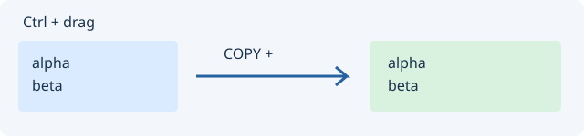
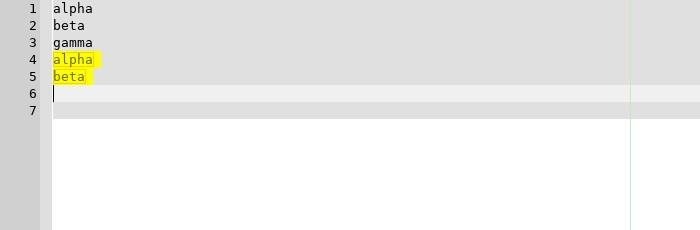

# Редактор

Основной текстовый буфер и вкладки открытых файлов.

## Управление

Ctrl+F открывает поиск, Ctrl+H — замену. Двойной щелчок по номеру строки переключает закладку. Правой кнопкой можно назначить язык файла. Полоса обзора показывает расположение кода и отметки.

## Копирование выделения мышью

Выделите любой фрагмент: слово, одну букву, пробелы, часть строки или несколько строк. Нажмите левую кнопку внутри выделения, перетащите его к нужному месту и отпустите. **Если в момент отпускания кнопки мыши нажат Ctrl, вставляется копия; иначе выделение перемещается.** Ctrl можно нажать только в конце жеста или отпустить перед завершением. Текст вставляется точно в выбранную позицию, без автоматического добавления новой строки. Для копирования целых строк включите их переводы строк в выделение.

Без Ctrl перетаскивание перемещает выделение. Ctrl можно нажать или отпустить во время перетаскивания; Esc отменяет операцию. Копирование отменяется одним Undo. Для перемещения используются отдельные шаги Undo для вставки и удаления. Режим «только чтение» запрещает вставку.

Начинайте жест внутри текста, а не на номере строки. Ctrl+щелчок вне выделения по-прежнему переходит к определению. Если в настройках редактора отключено перетаскивание текста, включите его.

Реальный редактор после копирования блока из двух строк; вставленная копия выделена:

## Короткий урок

Откройте файл, найдите имя через Ctrl+F, поставьте закладку и выберите символ в панели текущего файла.

Кнопка «?» справа вверху открывает эту страницу. Язык справки следует настройке интерфейса в Options.

Подробнее: [tutorials.md](tutorials.md).

Операции с функциями и точное дублирование выделения: [структурное редактирование](structural-selection.md).
