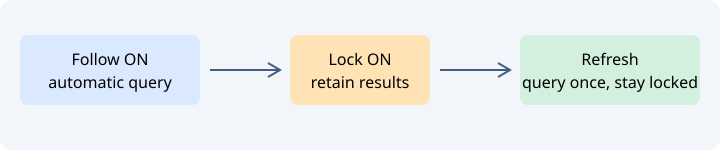

# Связи символов

Определения, ссылки и связи вокруг выбранного символа.

## Управление

Режим выбирает определения, члены, базовые и производные типы, ссылки, вызовы или места вызова. Доступны фильтр и представление графом. Возврат восстанавливает предыдущий запрос. Результаты основаны на Ctags и лексическом анализе, а не на полном семантическом анализаторе.

## Короткий урок

Поставьте курсор в функцию. Выберите «Вызовы». Просмотрите результат, перейдите к вызываемой функции и вернитесь назад.

Кнопка «?» справа вверху открывает эту страницу. Язык справки следует настройке интерфейса в Options.

Подробнее: [relations-calls.md](relations-calls.md).

Начните фильтр списка с `~` для нечёткого поиска по Unicode-подпоследовательности без учёта регистра: `~srd` находит `Shared`. Обычный запрос ищет буквальную подстроку, включая пробелы и знаки. Один `~` ничего не находит.

## Области поиска ссылок

В режиме **Ссылки** доступны **весь текст**, **пропускать комментарии** и
**только комментарии**. Пропуск комментариев сохраняет строковые литералы:
`target` находится в `"target"`, но не в `// target`. Поиск только в комментариях
исключает строки. **References: code only** исключает и комментарии, и строки;
включение этого флажка сбрасывает список, а выбор фильтра комментариев снимает
флажок «только код».

Это лексические фильтры C/C++, JavaScript, Python, Lua и Shell. Тройные строки и
docstring Python остаются строками. В фильтрованных режимах неподдерживаемые
языки пропускаются; для них выберите «весь текст». Фильтры не вычисляют условия
препроцессора и не различают посторонние символы с тем же именем. Они действуют
для ссылок, а не текстового поиска проекта или замены. Места вызова по-прежнему
ищутся только в коде. Возврат восстанавливает фильтр ссылок; настройка сохраняется
между запусками. Выбор результата показывает исходный текст в Context с точной
позицией совпадения.

[Relation outline snapshots and bookmark batches / Текстовое дерево и пакет закладок](relation-results.md).

Команда **Следующее представление окна связей** в меню навигации и кнопка рядом с параметрами Relations переключают список/дерево → горизонтальный граф → вертикальный граф → список/дерево. Масштаб, фильтр, запрос и загруженные ветви сохраняются; новый поиск не запускается. Тип дерева выбирается отдельно флажком раскрываемого дерева.

## Блокировка и ручное обновление

В меню навигации доступны **Заблокировать окно связей**, **Обновить окно связей**, **Связи: список / дерево**, **Горизонтальный граф связей** и **Вертикальный граф связей**. Блокировка — обратное состояние флажка слежения; оба контрола синхронизированы. Снятие слежения останавливает текущий автоматический поиск без очистки результатов и без нового запроса. Уже загруженное дерево остаётся доступно для ручного раскрытия.

Ручное обновление повторяет текущий запрос панели и восстанавливает скрытые узлы, сохраняя блокировку, фильтр и выбранную вкладку нижней полки. В режиме поиска текста команда отказывается выполнять поиск: используйте команды поиска проекта. Прямой выбор вида сохраняет масштаб и не запускает поиск.

[Поиск и копирование текущего списка](list-tools.md): контекстное меню, F4/Shift+F4, видимые колонки и загруженные строки.

[Печать списка и структуры Relations](list-printing.md): Print List, Print Relation Window и Print outline, переносы и нумерация страниц.
