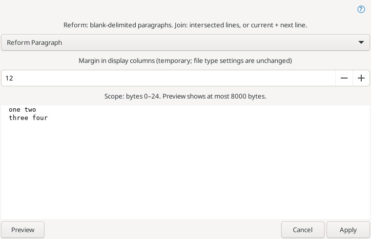

# Абзацы и строки

**Правка → Абзацы и строки** добавляет команды в стиле Source Insight. Они доступны вместе с существующими командами Geany для блоков отступов.

- **Переформатировать абзац** обрабатывает абзац под курсором либо все абзацы, затронутые выделением. Границы — пустые строки, содержащие только ASCII-пробелы/табуляцию; они сохраняются побайтно. Точный отступ первой строки повторяется на новых строках. Пробелы, табуляция и переносы внутри абзаца становятся разделителями слов. Длинные слова не разрезаются.
- Ширина берётся из включённого профиля **Параметры типа файла**, иначе из настроек переноса/длинной строки редактора, даже при скрытой направляющей. Подсчёт колонок учитывает табуляцию, широкие символы Unicode и комбинируемые знаки; это приближённые колонки, а не полная обработка графем и двунаправленного текста.
- **Объединить строки** без выделения соединяет текущую физическую строку со следующей. С выделением — все пересекаемые строки. Конец выделения в начале следующей строки не включает её. На границах удаляются отступы и хвостовые пробелы, добавляется один пробел. Пробелы и табуляция внутри строк, отступ первой строки и хвост последней строки сохраняются. Пустые строки внутри диапазона схлопываются. Конечный перевод строки без следующей физической строки сохраняется.
- **Предпросмотр абзацев…** позволяет выбрать действие и временную ширину, затем нажать «Просмотр» и «Применить». Начальная ширина совпадает с шириной прямой команды. Изменение параметров очищает просмотр. Показываются первые 8000 байт результата; применение пересчитывает полный диапазон. Настройки типа файла не меняются.

Операция создаёт одно действие отмены и выделяет результат, сохраняя обратное направление выделения. Если изменений нет, история отмены не пополняется. Разделители абзацев и окончание последней строки сохраняются; новые переносы используют первое окончание строки абзаца, а при его отсутствии — режим редактора.

Поддерживается одно обычное выделение. Режим чтения, прямоугольные/множественные выделения и виртуальные пробелы исключены. Ограничения: 8 МиБ на вход/выход, 500000 физических строк и пустая позиция EOF. Изменение текста/выделения, переключение вкладки или закрытие документа при открытом диалоге отменяет применение. Команды работают с обычным текстом, без специальной обработки кода, строк, комментариев и их префиксов.

Источник: [Reform Paragraph](https://www.sourceinsight.com/doc/v4/userguide/Manual/Command_Reference/Reform_Paragraph.htm), [Join Lines](https://www.sourceinsight.com/doc/v4/userguide/Manual/Command_Reference/Join_Lines.htm).

[Line insertion / Вставка строк](line-insertion.md) — above, below, split and stay, marked preview.
