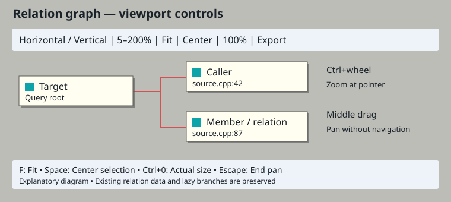
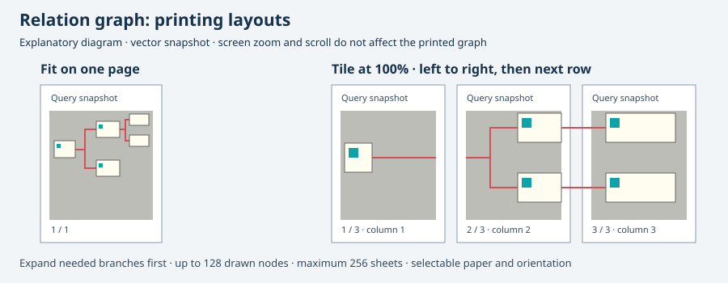

# Вызовы и отслеживание функции

Откройте Вид → Панели → Окно связей или синюю кнопку связанных узлов на панели.

- **Вызовы (текущая функция, лексические):** введите имя распознанной функции активного файла и начните поиск. Показаны выражения «идентификатор + скобка» в её теле. Один клик показывает место вызова в Контексте; двойной открывает редактор.
- **Места вызова (проект, лексические):** ищет идентификатор с последующей `(` в поддерживаемых исходниках. Можно ограничить текущим буфером; открытые несохранённые буферы читаются существующей системой поиска.
- **Следить за символом в редакторе + Следить за текущей функцией:** выбирает наименьшую окружающую полную функцию с телом в фигурных скобках, включая курсор на пробелах. Отключение отслеживания функции возвращает отслеживание идентификатора. Параметр и режим связей сохраняются.

Это лексические маски, а не семантический граф вызовов. Управляющие ключевые слова, комментарии и строки исключаются; макросы включены. Шаблоны, вызовы операторов и косвенные указатели на функции распознаются неполно. Вложенные объявления и прототипы могут выглядеть как места вызова. Перегрузки не разрешаются: для одинаковых имён в текущем файле поместите курсор в нужное тело. До 512 результатов и 2 МиБ буфера. Поддерживаются языки с фигурными скобками, Python с отступами и Lua с end; это лексические границы функций. Проектные места вызова сохраняют ограничения поиска и действие кнопки остановки.

Иконки — собственные рисунки Cairo с синими акцентами и цветами темы, без внешнего загрузчика изображений. У внутреннего сведения также есть кнопка панели.

Фильтр результатов сравнивает символ, путь и текст с учётом Unicode-регистра без повторного поиска проекта. Столбцы сортируются. Кнопки определений и мест вызова запрашивают выбранный результат, выключают отслеживание редактора и очищают фильтр. Определения показывают всех кандидатов, не угадывая перегрузку. Один клик даёт предпросмотр; двойной открывает место.

Стрелка назад восстанавливает запрос, режим, фильтр и параметры буфера/кода. До 32 шагов истории за сеанс; отслеживание редактора при просмотре истории выключено.

## Граф

Включите граф в окне связей. Он показывает текущие отфильтрованные/отсортированные результаты на одном уровне под запросом. Горизонтально/Вертикально меняют компоновку; масштаб — 5–200%. Рисуются первые 128 видимых результатов; нижняя строка показывает полное число, таблица содержит остальные. Выбор вида, компоновка и масштаб сохраняются.

Клик по узлу показывает Контекст; двойной клик или Enter открывает редактор. Стрелки, Home/End выбирают и прокручивают узлы. Определения, места вызова, назад и фильтр используют одно выделение в обоих видах. Узлы показывают символ и файл:строку; рамки и связи рисуются Cairo с цветами GTK-темы.

Это граф результатов поиска, не рекурсивное семантическое дерево вызовов. Связь означает текущий запрос, а не доказанный переход исполнения. Действуют ограничения лексического индекса и тегов.

**Скопировать изображение** или Ctrl+C с фокусом графа копирует весь текущий рисунок. **Сохранить PNG…** экспортирует снимок до открытия диалога, с тем же масштабом, выделением и порядком. Unicode-пути обслуживает GLib; перезапись подтверждается. Изображения больше 16384 пикселей по оси или 32 миллионов пикселей отклоняются до выделения памяти — уменьшите масштаб/отфильтруйте результаты. Экспорт включает первые 128 рисуемых результатов.

Правый клик по узлу открывает действия: редактор, определения, места вызова, использования, прямые члены, базовые/производные типы. При фокусе графа D/C/R выполняют запросы определений/мест вызова/использований; Ctrl+C копирует рисунок. Menu или Shift+F10 открывает меню узла. Действия используют историю и выключают отслеживание редактора: заменяют запрос результатами узла, не дорисовывают рекурсивные ветви.

## Типы и aliases с учётом scope

Цепочки `typedef`/`using` разрешаются в пространстве имён и файле объявления alias. Например, если `N::Alias` ссылается на `N::Base`, а `N::Child` наследует Alias, «Базовые типы» для Child показывает Base, «Производные типы» для Alias показывает Child, «Члены» для Alias — члены Base. Это работает и при выключенных косвенных связях: тогда показываются только прямые члены или одно ребро наследования. В дереве/графе Members раскрываются также вложенные aliases, union, enum и namespace.

Языковая совместимость проверяется до разрешения цепочки. Неоднозначности и циклы останавливаются; предел — 32 aliases. Убираются номинальные параметры шаблонов и квалификаторы, но подстановка шаблонов, перегрузки, include/ODR и произвольные выражения пока не разрешаются.

## Полотно графа и навигация

Светлые карточки с тенью, бирюзовые значки и красные соединения приближены к представленному образцу Source Insight. Это самостоятельная Cairo-отрисовка; схема выше поясняет интерфейс и не является снимком приложения.

- **Fit graph / F** вписывает текущий нарисованный граф в окно в пределах масштаба 5–200%. При минимальных 5% очень большой граф может по-прежнему требовать прокрутки.
- **Center selected node / Пробел** показывает выбранный узел по центру, насколько позволяют края полотна. Без видимого выбранного узла показывает корень.
- **Actual size / Ctrl+0** возвращает 100%. Ctrl+плюс/минус масштабирует относительно центра окна.
- **Ctrl+колесо** меняет масштаб относительно точки под курсором. Обычное колесо остаётся штатной прокруткой GTK.
- **Средняя кнопка + движение** перемещает полотно, не выбирая и не открывая узлы. Отпускание кнопки, Escape, скрытие панели и уничтожение виджета освобождают захват.
- Выбор видимой строки в таблице прокручивает граф к соответствующему узлу. Наведение на узел показывает полное имя и путь со строкой; сокращённые подписи карточек не скрывают исходный адрес.

Существующие режимы горизонтали/вертикали, раскрытие ветвей, фильтры и сортировка используют прежние данные. Точный процент масштаба сохраняется, в том числе выбранный Fit; автоматическое повторное вписывание при изменении окна не включается. Clipboard и PNG используют ту же палитру и геометрию, включая масштаб 5%, с прежними пределами 16384 пикселя и 32 млн пикселей на изображение. На графе по-прежнему не более 128 видимых исходных узлов. Новые жесты не добавляют семантическое разрешение вызовов или новые ветви отношений.

## Печать графа связей

Кнопка принтера, пункт **Печать графа…** в контекстном меню узла и **Ctrl+P** при фокусе на полотне открывают системный диалог печати. В нём доступны параметры бумаги/ориентации и вкладка **Размещение графа**:

- **Вписать граф в одну страницу** — весь видимый граф на одном листе с уменьшением при необходимости. Маленький граф не увеличивается.
- **Разбить на листы в масштабе 100%** — 96 логических пикселей графа на дюйм, листы идут по строкам слева направо. Нижний колонтитул содержит номер/число страниц, столбец и строку листа, количество показанных и найденных результатов. При сборке совмещайте печатные области листов.

Заголовок берётся из текущего запроса. Перед открытием диалога создаётся неизменяемый векторный снимок: обновление индекса, смена выделения или закрытие панели не меняют печать. Экранные масштаб и прокрутка не влияют на результат. В PDF, полученном через системную печать, сохраняется поиск по тексту.

Печатаются только отображаемые узлы (до 128); свёрнутые ветви и отфильтрованные результаты исключены. Сначала раскройте нужные ветви. Максимум — 256 листов: если выбранные бумага/поля превышают лимит или не оставляют места графу, печать отменяется с пояснением в строке состояния. Выберите вписывание в страницу либо увеличьте печатную область. Отмена диалога не меняет исходник и параметры графа.

Возможность соответствует описанной в [документации Source Insight](https://www.sourceinsight.com/doc/v4/userguide/Manual/Concepts/Outline_and_Graph_Views.htm) печати графов. Проверка Linux создаёт PDF средствами GTK без физического принтера; драйверы физических принтеров и другие платформы не проверялись.
