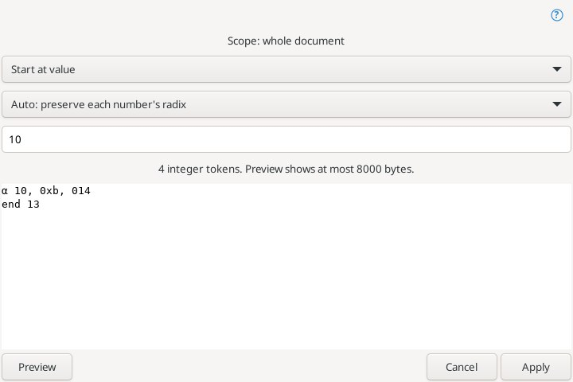
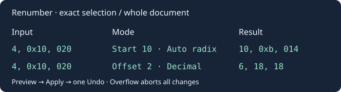

# Перенумерация

Правка → Вставка и буфер обмена → **Перенумерация…** обрабатывает точное выделение, а без выделения — весь документ. «Просмотр» не меняет текст. «Применить» создаёт одно действие отмены и выделяет результат.

- Автоматический режим увеличивает числа, начиная с первого найденного. Режим «Начать со значения» использует введённое число. «Смещение» прибавляет значение к каждому числу.
- Вывод: исходная система каждого числа, десятичная, шестнадцатеричная (`0x`), восьмеричная (начальный ноль). Ввод: десятичное число, `0x` или начальный ноль для восьмеричного. Поддерживается знак.
- Обрабатываются самостоятельные целые числа. Идентификаторы, дроби, экспоненциальная запись, суффиксы и некорректные восьмеричные/шестнадцатеричные записи сохраняются. Числа в строках и комментариях тоже обрабатываются. Выделение считается отдельным текстом: выделяйте числа целиком.
- Диапазон — знаковые 64-битные целые. Переполнение отменяет всю операцию. Вход и результат ограничены 8 МиБ; просмотр показывает первые 8000 байт. Начальные нули, явный плюс и регистр шестнадцатеричных цифр нормализуются. Пробелы, Unicode и окончания строк сохраняются.
- Только одно обычное выделение; прямоугольные и множественные выделения, виртуальные пробелы и режим чтения исключены. Изменение текста, выделения, переключение вкладки или закрытие документа во время диалога отменяет применение.

[Описание Renumber в Source Insight](https://www.sourceinsight.com/doc/v4/userguide/Manual/Command_Reference/Renumber.htm). Перенумерация прямоугольного выделения пока не реализована.
