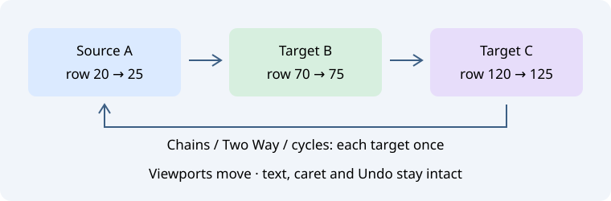

# Связанная прокрутка окон исходников

**Окно → Link Source Windows…** открывает немодальный менеджер связей. Выберите другой открытый буфер и нажмите **Apply Link**. Источник указан над списком; **Refresh** явно выбирает текущий редактор и обновляет список целей. **None — unlink this source** удаляет исходящую связь выбранного источника.

| Параметр или команда | Действие |
| --- | --- |
| Two Way | Добавить обратное направление для пары |
| Link All Source Windows | Связать все открытые исходные буферы, включая открываемые позже |
| Vertical scrolling | Применять такое же изменение числа видимых экранных строк |
| Horizontal scrolling | Применять такое же изменение горизонтального смещения в пикселях |
| Unlink All | Удалить отдельные связи и выключить связь всех окон |

По умолчанию включена вертикальная ось, горизонтальная выключена. Оси общие для всех связей и действуют сразу; изменение пары требует Apply Link. Включение связи и смена осей запоминают текущие позиции без скачка. Каждая цель сохраняет своё относительное смещение и ограничивается штатными границами прокрутки. В односторонней паре прокрутка цели не двигает источник. Поддерживаются цепочки и циклы; каждый достижимый буфер обновляется не более одного раза за событие. Отложенные уведомления Scintilla поглощаются кэшем видимых позиций и не запускают обратную волну.

## Область действия и время жизни

В менеджере показаны отдельные пары и направления. У источника может быть одна явно заданная исходящая пара; Two Way добавляет обратный путь. Обратные связи от других источников остаются независимыми. Включённый Link All временно заменяет маршрутизацию по отдельным парам; при выключении пары сохраняются. Флажки в меню и диалоге синхронизированы. В настройках клавиш Editor есть три изначально неназначенные команды: связать источник, связать все и удалить все связи.

Используется основной вид Scintilla каждого открытого исходного буфера Geany, включая неактивные вкладки и безымянные буферы. Новые MDI-окна не создаются, скрытые вкладки не показываются. Context, терминалы, diff/merge, история Git и предпросмотры ИИ не затрагиваются. Экранные строки зависят от сворачивания и переноса каждого буфера; это относительная прокрутка, а не выравнивание одинаковых строк диффа. Прокрутка из-за навигации и штатных изменений вида обрабатывается так же. Текст, выделение, курсор, Undo/Redo, флаги чтения и буфер обмена целей не меняются. Во время прокрутки нет чтения файлов и запросов или перестройки индекса проекта.

Связи и оси хранятся только в памяти текущего запуска. Закрытие менеджера не отключает связи. При закрытии источника или цели соответствующие пары удаляются; устаревшие концы пары нельзя применить молча. Refresh явно выбирает текущий редактор. Новый участник Link All принимает начальную позицию без немедленного скачка остальных. Допускаются 64 отдельные пары и 128 буферов для Link All; при превышении числа буферов Link All отключается с сообщением, сохраняя отдельные пары. Файлы проекта и исходников не записываются.

Эталон: [Source Insight Link Window](https://www.sourceinsight.com/doc/v4/userguide/Manual/Command_Reference/Link_Window.htm) и [Link All Windows](https://www.sourceinsight.com/doc/v4/userguide/Manual/Command_Reference/Link_All_Windows.htm).
