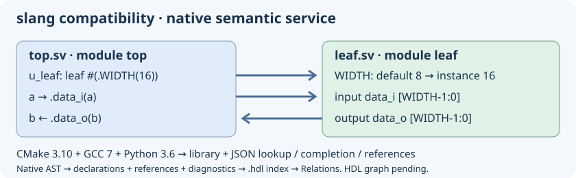

# SystemVerilog slang: адаптация к старым инструментам



В `external/slang` закреплён upstream **slang 3.0** (`7efcca2e348ecf1e01d1859f7ea85d6202fc9f91`) — последний основной выпуск до перехода на C++20. Это явно выделенный вариант совместимости, не современный slang 12.x и не законченная интеграция в редактор. Редактор пока использует существующие Ctags и лексическую подсветку Verilog/SystemVerilog.

## Сборка без обновления системных инструментов

Целевые инструменты Ubuntu 18.04: CMake **3.10.2**, GCC/G++ **7.5**, Python **3.6**, Make. Для первой сетевой подготовки нужны Git и сертификаты CA. Общий драйвер `build.sh` автоматически собирает slang для Meson и Autotools независимо от выбора Clang. Явное отключение: `--slang-provider disabled`.

```bash
python3 insight/tools/build_external_slang.py --jobs 2 --check
```

Скрипт инициализирует только подмодуль slang, загружает три зависимости по точным коммитам, применяет `external/slang-compat/cmake310-gcc7.patch`, собирает статическую библиотеку и консольную утилиту slang, затем запускает **проверку прямого C++ API**. В двух отдельных SystemVerilog-файлах объявляется модуль и создаётся его экземпляр с `WIDTH=16`; проверка находит межфайловый экземпляр, переопределённый параметр и оба порта. Это проверка elaboration и API, а не готовое автодополнение или поиск ссылок в редакторе.

Исходники доступны для изменения в `external/slang` и `external/slang-deps`. Существующие рабочие копии не сбрасываются; при неверной ревизии или конфликте патча подготовка останавливается. Повторный запуск распознаёт уже применённый патч. `--prepare-only` загружает/готовит без CMake; `--build PATH` и `--deps PATH` задают отдельные каталоги. `_external-slang/source-manifest.json` записывает ревизии исходников/зависимостей и версию CMake.

## Что адаптируется

- В варианте совместимости убраны зависимости от FetchContent, нового поиска Python и новых правил CMake для установки и относительных путей исходников.
- fmt 9.1.0, unordered_dense 2.0.0 и ghc::filesystem 1.5.14 закреплены по коммитам; CMake ничего не скачивает.
- В адаптированных публичных заголовках и реализации используется ghc::filesystem вместо отсутствующего в GCC 7 `std::filesystem`. Потребители должны использовать эти же заголовки и зависимости; ABI непатченного системного slang не взаимозаменяем.
- Вызовы целочисленного `std::from_chars`, отсутствующего в GCC 7, заменены совместимым разбором. Тестируются границы знаковых/беззнаковых чисел, переполнение и неверный ввод.
- Для старой стандартной библиотеки явно указаны типы контейнеров вместо недоступных deduction guides C++17.
- Сохраняются C++17 и исходный код парсера и семантического анализа. Из эксперимента исключены Python bindings, slang-tidy, полный upstream-набор тестов и цели установки/экспорта. Пример проверяет интеграцию, а не соответствие всему стандарту языка.

Workflow `insight-slang-compat.yml` проверяет настоящие инструменты Ubuntu 18.04 в контейнере. Checkout выполняется на хосте, чтобы не требовать современный Node.js в старом контейнере. Windows/UCRT64 CI также собирает движок, устанавливает SDK на диск D и компилирует/запускает отдельную C++ программу из установленного SDK по пути с пробелами. macOS не проверена.

## Что дают новые версии

В upstream [4.0](https://github.com/MikePopoloski/slang/releases/tag/v4.0) появились checkers, net aliases и параллельный разбор; в [6.0](https://github.com/MikePopoloski/slang/releases/tag/v6.0) — configurations; [7.0](https://github.com/MikePopoloski/slang/releases/tag/v7.0) завершил поддержку изменений IEEE 1800-2023; [9.0](https://github.com/MikePopoloski/slang/releases/tag/v9.0) добавил анализ потоков данных и существенно улучшенное кэширование экземпляров. Поздние версии улучшают диагностику, API анализа и корректность. В [12.1](https://github.com/MikePopoloski/slang/releases/tag/v12.1) исправлено много крайних случаев вычисления констант, разрешения имён и кэширования экземпляров. В адаптированную 3.0 эти изменения автоматически не переносятся.

Текущий upstream [требует](https://sv-lang.com/building.html) C++20 и CMake 3.28+. Вариант 3.0 — первая проверка возможности поддержки старых инструментов, а не решение навсегда оставить старый HDL-движок. Перенос нового движка C++20 на GCC 7 требует отдельной проверки осуществимости; одного снижения `cmake_minimum_required` недостаточно.

## Автосборка и установка SDK

`./build.sh --slang-only --install --prefix "$PWD/hdl-tools"` собирает и устанавливает только slang без зависимостей GTK/Clang. Обычный `--install` редактора тоже устанавливает движок. Утилита находится в `libexec/geany-insight/slang`; статический SDK — в `lib/geany-insight/slang`: исходные/сгенерированные заголовки, заголовки зависимостей, `libsvlang.a`, `libfmt.a`, pkg-config и лицензии. CI компилирует C++ проверку elaboration уже с установленным SDK. При наличии предпочитается Ninja; существующие каталоги сохраняют свой генератор.

## Семантический сервис для HDL

Сборка также создаёт `insight-slang-semantic` (`.exe` в Windows). Установка автоматически помещает его рядом с консольным slang в `libexec/geany-insight/slang`. Сервис обращается непосредственно к C++ AST встроенного slang, без LSP и системного парсера.

```bash
_external-slang/insight-slang-semantic --lookup top.u_leaf.data_i -- leaf.sv top.sv
_external-slang/insight-slang-semantic --complete top.u_leaf data_ -- leaf.sv top.sv
_external-slang/insight-slang-semantic --references -- leaf.sv top.sv
_external-slang/insight-slang-semantic --symbols -- leaf.sv top.sv
```

Один запрос читает явно переданные файлы и элаборирует их вместе. Возвращается один JSON-объект: `protocol: 1`, `diagnostics_count` и массив `records`. Позиции содержат абсолютный путь, строку и столбец (с единицы). Поиск принимает полное иерархическое имя; дополнение — область и регистрозависимый префикс. Пары «порт / внутренняя переменная» в дополнении не дублируются. Ссылки включают переходы от экземпляров к определениям модулей, обращения к значениям и вызовы пользовательских функций, в том числе в другом файле пакета. Системные функции не получают выдуманных исходных объявлений.

Ненулевой `diagnostics_count` означает, что результат требует проверки: наличие JSON не доказывает корректность проекта. Отсутствующий символ даёт пустой массив; ошибка чтения/аргументов — ненулевой код возврата, пояснение в stderr и пустой stdout. Ответ ограничен 100000 записями; превышение завершается ошибкой без частичного JSON. Исходники не изменяются. Список файлов может представлять временный набор без сохранённого проекта.

Это слой для следующего подключения к редактору: **дополнение, переход к определению и сохраняемый индекс ссылок HDL подключены; автоматическое обновление этого индекса и граф HDL ещё не подключены**. Каждый запуск разбирает набор заново; постоянный AST-кэш, параметры include/define/top и полный перечень видов ссылок ещё не подключены. Процесс можно отменить извне без обращения к GTK. Подсветка редактора пока лексическая.

Автопроверка `slang_semantic_protocol` запускает настоящий сервис и проверяет переходы между файлами, вызов функции пакета, дополнение без дублей, точные позиции, ошибочные исходники и пути с пробелами.

## Дополнение в редакторе

При включённых подробном и семантическом дополнении (настройки дополнения) ввод `u_leaf.data_` в модуле предлагает члены экземпляра `u_leaf`. В списке происхождение помечено `slang`. Команда обычного принудительного дополнения также запускает запрос. Нужна установленная копия `insight-slang-semantic` из текущей сборки; при её отсутствии работает обычный механизм тегов. Для разработки путь можно задать переменной `GEANY_INSIGHT_SLANG_SERVICE`.

В запрос входят файлы текущего проекта и открытые HDL-файлы. Без проекта открытые именованные файлы образуют временный набор. Несохранённый текст передаётся снимками через временный каталог, который удаляется после запроса; исходники и файл проекта не записываются. Чтение, запись снимков, запуск и ожидание slang выполняются в рабочем потоке. При новом вводе запрос отменяется вместе с процессом; перед показом проверяется, что открытые буферы, позиция и проект не изменились.

Поддержаны простые иерархии через точку и квалификаторы пакета `::`. Текущий модуль определяется по файлу и строке. Если он элаборирован несколько раз, неявная область не выбирается наугад; можно указать полную иерархию. Индексированные/динамические получатели, точная локальная область процедур, аргументы функций, include/define/top-настройки и постоянный кэш пока не реализованы. Ограничения запроса: 256 HDL-файлов, 2 МиБ на буфер, 32 МиБ снимков и переносимый предел длины командной строки; при превышении запрос уступает обычному дополнению. Заголовки, требующие контекста включения, пока не дают полноценной семантики. Каждый запрос заново элаборирует набор, поэтому для больших HDL-проектов нужен следующий этап кэширования.

## Переход к объявлению HDL

Обычная команда «К определению» в навигации и редакторе использует AST slang для Verilog/SystemVerilog. Установите курсор на ссылку на сигнал, вызов функции, тип модуля, имя экземпляра или именованный порт подключения. Переход открывает исходник в точной строке и столбце; «Назад» и «Вперёд» сохраняют исходную и целевую позиции. Для работы команды не требуется включать семантическое дополнение.

Разбор запускается в том же фоновом механизме по текущему проекту и открытым файлам; несохранённые буферы учитываются. При изменении позиции курсора, текста, проекта или состава файлов старый ответ не используется. Перед переходом проверяется содержимое открытого целевого файла. Изменение явно переданных дисковых файлов во время запроса также отбрасывает ответ. При неоднозначности элаборации переход не выполняется, строка состояния сообщает об отсутствии однозначного объявления. Обход по одному лишь совпадению имени не подменяет неудачный запрос slang.

Сервис поддерживает внутренний режим `--editor-definition FILE LINE COLUMN -- FILE...`; строка и столбец с единицы, столбец в байтах UTF-8. Возвращается заголовок `insight-slang-definition-v1` и, при успехе, одна строка: hex-кодировка UTF-8 пути, строка и столбец через табуляцию. Для снимков доступны те же `--overlay ORIGINAL SNAPSHOT` перед разделителем `--`, что и для дополнения. Совпадающие физические объявления нескольких экземпляров разрешены; разные назначения в одном исходном диапазоне дают пустой результат.

Поддержаны связанные AST-выражения значений, членов, пользовательских вызовов и ссылки на модуль/именованные порты. Это не полный перечень всех синтаксических ссылок SystemVerilog: типы, макросы и некоторые конструкции препроцессора ещё требуют отдельного покрытия. Постоянный AST-кэш, граф HDL и автоматическое обновление семантического индекса остаются следующим этапом.

## Кэш одинаковых запросов

Фоновый адаптер хранит до восьми недавних ответов дополнения/перехода, суммарно до 4 МиБ. Повторный запрос для тех же файлов, снимков и позиции получает ответ без нового запуска slang. Ключ SHA-256 учитывает порядок и полное содержимое исходников, несохранённые буферы, параметры запроса, рабочий каталог и версию исполняемого сервиса. Изменение содержимого файла, даже без изменения размера, создаёт новый ключ. Перед сохранением ответа содержимое проверяется повторно.

Кэш находится в памяти процесса и защищён между рабочими потоками. Чтение файлов и вычисление ключей происходят в рабочих потоках; GTK не ждёт эти операции. **Наборы с обратной кавычкой (директивами/макросами препроцессора) обходят кэш**, чтобы изменение заголовка или пути поиска не оставило устаревших подсказок. Лишний обход для обратной кавычки внутри комментария/строки допустим. Это кэш готовых ответов, а не постоянная база AST; для изменённого текста и include-проектов разбор пока запускается заново.

## Сохраняемый индекс и панель «Связи»

В «Навигация» и контекстном меню редактора выберите **«Ссылки HDL (slang)…»** либо в панели «Связи» — **«Ссылки (slang HDL, по имени)»**. Запрос совместно разбирает HDL-файлы проекта и открытые именованные HDL-файлы. В списке показываются места ссылок и их назначения (`вид → файл:строка:столбец`). Щелчок открывает место ссылки; команда «К определению» открывает связанное объявление. Поиск фильтрует имя, поэтому одноимённые символы могут дать несколько строк с разными назначениями; это не выбор одного символа по его идентичности.

Из AST извлекаются объявления и ссылки значений, членов, пользовательских функций, экземпляров, типов модулей и именованных портов. Они сохраняются атомарно в отдельной части индекса проекта: файл **`.hdl` рядом с основной БД проекта**. Это сохраняемые семантические факты, не сериализованный AST. Строка состояния показывает число объявлений/ссылок, число диагностик и состояние «сохранён», «восстановлен» либо «только в памяти».

Индекс строится **по запросу связей**, не при каждом открытии файла и не отдельно для каждого файла проекта. Для наборов без препроцессора повторный запрос или запуск редактора восстанавливает его после проверки полного содержимого исходников, состава/порядка файлов и исполняемого движка. Изменение файла вызывает совместный пересчёт при следующем запросе. Для наборов с директивами/макросами индекс также сохраняется, но пока пересчитывается при запросе: учёт транзитивных include-зависимостей для повторного использования ещё не завершён. Индексы с диагностикой тоже восстанавливаются для неизменённого набора без препроцессора, сохраняя сообщения и ненулевой счётчик диагностик. Устаревшие результаты отбрасываются при изменении снимков/состава проекта.

Без проекта используется только память: файл индекса не создаётся. Ctags-символы по-прежнему сохраняются и обновляются существующим механизмом БД проекта. Общий запрос ограничен 256 файлами, 32 МиБ снимков и 100000 записями; ответ проектного индекса ограничен 64 МиБ (дополнение/переход — 4 МиБ). Список показывает первые 2000 ссылок. Полный интерактивный HDL-граф ещё не подключён. Подробные сообщения и подсказки движка теперь доступны в режиме диагностики; автоматическое внесение исправлений не реализовано.

Снимки открытых файлов регистрируются в slang до разбора любых единиц компиляции: `include` получает несохранённое содержимое выбранного заголовка. При наличии основных `.v/.sv` заголовки `.vh/.svh` не разбираются повторно как отдельные единицы; они читаются через включения. Это не заменяет ещё не подключённые настройки include-путей и define.

## Диагностика и помощь с опечатками

Откройте **«Навигация → Диагностика HDL (slang)…»**, одноимённый пункт контекстного меню или режим **«Диагностика (slang HDL)»** в панели «Связи». Команда проверяет весь текущий HDL-набор и работает даже на пустой строке, без имени под курсором. Подробное дополнение включать не требуется.

Таблица показывает уровень (ошибка, предупреждение, примечание), файл, строку, столбец в байтах UTF-8, текст и стабильный код сообщения. Двойной щелчок открывает строку исходника через окно контекста и общую историю позиций. Сообщения уровня проекта без адреса помечаются отдельно и не выполняют переход. Общий фильтр результатов позволяет искать по тексту сообщений. Отображаются первые 2000 строк; число исходных диагностик и число показанных сообщений могут различаться из-за примечаний и фильтрации движка.

Для некоторых неизвестных имён slang формирует `did you mean ...?` с подходящим видимым объявлением. Например, `target_signl` может получить предложение `target_signal`. Это проверяемое предложение компилятора, а не гарантия правильности алгоритма. Редактор показывает его текст; изменения автоматически не применяются и не записываются. Не для каждой синтаксической/логической ошибки есть такое предложение.

Диагностика учитывает несохранённые выбранные исходники и заголовки. Сообщения входят в сохраняемый семантический индекс (`@hdldiag`), и повторно используются для неизменённого набора без препроцессора вместе с ненулевым счётчиком диагностик. Формат обмена проектного индекса обновлён до `insight-slang-index-v2`; старый сохранённый семантический индекс перестраивается. Исходные тексты сообщений идут от slang на английском, подписи интерфейса переключаются EN/RU. Системный Clang для этой проверки не используется.

## Семантическая подсветка

Откройте вкладку Verilog или SystemVerilog. Если помощник slang установлен, редактор после фонового анализа автоматически выделит распознанные имена модулей, экземпляров, портов, подпрограмм, параметров и сигналов в исходной вкладке. Ключевые слова, комментарии и строки по-прежнему раскрашивает лексер. Используются данные того же индекса, включая восстановленный с диска. Цвета наносятся возле видимых строк, а прокрутка открывает подсветку дальше без повторного разбора. Slang и подготовка диапазонов работают в отдельном потоке; редактор копирует открытые буферы и наносит цвета короткими порциями. При изменении HDL-исходника старые цвета сбрасываются, а после короткой паузы запускается новый анализ. Фоновая подсветка не открывает панель «Связи» и не заменяет её результаты. Диагностику и поиск ссылок по-прежнему можно вызвать отдельно.

## Настройки HDL из Vivado

Откройте проект Vivado и выполните команды в Tcl Console:

```tcl
source C:/my/geany-insight/insight/tools/export-vivado-settings.tcl
geany_export_hdl_settings C:/my/vivado-hdl.tsv
```

Запустите Geany Insight с переменной `GEANY_INSIGHT_VIVADO_CONFIG`, содержащей полный путь к `vivado-hdl.tsv`. Пример для командной строки Windows:

```cmd
set "GEANY_INSIGHT_VIVADO_CONFIG=C:\my\vivado-hdl.tsv"
C:\gi\editor\bin\geany.exe -i
```

Экспорт берёт пути include, макросы и верхний модуль из текущего набора исходников Vivado. Состав HDL-файлов отдельно задаётся в проекте Geany Insight. С этой конфигурацией анализ выполняется заново, чтобы изменения внешних заголовков не оставались в старом индексе. Для другого проекта перезапустите редактор с другим файлом настроек.

## Экспорт проекта Vivado и просмотр VCD

В Tcl Console открытого проекта Vivado загрузите экспортёр и создайте два файла:

```tcl
source C:/my/geany-insight/insight/tools/export-vivado-settings.tcl
geany_export_project C:/my/chip.geany
```

В Geany Insight откройте `chip.geany` через меню «Проект → Открыть». В проект попадут существующие HDL-файлы текущего design fileset. Для семантики запустите редактор с переменной `GEANY_INSIGHT_VIVADO_CONFIG`, указывающей на соседний `chip.hdl.tsv`, как описано выше. Для повторного экспорта выберите другое имя.

Экспортируйте цифровые сигналы из Vivado Simulator в VCD, затем в Geany Insight выберите **Инструменты → VCD Waveforms…**. Выберите сигнал, поставьте курсор щелчком по диаграмме или используйте кнопки перехода между изменениями и масштабирования. В поле исходника подставляется иерархическое имя VCD. Если симулятор добавил внешний уровень, уберите его в этом поле и нажмите **Go to HDL declaration**. slang ищет объявление в проекте и открытых HDL-файлах. Ограничения: 32 МиБ, 4096 сигналов и 250 000 изменений. Закрепляйте сигналы кнопкой **Pin track**: одновременно видны до 16 закреплённых дорожек и текущий сигнал. Курсор и масштаб общие. Кнопки **Earlier** и **Later** сдвигают видимый интервал. Щелчок по дорожке выбирает сигнал для перехода между изменениями и к объявлению.

Поле **Filter signal names…** ищет по части иерархического имени без учёта регистра. Enter выбирает первый результат. При закрытии окна Geany Insight сохраняет дорожки, активный сигнал, курсор и диапазон отдельно для каждого пути VCD. При повторном открытии изменившейся записи пропавшие сигналы пропускаются, а диапазон ограничивается новой длительностью.

Поставьте курсор на нужный момент и нажмите **Set A** или **Set B**. Маркеры видны на всех дорожках, а Δ показывает расстояние между ними в тиках VCD. **Binary** и **Hexadecimal** переключают формат шин. В шестнадцатеричном режиме смешанные группы с `X/Z` показаны в квадратных скобках побитно. Формат и маркеры сохраняются с раскладкой.

## Перенесённые исправления upstream

Отдельный патч `slang-3-backports.patch` сохраняет ширину больших нетипизированных числовых параметров и исправляет падение при диагностике `$static_assert` со скобками. Оба случая проверяются встроенным тестом совместимости.

[slang a93aa7c](https://github.com/MikePopoloski/slang/commit/a93aa7cffb70f257b600356421a96d44eadf8dba) · [slang 44a02d6](https://github.com/MikePopoloski/slang/commit/44a02d64e562d011ada3a1b99f79f4f26f75426c)

Патч `slang-3-streaming-ports.patch` переносит разрешение streaming-конкатенаций в соединениях портов неэлаборированного модуля. [Исправление upstream](https://github.com/MikePopoloski/slang/commit/0f6721311896b03d55441a37c0df9a554f017ba6)
