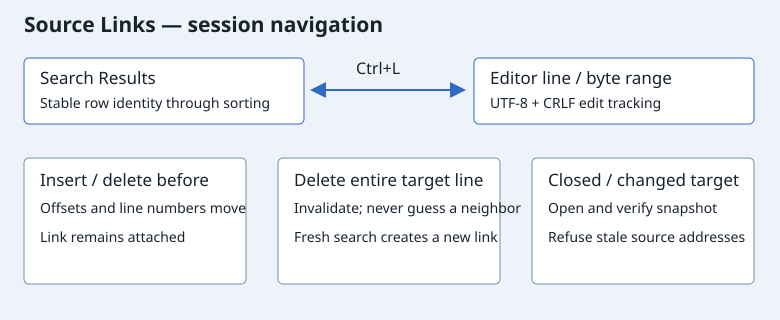

# Source Links: результаты ↔ редактор

Enter, двойной щелчок, кнопка **Jump To Link** или Ctrl+L в Search Results открывают выбранное совпадение. В редакторе **Ctrl+L** на связанной строке возвращает к результату и показывает Search Results. На строке без ссылки сохраняется штатное поведение клавиши. Если на одной строке несколько результатов, обратный переход выбирает последний открытый результат, затем первый доступный.

## Навигация и правки

В меню поиска доступны Jump To Link и переходы к первой, предыдущей, следующей и последней ссылке. Previous/Next в результатах также открывают привязанную строку; эти переходы циклические. Сортировка и удаление строки результата не перепривязывают другие ссылки.

Для уже открытых документов привязки создаются при получении результатов, если снимок ещё совпадает с буфером. Они следуют за вставками и удалениями, включая UTF-8 и CRLF, обновляют строку и столбец. Правки внутри совпадения сохраняют ссылку на строку: выделенный диапазон может уже не соответствовать первоначальному запросу. Текст Source остаётся снимком поиска, поэтому после смысловых изменений полезен повторный поиск.

Удаление всей целевой строки делает ссылку недействительной. Undo восстанавливает текст, но не оживляет удалённую ссылку: повторите поиск. Значок предупреждения показывает такую ссылку; переход не перемещает курсор на соседнюю строку.

Закрытый целевой файл открывается автоматически. После закрытия сохранённого файла привязка сверяется с его снимком. Если файл изменён на диске или несохранённые изменения были отброшены, переход отказывается выбирать старое место. Открытие файла для проверки при этом возможно.

Закрытие Search Results освобождает живые привязки; сами строки результатов сохраняются как проверяемые снимки и могут быть открыты снова. Новый поиск начинает новый набор привязок. Ссылки живут только в текущем сеансе, не записываются в проект и не являются семантическими ссылками компилятора. Компиляторный вывод и произвольные текстовые файлы пока не поддерживаются.

## Проверка

Нативный тест запускает настоящий редактор и проверяет обратный Ctrl+L, UTF-8/CRLF, вставки, undo/redo, сортировку, удаление результата и целевой строки, повторный поиск, открытие сохранённого файла и отказ при изменении файла на диске. Отдельный тест проверяет арифметику смещений и переполнение.
