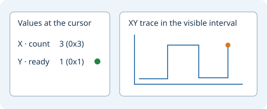

# Отладчик Verilog и SystemVerilog

Откройте сохранённый тестбенч `.v` или `.sv`. В меню
**Инструменты → Verilog / SystemVerilog** выберите
**Отлаживать текущий файл Verilog**. Эта команда также доступна в
контекстном меню редактора в группе инструментов исходного кода.
Сохраните изменения перед запуском.

Если тестбенч и модули лежат в разных файлах, выберите
**Отладить тестбенч Verilog…** и укажите все нужные файлы.
Команда **Запустить тестбенч Verilog…** запускает их без пошаговой отладки.

В окне **Verilog Simulation** выберите строку и добавьте точку останова.
Используйте **Continue**, **Step HDL**, **Step Current Process** и **Next Tick**.
Кнопка **Process Values** показывает значения выбранного процесса или кадра.
Кнопка **Load Lua Observer…** загружает скрипт наблюдателя. Команды и сообщения
симулятора доступны во встроенной консоли.

**Preview Waveform** показывает текущую запись. В окне волн откройте
**Signal Map → HDL Uses… → Connections** для просмотра связей данных,
условий и тактов. **VCD Waveforms…** открывает готовую запись VCD.

## Сигналы портов

При отладке текущего файла откроется окно **Port Signals**. Оставьте
настройки пустыми, если в файле уже есть тестбенч. Для модуля с портами
задайте имя модуля и по одной строке на порт. Пример:

```text
module counter
duration 1000
clock clk 5 5 5
pulse rst_n 0 20 0
bus data 8 40 "step * 3"
output count 8
```

Времена задаются в наносекундах. У `clock` параметры означают старт,
длительность единицы и длительность нуля. Вариант `clock-hz clk 5 100000000`
задаёт такт 100 МГц с равными фазами. У `pulse` параметры означают
старт, длину и активный уровень. `value data 8 "8'h2a"` задаёт постоянное
значение. У `bus` параметры означают ширину, интервал и выражение.
Счётчик `step` начинается с нуля. В выражениях SystemVerilog можно
использовать `$time`. Выражения с пробелами и литералы с апострофом
заключайте в двойные кавычки. `output` записывает порт в VCD.

Настройки сохраняются отдельно для проекта и исходного файла.
Кнопка **Port Signals…** на панели открывает их повторно. Изменения,
сохранённые во время симуляции, применяются при следующем запуске.

## Приборы вывода

В окне VCD, в том числе после **Preview Waveform**, откройте
**Signal Instruments…** и выберите до трёх записанных сигналов.
Однобитный сигнал получает лампочку. Известные значения до 64 бит
показаны в беззнаковом десятичном и шестнадцатеричном виде.
Показания следуют за курсором VCD.



Дорожки VCD показывают сигналы во времени. Выберите X и Y для графика
XY, добавьте Z для фиксированной проекции XYZ. График строится по
переходам на видимом интервале времени. Неизвестные значения прерывают
линию. Для плотного интервала показываются первые 2048 отсчётов.
Приблизьте нужный участок. В сохранённой сессии VCD оси запоминаются.

## Живой ввод, показания и SRAM

Добавьте в настройки портов:

```text
live-interval 10
live-input enable 1 0
monitor ready 1
monitor result 16
sram addr dq ce_n we_n oe_n 10 8
```

В **Live Port I/O** выберите вход, введите двоичное значение (доступны
`x` и `z`) и нажмите **Apply Input**. Во время прогона или после
возобновления с паузы применяется последнее значение к моменту опроса.
Показания выходов обновляются по мере получения отсчётов.
`live-interval` задаёт шаг опроса в наносекундах. На каждом опросе
симулятор делает короткую задержку по реальному времени для взаимодействия.

Строка SRAM связывает адрес, двунаправленные данные и активные нулём
сигналы выбора микросхемы, записи и чтения. Последние два параметра
задают ширины адреса и данных. Модель функциональная и асинхронная,
с неинициализированной памятью и высоким импедансом вне чтения.
Поддерживаются 1–16 бит адреса и 1–64 бита данных.

## Консоль UART

```text
duration 100000
live-interval 250
uart rx tx 1000000 console
```

Строка подключает один асинхронный UART 8N1 к RX и TX модуля.
Скорость задаётся в битах в секунду. Необязательное слово `console`
добавляет кнопку **UART Console…** на панели отладчика. Enter отправляет
байты UTF-8 из поля ввода без автоматического перевода строки. Приём
показывает ASCII и обозначает прочие байты как `\xNN`. Следующую строку
можно отправить после передачи предыдущей.
