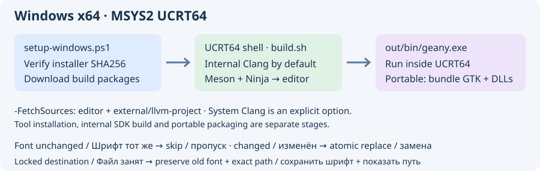
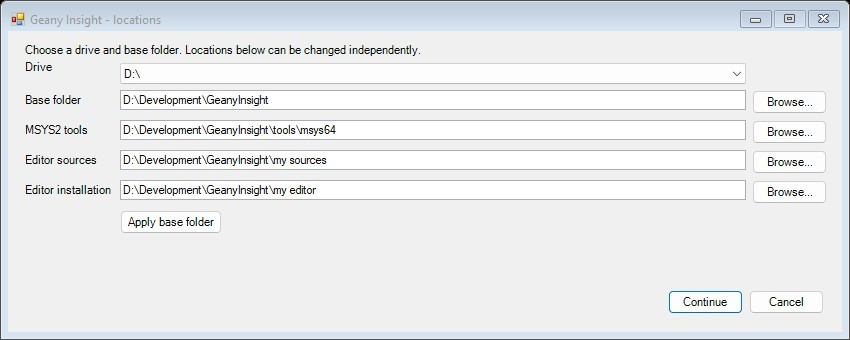

# Сборка на Windows x64

Из корня репозитория запустите `build.cmd -BuildEditor`. Без аргументов `build.cmd` открывает меню сборки, просмотра плана, справки и выхода; по умолчанию берутся исходники текущей копии.

Во время загрузки и сборки оставьте консоль открытой. Загрузчик показывает имя установщика и проценты (или объём, если сервер не указал размер). pacman и Git выводят собственный ход загрузки, а Ninja показывает число выполненных задач и процент текущего этапа, например Clang или редактора. У всей установки нет единого процента. Пока команда выполняется, каждые 20 секунд выводятся название этапа и прошедшее время. При сбое выводится код ошибки.

Если pacman сообщает `Operation too slow` или не может синхронизировать базы, режим `auto` по умолчанию пробует основной сервер MSYS2, географический перенаправитель и штатный порядок зеркал. Удачный вариант используется первым на следующем этапе. Для другого зеркала передайте `-MsysMirror <базовый HTTPS URL>` в `build.cmd -BuildEditor`. Постоянные настройки pacman не меняются.

Инструкция описывает **нативную сборку Windows x64 через MSYS2 UCRT64**, GCC и GTK3. Visual Studio, WSL и Cygwin не требуются. Компилятор и библиотеки должны относиться к UCRT64: не смешивайте их с MINGW64, CLANG64 и MSVC.



## Необходимые инструменты

| Компонент | Назначение / пакет MSYS2 |
| --- | --- |
| Windows PowerShell 5.1 или PowerShell 7 | Запуск скрипта подготовки; Windows PowerShell входит в Windows |
| MSYS2 x86_64, оболочка UCRT64 | Bash, менеджер пакетов pacman и среда сборки Windows |
| GCC/G++ и binutils | `mingw-w64-ucrt-x86_64-gcc`; компиляция C11/C++17, линковщик и компилятор ресурсов |
| Заголовки и библиотеки GTK3/GLib | `mingw-w64-ucrt-x86_64-gtk3`; минимум проекта GTK 3.22 / GLib 2.56 |
| pkg-config | `mingw-w64-ucrt-x86_64-pkgconf`; поиск заголовков и библиотек |
| Meson и Ninja | `mingw-w64-ucrt-x86_64-meson`, `mingw-w64-ucrt-x86_64-ninja`; минимум Meson 0.56 |
| CMake | `mingw-w64-ucrt-x86_64-cmake`; для внутреннего LLVM/Clang на Windows нужен **3.20+**; совместимость проекта с 3.10 предназначена только для Linux |
| Python и Docutils | `mingw-w64-ucrt-x86_64-python`, `mingw-w64-ucrt-x86_64-python-docutils`; скрипты сборки и документация |
| Git, curl, patch, diffutils, gettext, tar, xz, unzip, zip, rsync | Загрузка исходников, тесты парсеров, генерация файлов и вспомогательная упаковка |
| Необязательные Autotools | `-Autotools`: UCRT64 autotools, MSYS make и средства разработки gettext |
| Необязательный NSIS | `-Packaging`: `mingw-w64-ucrt-x86_64-nsis`, wget и dos2unix; нужен для установщика `.exe`, но не для компиляции и запуска редактора |
| Необязательный системный Clang/LLVM | `-ClangProvider System`: UCRT64 `clang` и `llvm`; явно выбираемая альтернатива внутреннему SDK из исходников |

Полный список пакетов, закреплённые адрес и SHA256 установщика MSYS2 находятся в [windows-toolchain.json](../../tools/windows-toolchain.json). Установщик закреплён, но pacman загружает текущие подписанные пакеты: версии пакетов не заморожены. Скрипт выводит установленные версии. Для инструментов нужны несколько ГиБ; исходники и сборка внутреннего LLVM могут занять десятки ГиБ и значительное время. MSYS2 устанавливайте в доступный для записи путь без пробелов, например `C:\msys64`; для исходников лучше короткий путь вроде `C:\src\geany-insight`.

## Автоматическая загрузка и установка



**Запустите двойным щелчком `insight/tools/Build-Windows.cmd`** для полного цикла: выбрать папки, установить инструменты, загрузить исходники, собрать и установить редактор. В диалоге есть выбор диска и отдельные поля с кнопками обзора для MSYS2, исходников и установки редактора. Изменение корневой папки обновляет её стандартные подпапки; каждый путь можно изменить независимо. Отмена останавливает подготовку до загрузок и установки.

По умолчанию используется папка в Local AppData (либо короткий путь `Development/GeanyInsight`, если путь для MSYS2 недопустим), а не корень C:. Можно выбрать другой диск и папку. Кэш загрузок также следует выбранной корневой папке. Путь самой MSYS2 должен быть ASCII без пробелов; пути исходников и установки могут содержать пробелы.

Для автоматизации добавьте `-NonInteractive`, например с `-RootDir D:\Development\Insight`: внутри появятся `tools\msys64`, `src`, `editor`, `downloads`. Параметры `-MsysRoot`, `-SourceDir`, `-InstallDir`, `-CacheDir` переопределяют отдельные пути. `-Plan` и `-Help` не показывают диалог и ничего не меняют.

```powershell
# Только план всех путей:
powershell.exe -NoProfile -ExecutionPolicy Bypass -File .\insight\tools\setup-windows.ps1 -RootDir D:\Development\Insight -Plan
# Полная сборка без диалогов на выбранном диске:
powershell.exe -NoProfile -ExecutionPolicy Bypass -File .\insight\tools\setup-windows.ps1 -NonInteractive -RootDir D:\Development\Insight -BuildEditor
```

`-BuildEditor` включает загрузку исходников и запускает общий Meson-драйвер с выбранной папкой установки. Без него готовятся инструменты и, по параметру, исходники. Общий драйвер автоматически собирает внутренний Clang и адаптированный slang; Windows-скрипт не является автономным установщиком.


Распакуйте предоставленный ZIP с инструментами (или используйте репозиторий). Откройте **обычный PowerShell**, перейдите в корень распакованного архива/репозитория и выполните:

```powershell
powershell.exe -NoProfile -ExecutionPolicy Bypass -File .\insight\tools\setup-windows.ps1 -FetchSources -SourceDir C:\src\geany-insight
```

`-ExecutionPolicy Bypass` действует только для этого процесса. Скрипт не меняет системную политику выполнения и глобальный PATH. Он загружает официальный установщик MSYS2, проверяет закреплённый SHA256 перед запуском, устанавливает MSYS2 при отсутствии, выполняет полные обновления в отдельных сеансах оболочки, затем загружает и устанавливает пакеты сборки. Перед обновлением закройте другие окна и программы MSYS2. Доступный для записи каталог обычно позволяет обойтись без повышения прав; при ошибке доступа выберите подходящий каталог.

С `-FetchSources` также клонируется Geany Insight и инициализируется закреплённый подмодуль `external/llvm-project` для варианта **Internal**, выбранного по умолчанию. Без этого параметра устанавливаются только инструменты. Уже существующая рабочая копия редактора не обновляется через pull/reset; инициализированные исходники Clang не перезаписываются. У существующей копии должен быть ожидаемый URL origin. С `-BuildEditor` скрипт также компилирует и устанавливает редактор и его внутренние движки.

Параметры:

```powershell
# Показать установщик, пакеты и действия с исходниками без загрузок:
powershell.exe -NoProfile -ExecutionPolicy Bypass -File .\insight\tools\setup-windows.ps1 -Plan
powershell.exe -NoProfile -ExecutionPolicy Bypass -File .\insight\tools\setup-windows.ps1 -Help

# Явно выбрать системный Clang — как в существующей Windows x64 CI:
powershell.exe -NoProfile -ExecutionPolicy Bypass -File .\insight\tools\setup-windows.ps1 -ClangProvider System -FetchSources

# Дополнительно установить Autotools и NSIS для установщика:
powershell.exe -NoProfile -ExecutionPolicy Bypass -File .\insight\tools\setup-windows.ps1 -Autotools -Packaging
```

`-MsysRoot D:\msys64` меняет каталог MSYS2, а `-CacheDir D:\downloads\insight-tools` — кэш установщика. Повторный запуск продолжает подготовку: проверенный установщик используется из кэша, а `pacman --needed` пропускает уже актуальные пакеты. Полное обновление MSYS2 всё равно выполняется. Несовпадение контрольной суммы или ошибка команды останавливает скрипт: исправьте указанную проблему и повторите запуск. Это сетевой установщик, а не автономное зеркало всех зависимостей.

## Сборка и запуск

Откройте **MSYS2 UCRT64** (`C:\msys64\ucrt64.exe`), а не оболочку MSYS/MINGW64. В рабочей копии исходников:

```bash
cd /c/src/geany-insight
printf '%s\n' "$MSYSTEM"   # должно быть UCRT64
export CC=gcc CXX=g++
which gcc g++ python3 meson ninja cmake pkg-config
pkg-config --modversion gtk+-3.0 glib-2.0
```

Вариант по умолчанию — **внутренний Clang из исходников** с возможностью менять `external/llvm-project`:

```bash
./build.sh --backend meson --install -- \
  --libdir=lib -Dhtml-docs=disabled -Dpdf-docs=disabled \
  -Dapi-docs=disabled -Dgtkdoc=false -Dvte=false -Dmac-integration=disabled
```

Драйвер автоматически собирает адаптированный slang в `_external-slang`, готовит `_external-clang-sdk`, затем собирает редактор в `_editor-build/meson` и устанавливает в `out`. Подготовка компилятора по умолчанию использует два задания. Для изменения добавьте `--jobs 4` перед `--`, если хватает памяти. `./build.sh` без аргументов показывает справку. При ошибке сборки внутренний Clang не заменяется системным автоматически. Подробнее: [интеграция Clang](clang.md).

Явный выбор **системного Clang** (сначала установите инструменты с `-ClangProvider System`):

```bash
./build.sh --backend meson --clang-provider system \
  --build-dir _editor-build/meson-system --install -- \
  --libdir=lib -Dclang-bundle=true -Dhtml-docs=disabled -Dpdf-docs=disabled \
  -Dapi-docs=disabled -Dgtkdoc=false -Dvte=false -Dmac-integration=disabled
```

Минимальную сборку без семантического компилятора можно сделать с `--clang-provider disabled` в отдельном каталоге; семантические функции Clang будут недоступны. Выбор пакетов при установке инструментов не меняет вариант `build.sh`: по умолчанию там по-прежнему Internal.

Запускайте **из UCRT64**, чтобы DLL GTK и компилятора были в PATH:

```bash
./out/bin/geany.exe --version
./out/bin/geany.exe
```

`out` — установка для разработки, а не готовый переносимый дистрибутив. Одного `geany.exe` недостаточно: для компьютера без MSYS2 нужны полный GTK runtime, схемы, иконки и зависимые DLL. Последовательность упаковки и проверки есть в [.github/workflows/insight-windows-check.yml](../../../.github/workflows/insight-windows-check.yml); используются `scripts/gtk-bundle-from-msys2.sh` и `insight/tools/bundle_windows_dependencies.py`. NSIS нужен только для отдельного установщика `.exe`.

## Проверки и типичные проблемы

Для скрипта подготовки предусмотрена Windows CI: разбор PowerShell, план без побочных действий и настоящая установка инструментов с проверкой их версий. CI также собирает и устанавливает slang общим драйвером; это **не** полная сборка внутреннего LLVM и редактора. Существующая Windows x64 CI редактора явно использует системный Clang и не подтверждает такую же проверку внутреннего SDK из исходников на Windows. При ошибке внутренней сборки сохраните журнал и первую ошибку CMake/компилятора/линковщика; переход на System должен оставаться осознанным.

- Не находятся `gcc` или `gtk+-3.0`: проверьте UCRT64 и выбранную установку MSYS2. Повторите скрипт; не подмешивайте GTK DLL из другой среды.
- Прервано обновление: закройте другие процессы MSYS2 и повторите запуск. Скрипт уже продолжает обновление ядра в новом сеансе оболочки.
- Нет исходников LLVM: повторите с `-FetchSources` или выполните в репозитории `git submodule update --init --depth 1 -- external/llvm-project`. Инициализированные локальные изменения Clang сохраняются.
- Вне UCRT64 не найдена DLL: запускайте из среды разработки либо подготовьте полноценную переносимую сборку. Это не ошибка отсутствующего заголовка C/C++.

Официальные инструкции MSYS2: [установщик, CLI и контрольные суммы](https://www.msys2.org/docs/installer/), [полные обновления](https://www.msys2.org/docs/updating/), [поддерживаемые Windows](https://www.msys2.org/docs/windows_support/). Для комплекта действуют требования текущей MSYS2 к системе сборки; поддержка устаревших Windows здесь не обещается.

## Автоматическая сборка HDL-движка

И `./build.sh --backend meson ...`, и `./build.sh --backend autotools ...` автоматически собирают адаптированный slang. Явно пропустить его можно через `--slang-provider disabled`. Для одной HDL-библиотеки/утилиты без зависимостей GTK и Clang:

```bash
./build.sh --slang-only --install --prefix "$PWD/hdl-tools"
```

`--install` помещает консольную утилиту в `libexec/geany-insight/slang`, а адаптированный статический C++ SDK (заголовки, библиотеки, pkg-config, лицензии) — в `lib/geany-insight/slang`. Это подготовка движка; подключение семантической HDL-навигации и автодополнения редактора остаётся отдельной работой. См. [адаптацию slang](slang.md).
