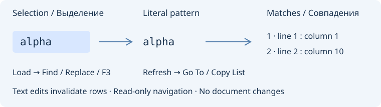
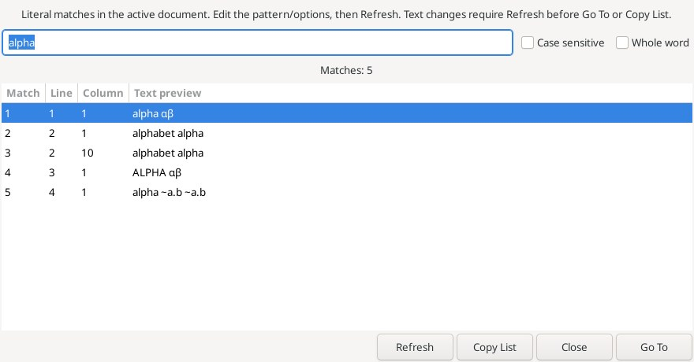

# Selection search / Поиск по выделению

**Search → Selection search** adds four unassigned native Search keybindings.
They operate on the current editor, including read-only documents, and leave
text, Undo, savepoint and clipboard unchanged unless Copy List is chosen.
Existing Geany selection-search commands and their preferences remain separate.

| Command | Behavior |
| --- | --- |
| Load Search String | Loads the exact ordinary selection as a literal pattern, without searching or moving the caret |
| Search Forward for Selection | Finds the next whole-word occurrence of the first word at/in the selection |
| Search Backward for Selection | Finds the previous whole-word occurrence, selecting in reverse direction |
| Find All for Selection… | Opens a list for the exact selection, or the word at the caret when selection is empty |

Word commands choose the first Unicode letter/digit/underscore in the selected
range, then use the editor's native word boundaries. A partial-word selection
therefore searches the complete word. With no selection the caret must be inside
such a word, not on whitespace/punctuation. Forward starts after that word;
Backward starts before it. Case sensitivity and wrap come from the file search
bar. Whole-word matching excludes larger words, e.g. alpha inside alphabet.
If no other occurrence exists, selection is preserved. A found match replaces
any prior selection (including Extend Mode), with an exact Back/Forward position.

Loading preserves case sensitivity, disables regex/escape/word-start modes and
sets literal matching; word commands enable whole-word matching. Existing native
Find/Replace fields and the file search bar are synchronized. Ctrl+F shows the
loaded pattern and Replace retains it even after the caret moves. F3 and reverse
F3 continue the loaded literal search until the user supplies another pattern or
flags. A leading `~` remains literal: the file bar receives a quoted regex form
so its existing fuzzy-search syntax cannot reinterpret the pattern. Loading
suppresses incremental search while populating controls and restores that option.

**Selection Matches** provides an editable pattern, Case sensitive / Whole word,
Refresh, Copy List, Close and Go To. Double-click also selects the chosen match.
Columns show match number, one-based physical line / visual column and a literal
UTF-8-safe 160-byte source excerpt. Pattern/options changes clear stale rows and
disable actions until Refresh. Text changes, unsupported selection mode, switched
or closed documents reject Go To / Copy List. Refresh explicitly recomputes only
for the original active document; caret movement alone does not invalidate rows.
Read-only sources allow navigation and copy. Copy List places only the displayed
rows on the clipboard as tab-separated line/column/text, bounded to 1 MiB.

Limits: valid UTF-8 without NUL, document up to 8 MiB, single-line nonempty pattern
up to 4096 bytes, one normal selection without virtual positions or partial
UTF-8/CRLF boundaries. Load and Find All reject invalid nonempty selections instead of silently falling
back to a word. Leading selected punctuation/whitespace scans at most 4096 characters for
word commands. The list contains the first 5000 nonoverlapping literal matches;
its counter explicitly reports truncation, not a full total. No regular-expression,
fuzzy, semantic reference, cross-document or persisted result-list behavior is
claimed for this window. Existing project/file search tools cover other scopes.

**Поиск/замена → Поиск по выделению** добавляет загрузку буквальной строки,
поиск первого слова вперёд/назад и окно всех совпадений. Загрузка не перемещает
курсор, синхронизирует строку с панелью поиска, Find/Replace и F3. Регулярные
выражения и escape-последовательности отключаются; начальный `~` ищется буквально.
Поиск слова использует регистр и зацикливание панели, исключает части длинных слов
и выделяет найденное вхождение. Назначаемые клавиши по умолчанию пусты.

**Совпадения выделения** показывает строки, столбцы и фрагменты текста. Можно
изменить строку/параметры и явно обновить список, перейти к совпадению или скопировать
показанные строки в TSV. Правки текста, закрытие/смена документа и неподдерживаемый
режим выделения блокируют устаревшие действия. Read-only разрешён. Ограничения:
8 МиБ на документ, однострочный UTF-8 без NUL до 4096 байт, первые 5000 совпадений,
копирование до 1 МиБ. Множественные/прямоугольные выделения, виртуальные позиции и
неполные UTF-8/CRLF-позиции отклоняются. Это буквальный поиск в одном документе.

References: [Load Search String](https://www.sourceinsight.com/doc/v4/userguide/Manual/Command_Reference/Load_Search_String.htm),
[Search Forward for Selection](https://www.sourceinsight.com/doc/v4/userguide/Manual/Command_Reference/Search_Forward_for_Selection.htm),
[Search Backward for Selection](https://www.sourceinsight.com/doc/v4/userguide/Manual/Command_Reference/Search_Backward_for_Selection.htm).

Actual production dialog from an isolated native Linux GUI fixture in the
successful 52-test run, not a mockup. The example uses UTF-8/CRLF and demonstrates
that exact-selection matching includes alphabet unless Whole word is enabled.

Настоящее окно из изолированного нативного GUI-теста Linux, прошедшего в составе
52 проверок; это не макет. Пример UTF-8/CRLF показывает буквальные совпадения внутри
alphabet при отключённом параметре «Целое слово».

[Word highlights / Подсветка слов](word-highlights.md)
