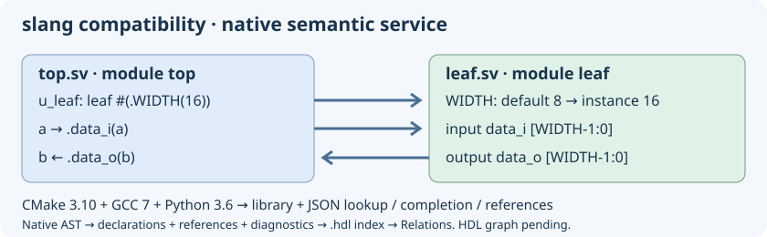

# SystemVerilog slang: old-toolchain compatibility experiment



The pinned source in `external/slang` is upstream **slang 3.0** (`7efcca2e348ecf1e01d1859f7ea85d6202fc9f91`), the last major release before the move to C++20. This is an explicit compatibility variant, not current slang 12.x and not a completed editor integration. The current editor continues using its existing Verilog/SystemVerilog Ctags and lexical highlighting.

## Build without upgrading the system toolchain

On Ubuntu 18.04 the target tools are CMake **3.10.2**, GCC/G++ **7.5**, Python **3.6** and Make. Git and CA certificates are needed for the first online source preparation. The common `build.sh` driver builds slang automatically for Meson and Autotools, independently of the Clang provider. Use `--slang-provider disabled` to skip it explicitly.

```bash
python3 insight/tools/build_external_slang.py --jobs 2 --check
```

The helper initializes only the slang submodule, fetches three exact dependency commits, applies `external/slang-compat/cmake310-gcc7.patch`, builds a static library and the slang command-line tool, then runs a **direct C++ API probe**. Its two separate SystemVerilog files declare a module and instantiate it with `WIDTH=16`; the probe resolves the cross-file instance, its overridden parameter and both ports. This establishes elaboration/API access, not completion or references inside the editor.

Sources and dependencies are editable in `external/slang` and `external/slang-deps`. Existing initialized checkouts are never reset; a wrong revision or conflicting patch stops preparation. A second run recognizes the already applied patch. `--prepare-only` downloads/prepares without CMake. `--build PATH` and `--deps PATH` select separate output/dependency directories. `_external-slang/source-manifest.json` records source/dependency revisions and the CMake version.

## Adaptation

- Remove reliance on FetchContent, modern Python discovery and newer CMake install/source-path behavior in the compatibility route.
- Pin fmt 9.1.0, unordered_dense 2.0.0 and ghc::filesystem 1.5.14 by commit; CMake performs no network downloads.
- Use ghc::filesystem consistently in the adapted public headers and implementation, avoiding GCC 7's missing `std::filesystem`. Consumers must compile against the adapted headers and dependencies; an unpatched system slang ABI is not interchangeable.
- Replace the integer-only `std::from_chars` calls missing in GCC 7; boundary tests cover signed/unsigned limits, overflow and invalid input.
- Spell out container types where GCC 7 lacks C++17 deduction guides.
- Keep C++17, original parser and semantic/elaboration code. Python bindings, slang-tidy, upstream test suite and installation/export targets are excluded from this experiment. The fixture is a focused integration check, not full language conformance testing.

The CI workflow `insight-slang-compat.yml` uses the actual Ubuntu 18.04 toolchain in a container. The host checkout avoids requiring modern Node.js inside the old container. The Windows/UCRT64 CI also builds the engine, stages the SDK on drive D and compiles/runs a separate C++ consumer from an install path containing spaces. macOS has not been validated.

## What newer versions add

Upstream [4.0](https://github.com/MikePopoloski/slang/releases/tag/v4.0) adds checkers, net aliases and parallel parsing; [6.0](https://github.com/MikePopoloski/slang/releases/tag/v6.0) adds configurations, [7.0](https://github.com/MikePopoloski/slang/releases/tag/v7.0) completes support for IEEE 1800-2023 changes, and [9.0](https://github.com/MikePopoloski/slang/releases/tag/v9.0) adds a data-flow analysis framework and substantially improved instance caching. Later releases improve diagnostics, analysis APIs and correctness. [12.1](https://github.com/MikePopoloski/slang/releases/tag/v12.1) fixes many corner cases in constant evaluation, name resolution and instance caching. Compatibility 3.0 does not inherit those features/fixes.

Current upstream [build requirements](https://sv-lang.com/building.html) include C++20 and CMake 3.28+. Supporting old build tools with 3.0 is a first experiment, not a commitment to freezing the editor's HDL engine on an old release. Porting a newer C++20 engine to GCC 7 requires a separate feasibility check, not just lowering `cmake_minimum_required`.

## Automatic build and staged SDK

`./build.sh --slang-only --install --prefix "$PWD/hdl-tools"` builds and stages only slang, without GTK/Clang prerequisites. Normal editor `--install` also stages the engine. The console tool is under `libexec/geany-insight/slang`; the static SDK is under `lib/geany-insight/slang` with merged/generated headers, dependency headers, `libsvlang.a`, `libfmt.a`, pkg-config metadata and licenses. The compatibility CI compiles the C++ elaboration probe against that installed SDK. Ninja is preferred when available; existing build directories retain their generator.

## Семантический сервис для HDL

Сборка также создаёт `insight-slang-semantic` (`.exe` в Windows). Установка автоматически помещает его рядом с консольным slang в `libexec/geany-insight/slang`. Сервис обращается непосредственно к C++ AST встроенного slang, без LSP и системного парсера.

```bash
_external-slang/insight-slang-semantic --lookup top.u_leaf.data_i -- leaf.sv top.sv
_external-slang/insight-slang-semantic --complete top.u_leaf data_ -- leaf.sv top.sv
_external-slang/insight-slang-semantic --references -- leaf.sv top.sv
_external-slang/insight-slang-semantic --symbols -- leaf.sv top.sv
```

Один запрос читает явно переданные файлы и элаборирует их вместе. Возвращается один JSON-объект: `protocol: 1`, `diagnostics_count` и массив `records`. Позиции содержат абсолютный путь, строку и столбец (с единицы). Поиск принимает полное иерархическое имя; дополнение — область и регистрозависимый префикс. Пары «порт / внутренняя переменная» в дополнении не дублируются. Ссылки включают переходы от экземпляров к определениям модулей, обращения к значениям и вызовы пользовательских функций, в том числе в другом файле пакета. Системные функции не получают выдуманных исходных объявлений.

Ненулевой `diagnostics_count` означает, что результат требует проверки: наличие JSON не доказывает корректность проекта. Отсутствующий символ даёт пустой массив; ошибка чтения/аргументов — ненулевой код возврата, пояснение в stderr и пустой stdout. Ответ ограничен 100000 записями; превышение завершается ошибкой без частичного JSON. Исходники не изменяются. Список файлов может представлять временный набор без сохранённого проекта.

Это слой для следующего подключения к редактору: **дополнение, переход к определению и сохраняемый индекс ссылок HDL подключены; автоматическое обновление этого индекса и граф HDL ещё не подключены**. Каждый запуск разбирает набор заново; постоянный AST-кэш, параметры include/define/top и полный перечень видов ссылок ещё не подключены. Процесс можно отменить извне без обращения к GTK. Подсветка редактора пока лексическая.

Автопроверка `slang_semantic_protocol` запускает настоящий сервис и проверяет переходы между файлами, вызов функции пакета, дополнение без дублей, точные позиции, ошибочные исходники и пути с пробелами.

## Дополнение в редакторе

При включённых подробном и семантическом дополнении (настройки дополнения) ввод `u_leaf.data_` в модуле предлагает члены экземпляра `u_leaf`. В списке происхождение помечено `slang`. Команда обычного принудительного дополнения также запускает запрос. Нужна установленная копия `insight-slang-semantic` из текущей сборки; при её отсутствии работает обычный механизм тегов. Для разработки путь можно задать переменной `GEANY_INSIGHT_SLANG_SERVICE`.

В запрос входят файлы текущего проекта и открытые HDL-файлы. Без проекта открытые именованные файлы образуют временный набор. Несохранённый текст передаётся снимками через временный каталог, который удаляется после запроса; исходники и файл проекта не записываются. Чтение, запись снимков, запуск и ожидание slang выполняются в рабочем потоке. При новом вводе запрос отменяется вместе с процессом; перед показом проверяется, что открытые буферы, позиция и проект не изменились.

Поддержаны простые иерархии через точку и квалификаторы пакета `::`. Текущий модуль определяется по файлу и строке. Если он элаборирован несколько раз, неявная область не выбирается наугад; можно указать полную иерархию. Индексированные/динамические получатели, точная локальная область процедур, аргументы функций, include/define/top-настройки и постоянный кэш пока не реализованы. Ограничения запроса: 256 HDL-файлов, 2 МиБ на буфер, 32 МиБ снимков и переносимый предел длины командной строки; при превышении запрос уступает обычному дополнению. Заголовки, требующие контекста включения, пока не дают полноценной семантики. Каждый запрос заново элаборирует набор, поэтому для больших HDL-проектов нужен следующий этап кэширования.

## Переход к объявлению HDL

Обычная команда «К определению» в навигации и редакторе использует AST slang для Verilog/SystemVerilog. Установите курсор на ссылку на сигнал, вызов функции, тип модуля, имя экземпляра или именованный порт подключения. Переход открывает исходник в точной строке и столбце; «Назад» и «Вперёд» сохраняют исходную и целевую позиции. Для работы команды не требуется включать семантическое дополнение.

Разбор запускается в том же фоновом механизме по текущему проекту и открытым файлам; несохранённые буферы учитываются. При изменении позиции курсора, текста, проекта или состава файлов старый ответ не используется. Перед переходом проверяется содержимое открытого целевого файла. Изменение явно переданных дисковых файлов во время запроса также отбрасывает ответ. При неоднозначности элаборации переход не выполняется, строка состояния сообщает об отсутствии однозначного объявления. Обход по одному лишь совпадению имени не подменяет неудачный запрос slang.

Сервис поддерживает внутренний режим `--editor-definition FILE LINE COLUMN -- FILE...`; строка и столбец с единицы, столбец в байтах UTF-8. Возвращается заголовок `insight-slang-definition-v1` и, при успехе, одна строка: hex-кодировка UTF-8 пути, строка и столбец через табуляцию. Для снимков доступны те же `--overlay ORIGINAL SNAPSHOT` перед разделителем `--`, что и для дополнения. Совпадающие физические объявления нескольких экземпляров разрешены; разные назначения в одном исходном диапазоне дают пустой результат.

Поддержаны связанные AST-выражения значений, членов, пользовательских вызовов и ссылки на модуль/именованные порты. Это не полный перечень всех синтаксических ссылок SystemVerilog: типы, макросы и некоторые конструкции препроцессора ещё требуют отдельного покрытия. Постоянный AST-кэш, граф HDL и автоматическое обновление семантического индекса остаются следующим этапом.

## Кэш одинаковых запросов

Фоновый адаптер хранит до восьми недавних ответов дополнения/перехода, суммарно до 4 МиБ. Повторный запрос для тех же файлов, снимков и позиции получает ответ без нового запуска slang. Ключ SHA-256 учитывает порядок и полное содержимое исходников, несохранённые буферы, параметры запроса, рабочий каталог и версию исполняемого сервиса. Изменение содержимого файла, даже без изменения размера, создаёт новый ключ. Перед сохранением ответа содержимое проверяется повторно.

Кэш находится в памяти процесса и защищён между рабочими потоками. Чтение файлов и вычисление ключей происходят в рабочих потоках; GTK не ждёт эти операции. **Наборы с обратной кавычкой (директивами/макросами препроцессора) обходят кэш**, чтобы изменение заголовка или пути поиска не оставило устаревших подсказок. Лишний обход для обратной кавычки внутри комментария/строки допустим. Это кэш готовых ответов, а не постоянная база AST; для изменённого текста и include-проектов разбор пока запускается заново.

## Сохраняемый индекс и панель «Связи»

В «Навигация» и контекстном меню редактора выберите **«Ссылки HDL (slang)…»** либо в панели «Связи» — **«Ссылки (slang HDL, по имени)»**. Запрос совместно разбирает HDL-файлы проекта и открытые именованные HDL-файлы. В списке показываются места ссылок и их назначения (`вид → файл:строка:столбец`). Щелчок открывает место ссылки; команда «К определению» открывает связанное объявление. Поиск фильтрует имя, поэтому одноимённые символы могут дать несколько строк с разными назначениями; это не выбор одного символа по его идентичности.

Из AST извлекаются объявления и ссылки значений, членов, пользовательских функций, экземпляров, типов модулей и именованных портов. Они сохраняются атомарно в отдельной части индекса проекта: файл **`.hdl` рядом с основной БД проекта**. Это сохраняемые семантические факты, не сериализованный AST. Строка состояния показывает число объявлений/ссылок, число диагностик и состояние «сохранён», «восстановлен» либо «только в памяти».

Индекс строится **по запросу связей**, не при каждом открытии файла и не отдельно для каждого файла проекта. Для наборов без препроцессора повторный запрос или запуск редактора восстанавливает его после проверки полного содержимого исходников, состава/порядка файлов и исполняемого движка. Изменение файла вызывает совместный пересчёт при следующем запросе. Для наборов с директивами/макросами индекс также сохраняется, но пока пересчитывается при запросе: учёт транзитивных include-зависимостей для повторного использования ещё не завершён. Индексы с диагностикой тоже восстанавливаются для неизменённого набора без препроцессора, сохраняя сообщения и ненулевой счётчик диагностик. Устаревшие результаты отбрасываются при изменении снимков/состава проекта.

Без проекта используется только память: файл индекса не создаётся. Ctags-символы по-прежнему сохраняются и обновляются существующим механизмом БД проекта. Общий запрос ограничен 256 файлами, 32 МиБ снимков и 100000 записями; ответ проектного индекса ограничен 64 МиБ (дополнение/переход — 4 МиБ). Список показывает первые 2000 ссылок. Полный интерактивный HDL-граф ещё не подключён. Подробные сообщения и подсказки движка теперь доступны в режиме диагностики; автоматическое внесение исправлений не реализовано.

Снимки открытых файлов регистрируются в slang до разбора любых единиц компиляции: `include` получает несохранённое содержимое выбранного заголовка. При наличии основных `.v/.sv` заголовки `.vh/.svh` не разбираются повторно как отдельные единицы; они читаются через включения. Это не заменяет ещё не подключённые настройки include-путей и define.

## Диагностика и помощь с опечатками

Откройте **«Навигация → Диагностика HDL (slang)…»**, одноимённый пункт контекстного меню или режим **«Диагностика (slang HDL)»** в панели «Связи». Команда проверяет весь текущий HDL-набор и работает даже на пустой строке, без имени под курсором. Подробное дополнение включать не требуется.

Таблица показывает уровень (ошибка, предупреждение, примечание), файл, строку, столбец в байтах UTF-8, текст и стабильный код сообщения. Двойной щелчок открывает строку исходника через окно контекста и общую историю позиций. Сообщения уровня проекта без адреса помечаются отдельно и не выполняют переход. Общий фильтр результатов позволяет искать по тексту сообщений. Отображаются первые 2000 строк; число исходных диагностик и число показанных сообщений могут различаться из-за примечаний и фильтрации движка.

Для некоторых неизвестных имён slang формирует `did you mean ...?` с подходящим видимым объявлением. Например, `target_signl` может получить предложение `target_signal`. Это проверяемое предложение компилятора, а не гарантия правильности алгоритма. Редактор показывает его текст; изменения автоматически не применяются и не записываются. Не для каждой синтаксической/логической ошибки есть такое предложение.

Диагностика учитывает несохранённые выбранные исходники и заголовки. Сообщения входят в сохраняемый семантический индекс (`@hdldiag`), и повторно используются для неизменённого набора без препроцессора вместе с ненулевым счётчиком диагностик. Формат обмена проектного индекса обновлён до `insight-slang-index-v2`; старый сохранённый семантический индекс перестраивается. Исходные тексты сообщений идут от slang на английском, подписи интерфейса переключаются EN/RU. Системный Clang для этой проверки не используется.

## Semantic highlighting

Run HDL diagnostics or a slang reference search from the source tab you want to highlight. Once background analysis finishes, the editor colors recognized modules, instances, ports, subroutines, parameters and signals in that tab. The lexer still colors keywords, comments and strings. Highlighting uses the same project index, including a restored one, and covers up to 2048 locations. Editing an HDL source clears the analysis colors; run the command again to refresh them.
