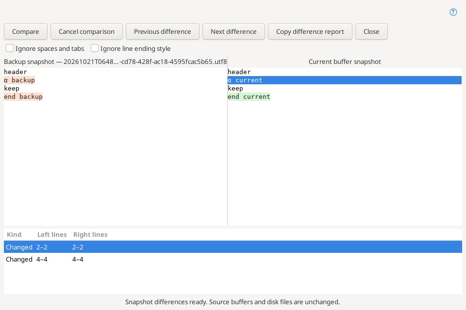
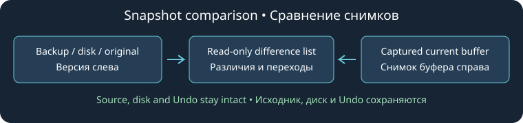

# Compare snapshots

**File → Compare with Backup File…** selects a saved version and compares it with the source buffer, including unsaved edits. The backup browser also offers **Compare with Current Buffer**. The source document must still exist under the displayed filename when comparison is requested. The selected backup's listed identity is checked again before reading.

Two companion commands are available in File: **Compare Current Buffer with Disk** and **Compare Current Buffer with Original**. Disk reads a regular UTF-8 file and strips one file BOM; it does not convert other disk encodings. Original uses the decoded opening snapshot, or the replacement baseline established by [Checkpoint](checkpoint.md). Normal Save does not replace that original. All three have initially unassigned Editor keybindings and appear in the command browser.

The new window contains two read-only text panes and a list of inserted, deleted and changed line blocks. Left is the selected backup, disk or original snapshot; Right is the captured buffer. Headers identify the snapshots. Selected blocks highlight both ranges and scroll the panes; insertion/deletion rows identify a zero-width **anchor** on the empty side. Line numbers are one-based logical lines, with CRLF counted as one break. **Previous difference** and **Next difference** stop at the ends of the list.

**Copy difference report** copies the entire displayed block list as TSV (English column header, localized row labels, 1 MiB maximum). This reports line ranges; it does not copy the complete source text. It is disabled when no differences are listed. The read-only panes allow ordinary text selection and copying.

**Ignore spaces and tabs** and **Ignore line ending style** apply independently, using the existing comparison core. Case remains significant; a missing final terminator remains different. Changing options clears the list and highlights immediately. Press **Compare** to rebuild them. Empty results mean no differences under those options, not necessarily byte-identical text.

Comparisons use owned text copies and run in a cancellable worker. **Compare** recalculates those same captured inputs; it does not reload a changed source or backup. Close the window and invoke the command again to capture newer versions. Source edits, selection, Undo/Redo, original baseline and disk are unaffected. There is no merge/apply/save action in this window. Use the separate [Diff / Merge window](internal-diff.md) for a merge result.

Both inputs require valid UTF-8 without NUL, up to 1 MiB per side. Two-sided line comparisons retain the existing 4 million LCS-cell work limit. Oversized, unavailable or invalid snapshots do not open a comparison. Work-limit and cancellation errors clear results and report status; closing a running window cancels its task and prevents late UI publication. Options and captured texts are not persisted across windows or editor restarts. The window does not track source edits or navigate back into the live source.

Linux validation covers all three menu/key commands, backup selection/cancel and closed-source rejection, immutable pane text, mixed-EOL ranges, navigation/report, unchanged source text/selection/Undo/disk, read-only sources, save-versus-original semantics, ignore options, case sensitivity, size/NUL/work limits, cancellation and window destruction. The JPEG is a real production window captured by the native test under Xvfb. Windows and Android were not run.

Source Insight reference: [Compare with Backup File](https://www.sourceinsight.com/doc/v4/userguide/Manual/Command_Reference/Compare_with_Backup_File.htm). Disk/original companion commands and this independent read-only snapshot window are extensions specific to Geany Insight. See [Backup versions](backup-versions.md).

[Shared comparison layout / Единое оформление сравнений](comparison-layout.md).
