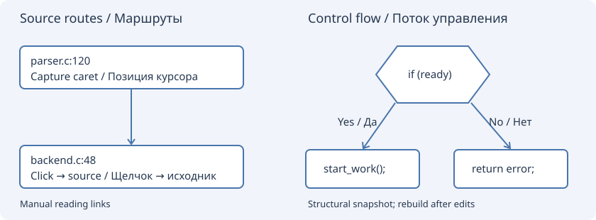
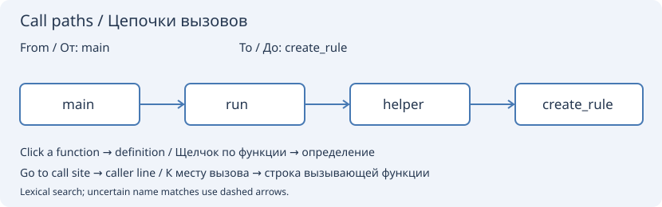

# Source routes and control flow / Маршруты и поток управления

**Relations → View → Source routes / flow** opens a separate graph presentation
inside the existing Relations panel. The old symbol/call graphs remain available
through **Relations**, Graph view and the Navigate menu. A source route is a
user-defined reading/navigation link, not proof that one statement executes another.

## Меню, тулбар и быстрый урок / Menu, toolbar and tutorial

**Навигация → Цепочки вызовов / Navigate → Call paths** содержит команды:

| Команда / Command | Результат / Result |
| --- | --- |
| Открыть граф цепочек вызовов… / Open call path graph… | Открывает панель и разворачивает вкладку «Цепочки вызовов» |
| Начало цепочки из позиции курсора / Call path start from caret | Запоминает файл и строку внутри начальной функции |
| Конец цепочки из позиции курсора / Call path target from caret | Запоминает файл и строку внутри целевой функции |
| Найти цепочки вызовов / Find call paths | Строит цепочки между выбранными концами |
| Урок построения цепочки вызовов… / Call path tutorial… | Открывает эту инструкцию во встроенной справке |

На главном тулбаре, рядом со «Связями», находится кнопка **«Цепочки вызовов»**.
Основная часть кнопки открывает граф, стрелка справа — те же команды. Они также
доступны в меню правой кнопки редактора. Начало и конец берутся из текущего
исходника; создавать ручные узлы для этого не требуется.

### Пример: main → create_rule

1. Откройте проект и дождитесь завершения индексации.
2. Откройте файл с нужным `main`, поставьте курсор внутри этой функции.
3. Выполните **Навигация → Цепочки вызовов → Начало цепочки из позиции курсора**.
4. Откройте нужный `create_rule`, поставьте курсор внутри его определения.
5. Выполните **Конец цепочки из позиции курсора**, затем **Найти цепочки вызовов**.
6. Ожидаемый результат: цепочка с промежуточными функциями, местами вызовов и
   поддерживаемыми условиями с отметками «Да/Нет». Щелчок открывает исходник.
7. Смените вариант в списке цепочек, чтобы посмотреть другой маршрут или место
   вызова. «Показывать места вызовов и ведущие к ним ветвления» включает подробности.

Можно вместо шагов 2–5 ввести имена `main` и `create_rule` на вкладке. Если имена
неоднозначны, выберите точные определения по файлу и строке в появившихся списках,
затем снова нажмите поиск. При отсутствии цепочки прочитайте статус: колбэки,
внешние библиотеки и пропущенные исходники могут требовать другого анализа.

**English:** open a project, place the caret inside the desired `main`, choose
**Navigate → Call paths → Call path start from caret**, visit `create_rule` and
choose **Call path target from caret**, then **Find call paths**. The toolbar's
main button reveals the graph; its arrow and the editor popup expose the same
commands. Definition selectors resolve duplicate names. Click condition, call-site
or function nodes to open their corresponding source locations.

## Arbitrary source positions

1. Put the caret at a useful position in a saved source file.
2. Choose **Navigate → Add caret to source routes**, the same editor context-menu
   command, or **Source routes → Add caret location**.
3. Repeat in another file or another place in the same file.
4. Click the origin node, press **Link from selected**, then click the destination.
   Escape cancels a pending link. Reverse arrows can be added separately.

A click opens the source immediately; Up/Down select nodes and Enter opens one.
Repeated positions and identical arrows are ignored. **Remove node** removes that
node and its incident arrows. There are at most 256 manual nodes and 1024 arrows.
Zoom is 40–200%, also Ctrl+wheel. Full paths/line text appear in tooltips. The
shared compact options notebook has a Collapse tab.

Named-file locations, full-line anchors and arrows are stored in the native
project file, in `insight-source-routes`; project writes use the existing save
mechanism. Paths inside the project are relative. A new editor process restores
the graph; without a project, routes exist for the current session only. Closed
files reopen on click. A changed line is relocated only when its complete saved
line text has one exact match in a buffer up to 2 MiB. Missing/ambiguous anchors
are refused rather than silently jumping elsewhere. Positions are byte columns;
no source bytes, selections, Undo history or source disk files are changed by
adding/linking nodes. Links are retained until explicitly removed, including if
a source file becomes unavailable.

## Function and selection flow

**Control flow → Function flow** builds a snapshot of the brace-bodied function
containing the caret, using current parser tags and unsaved editor text.
**Selection flow** builds a graph from one ordinary selected range of complete
statements. Entry/Exit, operators, if/else (including else-if), while/for,
return, break and continue have directed arrows; conditions have Yes/No labels.
Loop-back edges and early exits are explicit. Function-call expressions remain
inside their statement nodes; use the existing lexical Calls/Call sites relation
graph for inter-function browsing. An arbitrary pair of locations can always be
connected manually in Source routes.

This is a bounded structural graph for C/C++/C#/Java and semicolon-terminated
JavaScript/TypeScript, not a compiler CFG or semantic call resolver. Comments and
strings are masked first. Conditions/loop headers are atomic; short-circuit
operators and for-loop header steps are not separate nodes. Constant conditions,
macro expansion, overloads, exception edges and runtime paths are not inferred.
Switch, do/while, goto, exception constructs, labels, ternaries, preprocessors
inside the body, nested definitions and unsupported brace expressions are refused with an
explanation. Unreachable statements may remain as disconnected syntactic nodes.
Other languages remain supported by the existing symbol/call relation tools;
manual routes are language-independent.

Bounds: a complete UTF-8 buffer without NUL up to 2 MiB, 512 nodes, 1024 edges,
64 statement/128 expression nesting levels and 4096 bytes per captured line.
Selection requires one stream range without virtual space. A generated graph
keeps its exact source digest; editing the buffer makes click navigation refuse
the old snapshot until it is rebuilt. Generated snapshots are not project data.
Changing graph presentation never launches a project scan or index rebuild.

## По-русски

В панели **Связи → Вид → Маршруты / поток управления** появились два режима.
В ручном режиме добавляйте позицию курсора из меню **Навигация**, контекстного
меню редактора или кнопкой **Добавить позицию курсора**. Выберите начальный узел,
нажмите **Связать от выбранного**, щёлкните конечный. Узлы могут находиться
в любых двух файлах или двух местах одного файла. Щелчок открывает исходник;
стрелки клавиатуры выбирают узлы, Enter открывает выбранный. Маршруты и стрелки
сохраняются в проекте, закрытые исходники переоткрываются. Повторные узлы и стрелки
не создаются. Изменившаяся строка ищется только по уникальному полному совпадению;
при неоднозначности нужно добавить позицию заново. Это ручные навигационные связи,
а не автоматически доказанные пути исполнения.

**Граф функции** строит ветвления текущей функции; **Граф выделения** — полных
выделенных операторов. Поддержаны if/else, while/for, return, break/continue.
Есть вход/выход, стрелки Да/Нет и обратные стрелки циклов. Это структурный
С-подобный анализ с перечисленными выше ограничениями, без вычисления макросов,
типов и условий. Неподдерживаемые конструкции явно отклоняются. После изменения
исходника граф нужно перестроить. Графы вызовов между функциями уже доступны
в прежних режимах **Вызовы / Места вызовов** панели «Связи».

## Automatic paths from main to create_rule / Автоматические цепочки

**Call paths** is now distinct from manual Source routes and from the old
symbol/text query. Enter **From function: main**, **To function: create_rule**
and press **Find call paths**. Alternatively, select a source node and use
**From selected**, then select the other node and use **To selected**. This
resolves the containing function, including identically named static functions
in different files. A bare ambiguous function name requires selecting a location.

The background search follows lexical function calls through the captured project
index and shows up to 32 shortest chains, with at most 64 calls per chain. Choose
an alternative in the path list. Click a function to open its definition;
**Go to call site** opens the caller's actual source line for the selected hop.
Initializers in a function do not prevent call-chain scanning. Simple assignment
brace initializers are also accepted as atomic statements by Function flow.

**Include uncertain name matches** permits ambiguous and member-name matches,
shown with dashed arrows. These are hypotheses: function pointers, virtual calls,
overloads, callback registration, macros and runtime conditions are not semantically
resolved. If no lexical chain is found, the UI says so; it does not replace the
missing chain with a fabricated direct arrow. Initializers assigning a callback
do not by themselves prove an execution edge. Cycles are bounded; only shortest
chains in the inspected graph are listed, not every possible execution path.

The search does not rebuild the project index. Wait for indexing to finish before
starting. It snapshots open named buffers (including unsaved changes) and lazily
reads closed sources in a worker. No code is executed or changed. Source digests
are checked again before navigation; modified sources require another search.
Cancel, changed endpoints/options, changed projects and destroyed panels invalidate
pending jobs. Graphs are temporary snapshots; manual project routes stay separate.
Bounds: 20000 function definitions, 50000 edges, 200000 inspected call tokens,
512 source files, 2 MiB per source, 64 MiB loaded source text, 16 MiB function
metadata, 256 MiB cumulative function-range scanning, and 32 MiB copied open buffers. Skipped sources and work limits are
reported; a negative result is not a proof of runtime unreachability.

**По-русски:** для `main → … → create_rule` откройте вкладку **Цепочки вызовов**,
введите `main` и `create_rule`, нажмите **Найти цепочки вызовов**. Старый запрос
«Текстовый поиск» этого не делает и скрыт в новом режиме. По вашим уже созданным
узлам можно выбрать **От выбранного / До выбранного**. Появятся найденные
промежуточные функции и список кратчайших вариантов. Щелчок ведёт к определению,
**К месту вызова** — к вызову из предыдущей функции. Пунктирные связи при включённых
предположительных совпадениях не являются доказанными вызовами. Если переход
происходит через указатели/таблицы callback с другими именами, лексический поиск
может не найти его — это явно отмечается, а не заменяется ручной стрелкой.

### Choosing duplicate function names

If several project functions have the same name (for example `main` or
`create_rule`), pressing **Find call paths** now shows a definition selector
under each ambiguous endpoint. Choose the desired **function — full file path:line**
from each visible list, then press **Find call paths** again. No manually created
route nodes are required. Editing a function name clears its previous exact
selection. The worker validates the selected definition against the source.
An unsuccessful search shows its actual status in the graph area as well as
the status line; it does not continue displaying a running-search message.

**Русский:** если имена неоднозначны, под полями начала и конца появляются
списки определений. Выберите файл и строку в каждом показанном списке и снова
нажмите **«Найти цепочки вызовов»**. Создавать узлы вручную не требуется.

### Call locations and branch context

**Show call sites and controlling branches** is enabled initially. Between each
caller and callee the graph now includes a clickable **Call site** node at the
exact source line/column, preceded by the controlling `if/else`, `while` and `for`
conditions on a shortest structural route to that occurrence. Yes/No arrows
show the required branch direction, including guards such as `if (failed) return;`.
Choices whose branches reconverge before the call are omitted. Clicking a
condition opens its expression; clicking a call site opens the actual invocation.
Turn the option off for the compact function-only graph.

Multiple occurrences of the same caller/callee pair are retained as distinct
path alternatives (within the same 32-path/50000-edge bounds). The path selector
also shows the final call's file, line and column. Expanded graphs have at most
512 nodes. The lexical CFG does not evaluate conditions or expand short-circuit
`&&`/`||`, ternaries, macros or unsupported control syntax. If branch context is
unsupported or structurally unreachable, the call node explicitly says **Branch
analysis unavailable**, with the reason in its tooltip; the interfunction chain
is still shown. This is a source-navigation view, not a runtime execution trace.

**Русский:** между функциями теперь видны место вызова и ведущие к нему условия
с отметками «Да/Нет». Узлы кликабельны. Разные места вызова одной функции
сохраняются как отдельные варианты цепочки. Вычисление условий не производится.

### Clang C/C++ frontend

Clang-enabled builds now parse project C/C++ definitions through libclang and
retain compiler-resolved symbol identities, references and calls in the existing
project database. Header and compilation database stamps invalidate affected
source results. Sources with compiler errors retain the lexical project-index
fallback; **Navigate → Reanalyze C/C++ buffer with Clang** reports the active
buffer's semantic result and whether compiler defaults or a compilation database
were used. Semantic colors overlay identifier tokens without replacing the
Scintilla lexer, comments, strings, selections or source text.

The call-chain renderer's branch analysis is still structural; adding a compiler
frontend does not make runtime conditions known. Detailed integration and portable
runtime instructions are in [Clang C/C++](clang.md).
