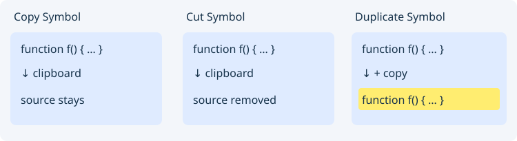
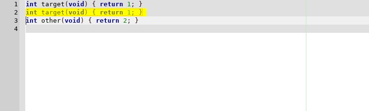
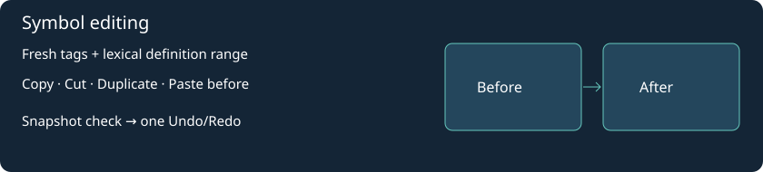

# Структурное выделение

Эталон поведения:
https://www.sourceinsight.com/doc/v4/userguide/Manual/Concepts/Selection_Shortcuts.htm

**Edit → Structural selection**:

| Команда | Клавиши | Поведение |
| --- | --- | --- |
| Select enclosing block / expand | Ctrl+Alt+B | Выделяет наименьшую пару `()`, `[]` или `{}`, охватывающую курсор или всё выделение. Повторение выбирает следующий внешний блок. |
| Select matching brackets | Ctrl+Alt+M | Выделяет пару скобок, на которой или непосредственно после которой стоит курсор. |
| Select line | Ctrl+Alt+L | Вызывает штатное выделение текущей строки/строк Geany. |

Клавиши отличаются от Source Insight: штатные сочетания Geany, включая
Ctrl+- для масштаба, сохраняются. Команды не меняют текст файла.

Для блоков и пар используется существующая лексическая маска: скобки в
комментариях и строках не участвуют в поиске. Поддержаны C/C++, C#, Java,
JavaScript/TypeScript, Python, Lua и Sh; файлы UTF-8 до 2 MiB. Для Python/Lua
Ctrl+Alt+B также выбирает вложенные блоки отступов или `end`/`until`; повтор расширяет выделение к родительскому блоку. Ctrl+Alt+M остаётся командой пар скобок. Ограничения маски остаются:
нет AST, разрешения препроцессора, JS regex literals или интерполяции строк.
Несогласованные скобки не соединяются искусственно; при отсутствии внешнего
блока выделение сохраняется. Прямоугольное и множественное выделение отклоняются.
Выделение полного символа/функции — отдельный следующий этап.

В `insight/examples/structural-selection.c` поставьте курсор внутри
`value + 1`. Три нажатия Ctrl+Alt+B выделят выражение со скобками, тело `if`,
затем тело функции. Строка и комментарий с фиктивными скобками не помешают.

Проверка ядра: `python3 insight/tests/run.py`. Тест также включён в CMake,
Meson и ручную Windows-сборку. Автоматический запуск Actions остаётся выключенным.

Select Function (Ctrl+Alt+F) selects from the parser definition line through the closing body brace, Python suite end, or Lua function `end`. It does not include earlier return-type or annotation lines. Function Up/Down (Ctrl+Alt+PageUp/PageDown) navigate parsed definitions.

Python supports async/multiline definitions, nested suites, continuation brackets, tabs (8-column indentation) and CRLF. Lua balances nested function/if/for/while/do/repeat blocks; masked comments and strings do not contribute keywords. Function selection chooses the smallest containing parsed definition. Function tracking, lexical Calls and Overview use the same ranges. Unsupported languages and unfinished delimiter bodies retain a no-range result; this is lexical structure, not compiler syntax/type validation. Decorators preceding the parser definition line are not included.

## Copy Symbol / Cut Symbol / Duplicate Symbol

В **Edit → Structural selection** добавлены команды копирования, вырезания и дублирования целой функции. Они выбирают наименьшую завершённую функцию, содержащую курсор или всё выделение. Те же команды доступны в контекстном меню **File Symbols**: там обрабатывается выбранная строка панели, даже если курсор находится в другой функции. Project Symbols пока не предоставляет эти операции.

| Команда | Результат |
| --- | --- |
| Copy Symbol | Текст полной функции попадает в обычный буфер обмена. Положение курсора и Undo не меняются; read-only разрешён. |
| Cut Symbol | Функция удаляется и копируется в буфер обмена; одно Undo возвращает её. |
| Duplicate Symbol | Копия вставляется сразу после функции и выделяется; буфер обмена не меняется. Одно Undo удаляет копию. Имя остаётся прежним. |

Диапазон включает отступ на строке определения, тело, оставшийся комментарий на завершающей строке и её перевод строки. В конце файла без EOL перед копией добавляется один разделитель в формате документа (LF/CRLF/CR). Python выбирает вложенную функцию; Lua учитывает вложенные `if`/`end`. Предыдущие строки с декораторами, аннотациями или типом возврата не включаются.

Поддержаны отдельно расположенные определения функций и методов в языках со скобками, Python и Lua. Это лексические границы с актуальными parser tags, а не AST: классы, переменные, прототипы, неполные тела и несколько определений на одной строке отклоняются. Документ ограничен 2 МиБ, функция — 1 МиБ; нужны корректный UTF-8 без NUL и одно обычное выделение без виртуальных позиций. Изменённая строка выбранного символа проверяется заново, устаревший пункт панели не вырезает соседний код. Изменения в read-only запрещены.

Реальный редактор Linux после Duplicate Symbol из File Symbols: вставленная функция выделена, следующая функция сохранена.

## Точное дублирование выделения

**Edit → Duplicate Line or Selection / Ctrl+D** дублирует именно выделенный фрагмент, включая части первой и последней строк, буквы, пробелы и переводы строк. Предварительное расширение многострочного выделения до полных строк больше не выполняется. Без выделения сохраняется дублирование текущей строки. Операция поддерживает обратное выделение и Undo/Redo; read-only запрещает изменение.

[Delimiter navigation and enclosing-pair browser / Переходы по скобкам](delimiter-navigation.md).

## Дополнение: Paste Symbol и редактирование определений

Команды Copy/Cut/Duplicate Symbol теперь работают не только с функциями, но и с поддерживаемыми именованными class/struct/union/enum/namespace/interface, включая классы Python. Выбирается наименьшее полное определение, охватывающее курсор или выделение; в File Symbols — выбранная строка независимо от курсора. Диапазон подтверждается свежими тегами и лексической маской. Переменные, прототипы, незавершённые тела, объявления с дополнительным именем после закрывающей скобки и соседние определения на одной строке отклоняются.

**Paste Symbol…** доступна в Edit → Structural selection и контекстном меню File Symbols. После асинхронного чтения буфера обмена открывает два окна с подсветкой и номерами строк: полный исходник до и после вставки **перед** определением. Apply не заменяет тело или текущее выделение; Cancel ничего не вставляет. Если в конце вставляемого текста нет перевода строки, добавляется окончание строки документа. Имеющиеся байты и окончания строк сохраняются точно; отступы и имена не корректируются. Содержимое буфера — обычный текст UTF-8, а не синтаксическое дерево. Файлы на диск не записываются.

Для всех четырёх команд можно назначить клавиши в группе Editor; стандартных сочетаний нет. Cut/Duplicate/Paste используют общий план и один Undo/Redo. Перед изменением повторно проверяются документ, имя файла, тип языка, полный текст, счётчик правок, обычное выделение, активная вкладка и разрешение редактирования. Даже правка с последующим Undo блокирует старый вариант Paste. Закрытие, переименование и переключение исходника также отменяют применение. Проверяется фактический результат вставки, включая подмену расширением; при вмешательстве сообщение предложит проверить исходник и воспользоваться Undo.

Copy допускает исходник только для чтения. Прямоугольные, множественные выделения и виртуальные позиции не поддерживаются. Ограничения: 2 МиБ исходника, 1 МиБ определения или текста буфера обмена. Это лексическое распознавание границ, а не семантический рефакторинг.

[Подробности и ссылки на команды Source Insight](en/structural-selection.md).
