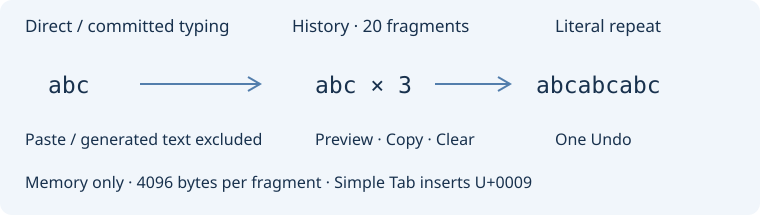
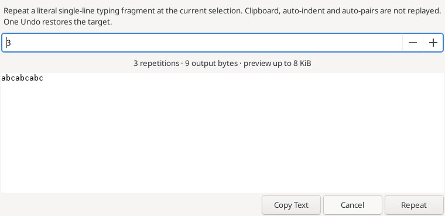
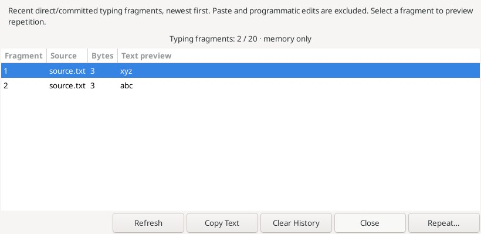

# Repeat Typing and Simple Tab / Повтор набора и обычная табуляция

**Edit → Typing and replay** adds five unassigned native Editor keybindings:
Repeat Typing, Repeat Typing Preview, Typing History, Simple Tab and Clear Typing
History. Repeat Typing inserts the most recent recorded fragment literally at the
caret or replaces the exact normal selection, with one Undo/Redo and the caret
after the inserted text. It preserves clipboard, EOL mode and text outside the
selection. Identical replacement preserves selection and Undo history.

The recorder stores contiguous **single-line direct/committed typing fragments**
from Scintilla character notifications, including whole committed IME chunks.
Tentative composition, Paste, API/programmatic edits, Undo/Redo and editor-generated
text are excluded. Moving the caret, replacing a selection, changing document,
newlines/controls and intervening edits end a fragment. The prior fragment remains
available even if source text is later deleted or its document closed. Auto-pairs,
indentation, intercepted typing shortcuts and completion may split or bypass
fragments; their generated text is never reconstructed. This is literal text
repetition, not command/macro recording or reconstruction of a document diff.

**Repeat Typing Preview…** shows a noneditable monospace preview, a repeat count
from 1 to 100, output byte count, Copy Text, Cancel and Repeat. The first 8 KiB is
shown; Copy/Repeat use the complete output. Changing the count updates preview.
Copy Text is explicit and does not edit the target. Apply revalidates document id,
text generation, active tab, anchor/caret, ordinary selection and writable state.
Read-only or unsupported targets can preview/copy but cannot apply. A switched,
closed, edited, moved or newly read-only target cancels Apply. Reopen the preview
to capture a new target. Repetition uses literal insertion, without auto-indent,
auto-pairs, case adaptation, clipboard paste transforms or overwrite mode.

**Typing History…** lists up to 20 recent fragments, newest first, with source
basename, byte length and a UTF-8-safe 160-byte excerpt. Copy Text copies the full
selected fragment; Repeat… or double-click opens its preview at the current target.
Refresh recomputes the list; stale history requires explicit Refresh. Clear History
removes its retained fragments and disables empty-list actions. The menu command
Clear Typing History performs the same operation. History is memory-only, not saved
in configuration/session files or sent elsewhere. Existing clipboard contents and
already opened preview snapshots are independent of clearing this list.

**Simple Tab** replaces the exact selection with one literal U+0009 tab, bypassing
Smart Tab, indentation and the tabs/spaces preference. It uses one Undo/Redo and
does not enter typing history. It does not shift or reindent selected lines.

Limits: 4096 bytes per recorded fragment; exceeding that limit discards the whole
active fragment rather than retaining a misleading prefix. At most 20 fragments
are retained. Capture/replay requires valid UTF-8 without NUL; fragments exclude
newlines and controls except horizontal tab. Replay requires one normal selection,
no virtual positions, complete UTF-8/CRLF boundaries, and input/final documents up
to 8 MiB. Counts are limited to 100 (409600 output bytes maximum). Read-only edits,
multiple/rectangular selections and unsupported positions are rejected. Preview
and history are local snapshots, not persistent edit recovery.

**Правка → Набор и повторение** добавляет повтор последнего фрагмента, предпросмотр
с количеством 1–100, историю набора, обычную табуляцию и очистку истории. Повтор
вставляет буквальный текст одним Undo, заменяя точное выделение и сохраняя остальной
текст, clipboard и окончания строк. Совпадающая замена не создаёт лишней правки.

Записываются только однострочные фрагменты прямого или подтверждённого IME-набора.
Предварительная композиция, Paste, Undo/Redo, автоскобки и программные правки не
записываются. Перемещение курсора, смена документа, перевод строки и другие правки
прерывают фрагмент. Перехватывающие ввод команды могут не создавать уведомление
о набранном символе; это буквальный повтор текста, а не запись макросов.

В истории хранятся до 20 фрагментов по 4096 байт, только в памяти. Можно скопировать,
очистить или выбрать фрагмент для предпросмотра повторения. Превышение размера
удаляет весь текущий фрагмент. Перед применением проверяются документ, поколение
текста, выделение и права. Read-only допускает просмотр/копирование, но не правку.
Обычная табуляция вставляет ровно U+0009 независимо от Smart Tab и настройки пробелов.
Лимит документа — 8 МиБ, без NUL и неполных UTF-8/CRLF-позиций; множественные,
прямоугольные выделения и виртуальные позиции не поддерживаются.

References: [Repeat Typing](https://www.sourceinsight.com/doc/v4/userguide/Manual/Command_Reference/Repeat_Typing.htm),
[Simple Tab](https://www.sourceinsight.com/doc/v4/userguide/Manual/Command_Reference/Simple_Tab.htm).

Both are actual production dialogs from an isolated native Linux GUI fixture in
the successful 54-test run, not mockups. Ordinary typing uses real GTK key/IM
handling. Committed/tentative IME cases use controlled Scintilla notifications;
an external OS IME provider was not tested.

Оба снимка показывают настоящие окна из изолированного нативного GUI-теста Linux,
прошедшего в составе 54 проверок; это не макеты. Обычный ввод проходит через
GTK/Scintilla. Для IME использованы управляемые уведомления; внешний системный
IME-провайдер не проверялся.
