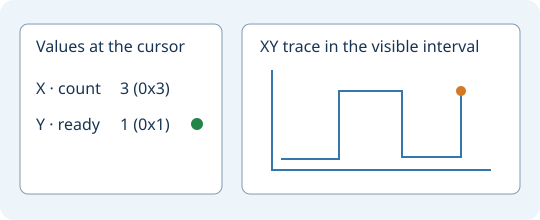

# Verilog and SystemVerilog debugger

Open a saved `.v` or `.sv` testbench in Geany. Choose
**Tools → Verilog / SystemVerilog → Debug Current Verilog File**.
The same command is available in the editor context menu under
**Source tools**. Save any edits before starting.

Use **Debug Verilog Testbench…** to select several files when the design
and its testbench are in separate files. **Run Verilog Testbench…** runs
the selected files without stopping at debugger prompts.

In **Verilog Simulation**, select a source line and add a breakpoint.
Use **Continue**, **Step HDL**, **Step Current Process** and **Next Tick**
to move through execution. **Process Values** displays the selected
process or frame. **Load Lua Observer…** opens an observer script.
Simulator messages and commands appear in the embedded console.

**Preview Waveform** opens the current capture. In the waveform window,
use **Signal Map → HDL Uses… → Connections** to inspect data, guard and
clock dependencies. **VCD Waveforms…** opens an existing recording.

## Port signals

**Debug Current Verilog File** opens **Port Signals**. Leave the recipe
empty for an existing testbench. For a module with ports, enter its name
and one rule per port. For example:

```text
module counter
duration 1000
clock clk 5 5 5
pulse rst_n 0 20 0
bus data 8 40 "step * 3"
output count 8
```

Times are in nanoseconds. `clock` takes the start, high and low durations.
Use `clock-hz clk 5 100000000` for a 100 MHz clock with equal phases.
`pulse` takes start, length and active level. `value data 8 "8'h2a"`
drives a constant. `bus` takes the width, update interval and expression.
`step` starts at zero, and SystemVerilog expressions can also use
`$time`. Use double quotes around expressions with spaces or Verilog
literals containing an apostrophe. `output` records a port in the VCD.

Port recipes are saved by project and source file. **Port Signals…**
on the debugger panel reopens the recipe. Edits made during a run apply
the next time debugging starts.

## Output instruments

Open **Signal Instruments…** in the VCD viewer, including from
**Preview Waveform**. Choose up to three recorded signals. One-bit
signals have a lamp. Known values up to 64 bits appear as unsigned
decimal and hexadecimal. Unknown states remain visible as recorded.



Use the waveform tracks for plots against time. Choose X and Y for an
XY trace and add Z for a fixed XYZ projection. The plot follows the
visible time interval and uses transitions in those signals. Unknown
samples interrupt the trace. The first 2048 samples are shown when
the interval is dense. Zoom in to inspect more detail. The readings
follow the VCD cursor, and named VCD sessions save the axis selections.

## Live inputs, output readings and SRAM

Add rules such as these to the port recipe:

```text
live-interval 10
live-input enable 1 0
monitor ready 1
monitor result 16
sram addr dq ce_n we_n oe_n 10 8
```

**Live Port I/O** accepts binary input (including `x` and `z`).
Click **Apply Input** while running or paused. The next simulated poll
applies the most recent value. Monitors refresh as samples arrive.
`live-interval` sets the polling interval in nanoseconds. A short wall-clock
delay at each poll leaves time for interaction. Simulation time remains
controlled by the testbench and its duration.

The SRAM rule connects address, bidirectional data and active-low chip,
write and output enables. The last two numbers set address and data widths.
Geany ships this C model as an Icarus VPI module. It is a functional asynchronous model with uninitialized contents and
high-impedance data outside reads. It supports 1–16 address bits and
1–64 data bits. SRAM timing constraints and vendor-specific behavior are
outside this model.

## UART console

```text
duration 100000
live-interval 250
uart rx tx 1000000 console
```

This connects one asynchronous 8N1 UART to the design's RX and TX.
The baud rate is in bits per second. The optional `console` keyword
adds **UART Console…** to the debugger panel. Press Enter to send the
entry's UTF-8 bytes without an automatic newline. The receiver displays
ASCII and escapes other bytes as `\xNN`. The entry waits for the previous
message to finish transmitting before accepting another one.

## External SystemVerilog device models

Use a simulator-compatible model you already have. The source path is
relative to the current HDL file, or absolute. Quote paths with spaces.
Add companion compilation units with `model-source`. The source
directories are also added to Icarus's include search.

```text
model mem external_memory "models/external memory.sv"
model-param mem DATA "8'h3c"
model-value mem mask "8'h05"
monitor ready 1
model-share mem ready enable
model-link mem external_data data 8
```

`model-link` creates a shared wire of the specified width between a DUT
port and a model port. It also works for bidirectional buses.
`model-share` attaches a model port to an already configured DUT signal.
`model-param` passes a named parameter and `model-value` ties a model
port to an expression. Declare the instance before its bindings.

## Memory presets

In **Port Signals**, enter just a device name to use its standard
lowercase port names and default parameters. For a DUT with ports
`sck`, `cs_n`, `mosi` and `miso`, a complete recipe is:

```text
module my_controller
spi-nor
```

| Preset | Default port order | Parameters |
| --- | --- | --- |
| `sram` | `addr dq ce_n we_n oe_n` | 16 address bits, 8 data bits |
| `ddr2` | `ck cke cs_n ras_n cas_n we_n a ba dq dqs dm` | RL 3, WL 2 CK cycles |
| `ddr3` | `ck reset_n cke cs_n ras_n cas_n we_n a ba dq dqs dm` | RL 3, WL 2 CK cycles |
| `ddr4` | `ck reset_n cke cs_n act_n a ba bg dq dqs dm_n` | RL 3, WL 2 CK cycles |
| `spi-nor`, `spi-nand`, `spi-eeprom` | `sck cs_n mosi miso` | SPI mode 0, built-in geometry |

To override ports, list them in order. Use `-` in positions that should
keep the preset value, for example `spi-nor - flash_cs_n - -`. SRAM
widths and DDR latencies can be omitted at the end or overridden
individually. For example, `sram - - - - - 12` keeps 8-bit data and uses
12 address bits. With a bare preset, key `memory-image` by `addr` for
SRAM, `a` for DDR and `cs_n` for SPI. With a custom port name, use that
name instead.

## Built-in functional DDR4 x8

```text
ddr4 ck reset_n cke cs_n act_n a ba bg dq dqs dm_n 3 2
```

The C VPI device connects one rank with a 17-bit multiplexed address,
two bank bits, two bank-group bits, eight DQ bits, a single-ended DQS,
and active-low byte mask. The final numbers set read and write latency
in rising CK cycles. The model opens rows, handles fixed BL8 reads and
writes, supports auto-precharge and explicit precharge, and retains
four-state bytes. Storage is sparse with a 65,536-byte limit.

This functional model is intended for controller data-path debugging.
It supports one outstanding burst. The read strobe is edge-aligned
with CK. Training, differential signaling, mode-register configuration,
refresh timing, power states and JEDEC timing checks are outside its scope.

## Built-in functional DDR3 x8

```text
ddr3 ck reset_n cke cs_n ras_n cas_n we_n a ba dq dqs dm 3 2
```

The C device takes separate RAS#, CAS# and WE# signals, a 16-bit address,
a 3-bit bank, eight DQ bits, single-ended DQS and active-high DM.
It shares the functional BL8 behavior, latency units and limits described
for DDR4 above.

## Preload SRAM, DDR3 or DDR4

Put a `memory-image` line before the device rule and name the same DUT
address port. The path can be absolute or relative to the open Verilog
source directory. Quote paths containing spaces.

```text
memory-image sram_addr "fixtures/boot words.hex"
sram sram_addr dq ce_n we_n oe_n 12 16
```

The image is a plain text file of up to 1 MiB. Separate hexadecimal
words by whitespace. An optional `@hex_address` changes the address
for the next word. The default starting address is zero. A token
beginning with `#` starts a comment through the end of the line.

```text
# Two consecutive SRAM words, starting at address 0x10
@10 BEEF 1234
```

SRAM addresses count words of the configured width. DDR images contain
one byte per address, using `(row << 14) | (bank << 10) | column`. For
DDR3, bank is BA (0–7). For DDR4 it is `(BG << 2) | BA` (0–15).
The saved recipe keeps the path. Each new session reads the file again
and applies it before the device responds to its first bus event.


## Built-in functional DDR2 x8

```text
ddr2 ck cke cs_n ras_n cas_n we_n a ba dq dqs dm 3 2
```

This profile uses a 14-bit address and three bank bits. It starts with
closed banks and uses the DDR3 BL8 behavior, DM polarity and image
layout. Use the DUT address port as the `memory-image` key.

## SPI memories

```text
memory-image flash_cs_n "fixtures/flash.hex"
spi-nor sck flash_cs_n mosi miso
```

The built-in C devices use four-wire SPI mode 0, active-low chip select
and MSB-first bytes. MISO floats while the device is deselected.
Use `spi-nand` or `spi-eeprom` with the same port order.
Devices can share SCK, MOSI and MISO with a separate CS# for each.
Each image uses byte addresses and is keyed by that device's CS# port.
Uninitialized bytes start at FF.

| Model | Geometry | Implemented commands (hex) |
| --- | --- | --- |
| SPI NOR | 64 KiB, 256-byte pages, 4 KiB sectors | 03 read, 02 page program, 20 sector erase, 05 status, 06/04 write enable/disable |
| SPI NAND | One block of 64 × 2048-byte pages | 13 page to cache, 03 cache read, 02 program load, 10 program execute, D8 block erase, 0F get feature, FF reset, 06/04 write enable/disable |
| SPI EEPROM | 64 KiB, 128-byte pages | 03 read, 02 page write, 05 status, 06/04 write enable/disable |

NOR takes three address bytes and EEPROM takes two. NAND page commands
take three row bytes. Its cache read takes two column bytes followed by
one dummy byte. For NAND images, byte address = page × 2048 + column.
These profiles model data transfers with immediate completion.
Device identification, busy timing, protection, ECC and spare areas
are outside the implemented command sets.
