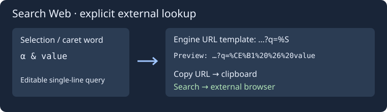

# Поиск в интернете и поисковые системы

Откройте **Поиск → Поиск в интернете…**, пункт контекстного меню редактора либо назначьте сочетание клавиш в группе поиска. В запрос подставляется обычное выделение или слово под курсором. Многострочное, прямоугольное, множественное и виртуальное выделения не подставляются. Запрос можно ввести и без открытого исходника.

Выберите поисковую систему и проверьте URL в выделяемом поле предпросмотра. **Копировать URL** меняет только буфер обмена. **Искать** открывает внешний браузер через штатную настройку Geany; окно поиска остаётся открытым. Изменение запроса или поисковика не запускает браузер. Запросы не сохраняются в настройках; функция не загружает файлы и не сканирует проект.

В окне **Поисковые системы…** доступны имя, URL, добавление, изменение выбранной записи, удаление и перемещение вверх/вниз. Допускается до 32 записей, хотя бы одна должна остаться. Начальные примеры: DuckDuckGo, Google и Bing. Список и выбранный поисковик сохраняются между запусками в `insight/web-search.conf`. При повторном открытии окна запрос снова берётся из текущего исходника.

Шаблон URL: HTTP(S), до 4096 байт UTF-8, ровно один маркер **%S** после имени узла. Отклоняются адреса с логином/паролем, неэкранированными пробелами и управляющими символами, ошибочными процентными последовательностями и портами. Готовые последовательности вроде `%20` сохраняются. Запрос кодируется как один компонент URL: Unicode, пробелы, `&`, `+`, `#`, кавычки и косые черты не создают дополнительные параметры или команды. Запрос — одна строка до 4096 байт, имя поисковика — до 128 байт. `%S` допустим в пути или параметрах URL.

Текст, выделение, история отмен и исходники на диске не меняются. Сетевой запрос выполняет внешний браузер после кнопки **Искать**. В Windows используется браузер по умолчанию, на других настольных платформах — настройка Geany или системный браузер. Встроенного браузера и загрузки результатов в редактор нет.

Прототипы: [Source Insight Search Web](https://www.sourceinsight.com/doc/v4/userguide/Manual/Command_Reference/Search_Web.htm), [Search Engines](https://www.sourceinsight.com/doc/v4/userguide/Manual/Command_Reference/Search_Engines.htm).
