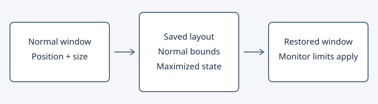
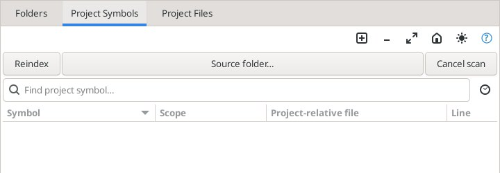
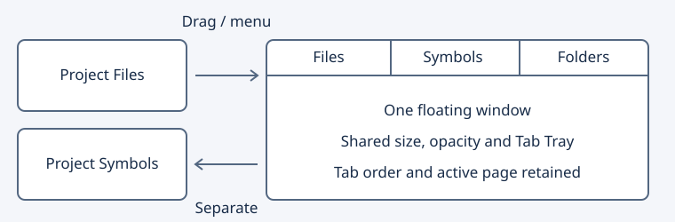

# Окна, раскладки и Tab Tray

Geany Insight позволяет управлять десятью отдельными панелями: Project Files,
Project Symbols, Folders, Relations, Symbol Categories, File Types, Bookmarks,
Clips, File Symbols и Context.

## Кнопки заголовка

| Действие | Результат |
| --- | --- |
| Открепить | Открывает панель отдельным плавающим окном. |
| Закрепить (домик) | Возвращает панель на штатное место и выбирает её вкладку. |
| Развернуть / Восстановить | Меняет размер плавающего окна; обычные размеры сохраняются отдельно. |
| Свернуть (минус) | Помещает плавающую панель в нижнюю полосу Tab Tray. |
| Системное закрытие окна | Закрепляет панель обратно. |

Подсказка при наведении показывает действие. Разворачивание и сворачивание
доступны только для плавающей панели. Можно многократно откреплять и закреплять
панели, сохраняя их содержимое и кнопки.

## Нижняя полоса

Нажатие имени в Tab Tray возвращает плавающее окно. Полоса скрывается, когда
свёрнутых панелей нет. View → Panels → Tab Tray управляет видимостью полосы:
скрытие не восстанавливает окна. Команда Restore minimized panels возвращает
все свёрнутые панели даже при скрытой полосе. Активация панели из меню также
возвращает её окно. Обычное системное сворачивание направляется в Tab Tray.

## Раскладки A–D

View → Layouts → Save current layout → Save as A–D запоминает текущую
компоновку. Load layout A–D восстанавливает её. Включены разделители,
видимость, активная проектная вкладка, Follow/Wrap, отдельные плавающие панели,
их обычные координаты/размеры, развёрнутое и свёрнутое состояние, видимость
Tab Tray и параметры окна Window List. После переноса на другой монитор
положение плавающей панели ограничивается доступной рабочей областью.

## Дополнительные файлы

View → Layouts → Save layout to file… сохраняет компоновку в
`*.geany-layout`; Load layout from file… применяет её. Эти команды не заменяют
ячейки A–D. Для привязки загруженной компоновки к ячейке сохраните её отдельно.
Отмена диалога ничего не применяет. Перезапись файла требует обычного
подтверждения системного диалога.

Это собственный INI-формат Geany Insight, без текста исходников и путей проекта;
файлы XML Source Insight не импортируются. Слишком большой файл (более 64 КиБ),
нулевые байты, отсутствующие поля и неверные значения отклоняются до изменения
окон. Ошибка отображается в строке состояния. Старые версии внутренних
раскладок 1–7 читаются с настройками по умолчанию для отсутствующих возможностей.

## Пример

1. Открепите Project Files, измените размер и сверните его в Tab Tray.
2. Сохраните раскладку в A или в файл `review.geany-layout`.
3. Восстановите панель нажатием имени в полосе и закрепите её.
4. Загрузите раскладку: плавающая панель снова будет свёрнута в полосе.

Снимок настоящего окна приложения Linux, полученный в автоматическом сценарии
сборки и перезапуска (показана верхняя часть Project Files):

Произвольное закрепление у любой границы пока не реализовано. Восемь проектных
панелей можно объединять в группы, как описано ниже. Отдельное окно Window List и плавающая целая группа
Project Window не входят в десять панелей Tab Tray. Проверен Linux; Windows и
Android в этой серии не запускались.

## Главное окно редактора

Раскладка также запоминает обычные размеры/положение главного окна и его
развёрнутое состояние. Для развёрнутого окна отдельно сохраняются ранее
наблюдавшиеся обычные размеры: «Восстановить» возвращает именно их. При загрузке
координаты ограничиваются рабочей областью монитора. Старые форматы раскладок
не меняют главное окно. Минимальные размеры интерфейса и ограничения оконного
менеджера по-прежнему действуют.

## Прозрачность плавающих панелей

View → Panels → Enable transparent panels включает регулятор непрозрачности
в заголовках плавающих панелей. Нажмите значок яркости и выберите от 40 до
100 процентов; текущее значение видно в подсказке. 100 процентов — полностью
непрозрачное окно. У закреплённой панели регулятор скрыт. Отключение общей опции
делает окна непрозрачными, сохраняя отдельные значения. Изначально опция выключена.

Общий переключатель и значения панелей сохраняются между запусками, в A–D и
файлах раскладок. Старые раскладки используют непрозрачные панели с выключенной
опцией. Видимый эффект требует композитора рабочего стола. Клики обрабатывает
сама панель; пропуск кликов через фон, как в Source Insight, пока не реализован.

На Linux проверены значение GTK, изменение пикселя экрана под Xvfb/Openbox/xcompmgr,
восстановление из раскладки и перезапуск.

## Группы плавающих проектных панелей

Открепите проектную панель и нажмите значок вкладок/группы в её заголовке.
Выберите другую проектную панель: обе окажутся в одном окне с вкладками;
закреплённая целевая панель открепляется автоматически. Так же добавляются
следующие панели. Вкладки внутри группы можно переставлять мышью. Команда
«Открыть эту панель отдельным окном» извлекает только выбранную панель.
«Закрепить» возвращает только её на штатное место. Закрытие группового окна
закрепляет оставшиеся панели, сохраняя открытые документы редактора.

Сворачивание, разворачивание и непрозрачность действуют на всё окно. В Tab Tray
группа представлена одной кнопкой с именем панели и числом дополнительных вкладок.
Раскладки и настройки сеанса запоминают состав, порядок и активную вкладку.
Неверные связи групп, одинаковые позиции вкладок и несогласованные видимость или
непрозрачность отклоняются при загрузке раскладки. Повреждённые группы сеанса
восстанавливаются отдельными окнами.

Группируются Project Files, Project Symbols, Folders, Relations, Symbol Categories,
File Types, Bookmarks и Clips. File Symbols, Context, Window List и целая группа
Project Window остаются отдельными. На этом этапе используется меню группировки;
перенос между окнами мышью пока не добавлен.

Настоящее приложение Linux в сценарии группировки и перезапуска:

