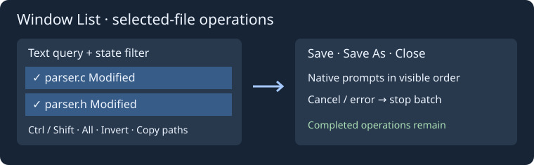

# Window List

Open Window → Window List…. This is a reusable nonmodal floating window listing the editor's live documents, including untitled buffers. It does not load extra project files or Context-only disk previews into the editor.

The search matches names, full paths and nearest parsed symbols using Unicode case folding. Columns show the active buffer, file name, modified/read-only status, line count, nearest symbol and path. Click column headers to sort; the selector provides most recently used, name and path order. Recent order is tracked through document open/activation events for this editor session.

Single selection/click previews the buffer at its retained caret in Context; the editor stays on its current document. Double click, Enter from the search/list, or Activate switches the editor to the selected buffer while preserving its caret. Save uses Geany's native save/Save As handling. Close file uses its native unsaved-change prompt, so cancelling keeps the buffer open. Actions resolve stable document IDs at execution time.

The list refreshes after document events and editor updates while visible, keeps the selected document when possible, and uses coalesced updates. Escape hides the window; reopening preserves the search and sort. The window close button also hides it. The nearest-symbol column uses existing parser tags, not a proven enclosing semantic scope. Use Dock in sidebar to move the same list into a sidebar tab. Clear it to return to the floating window. Escape or the tab close button hides only the list; Window → Window List… reveals it again. The mode is saved, and the list opens in that mode when requested after restarting. General edge dragging, snapping and Window List integration into A–D layouts remain open.

## Saved window settings

Resize columns by dragging their edges and reorder them by dragging their headers.
The window remembers its normal size and position, maximized state, search text,
column widths/order, and the actual sort column/direction (including custom header
sorting). It saves on Escape, window close, view destruction or editor shutdown.
Settings are restored the next time the list is created, including after restarting
the editor; the list opens only when requested.

The normal window rectangle is clamped to a monitor's available work area. Invalid
sizes, widths or sort values use defaults; malformed column permutations are ignored.
Preferences are stored atomically in `config/insight/window-list.conf`. The MRU order
of individual buffers remains specific to the current editor session. Changing the
interface language refreshes the displayed file-state labels and status message.

### Window List в раскладках A–D

Save current layout сохраняет видимость Window List, закрепление в боковой панели и положение/размер/максимизацию плавающего окна. Load layout восстанавливает это состояние, сохраняя список, фильтр, сортировку и колонки. Скрытый список не открывается при загрузке раскладки. Формат раскладок v3 читает старые v1/v2; старые раскладки не меняют Window List. Координаты восстанавливаются в рабочей области доступного монитора. Перетаскивание и snap-to-edge ещё не реализованы.

## Групповые операции с файлами

Ctrl+щелчок и Shift+щелчок выбирают несколько строк. **Выбрать все** действует на видимые строки, **Инвертировать выбор** меняет их выделение на противоположное. Активация и предпросмотр Context работают для одной строки. **Сохранить**, **Сохранить как…**, **Закрыть файл** обрабатывают выбранные файлы в порядке сортировки. Сохранение пропускает файлы только для чтения. Отмена диалога или ошибка останавливает оставшуюся серию; уже выполненные операции сохраняются. «Сохранить как» использует обычный диалог редактора и активирует соответствующую вкладку.

**Копировать пути** копирует имена выбранных именованных буферов, разделённые переводами строк, до 2 МиБ. Безымянные буферы пропускаются; пустой результат не меняет буфер обмена. Фильтры всех, изменённых, доступных только для чтения и несохранённых файлов сочетаются с текстовым поиском. Несохранённые — буферы без привязки к файлу на диске. Этот фильтр действует до пересоздания окна.

Если отображаемые сведения не изменились, фоновое обновление не пересоздаёт строки. Обычное перемещение курсора внутри того же ближайшего символа сохраняет модель, множественное выделение и прокрутку. При изменении строк сохраняются выбранные идентификаторы документов, оставшиеся видимыми; иначе выбирается текущий или первый видимый файл. Фильтры не меняют состав проекта и не обходят каталоги.

Прототип операций сохранения и закрытия: [Source Insight Pick Window](https://www.sourceinsight.com/doc/v4/userguide/Manual/Command_Reference/Pick_Window.htm). Отдельное сворачивание и размещение исходников плиткой в эту команду не входят.
