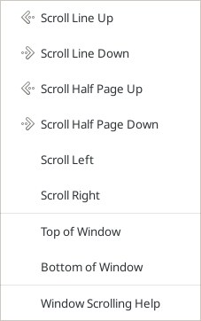
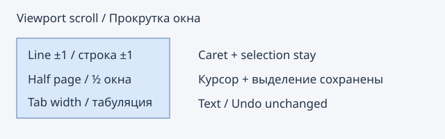

# Window scrolling / Прокрутка окна

Edit → Selection and navigation → Window scrolling provides six viewport commands.
Line Up/Down moves one display row; Half Page moves half the visible display rows
(at least one). Left/Right moves one tab width measured using the default font.
The caret, every selection, text, savepoint and Undo remain unchanged, including
read-only buffers and rectangular/multiple selections. Native scroll limits apply.
No default shortcuts override Geany navigation or document switching.

Правка → Выделение и навигация → Прокрутка окна: строка вверх/вниз,
полстраницы вверх/вниз и влево/вправо на ширину табуляции. Курсор и все
выделения сохраняются, даже вне видимой области. Текст и история Undo
не меняются; команды доступны в режиме только чтения.

Reference: [Source Insight scrolling commands](https://www.sourceinsight.com/doc/v4/userguide/Manual/Concepts/Scrolling_Commands.htm).

Top/Bottom of Window moves to the beginning of the first/last fully visible
logical line (one line minimum), bounded to EOF. Folded display rows are mapped
back to document lines. Wrapped rows target their logical line beginning, which
can scroll the view to that beginning. Extend Mode retains the anchor. These two
commands require one normal selection; read-only is allowed. A partially visible
bottom row is excluded. No preferred visual column is retained.

Верх/Низ окна перемещают курсор к началу первой/последней полностью видимой
логической строки. Extend Mode сохраняет anchor. Свёрнутые строки учитываются;
при переносе строки используется начало её логической строки. Эти два перехода
требуют одного обычного выделения; режим только чтения допускается.

References: [Top of Window](https://www.sourceinsight.com/doc/v4/userguide/Manual/Command_Reference/Top_of_Window.htm),
[Bottom of Window](https://www.sourceinsight.com/doc/v4/userguide/Manual/Command_Reference/Bottom_of_Window.htm).

Horizontal commands leave the viewport unchanged while line wrapping is enabled.
При включённом переносе строк горизонтальная прокрутка не выполняется.
