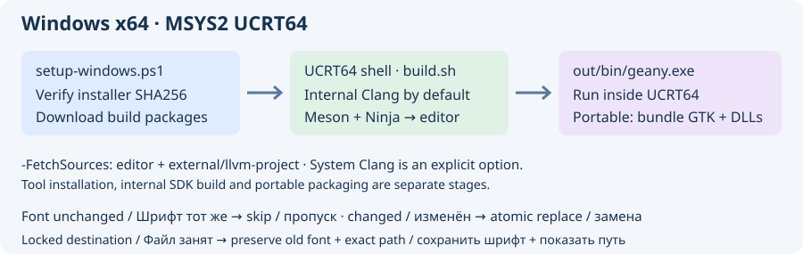
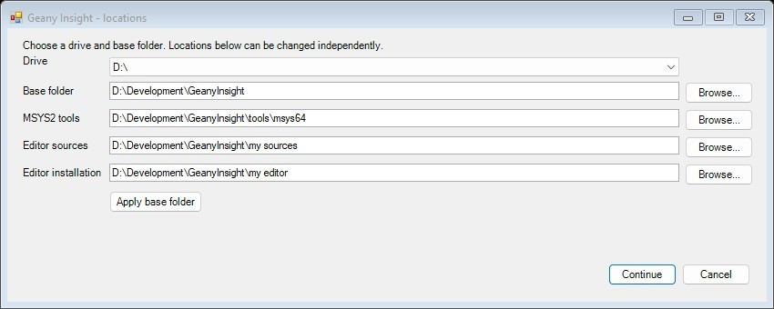

# Build on Windows x64

From the repository root, run `build.cmd -BuildEditor`. With no arguments, `build.cmd` opens a menu with build, plan, help and exit; the source path defaults to the checkout containing the script.

Keep the console open during the build. The bootstrap shows the installer name and download percentage (or bytes received if the server did not provide a size). pacman and Git report their own download progress. Ninja shows completed tasks and percentage for the current build stage, such as Clang or the editor; there is no single percentage for the whole installation. While a command is running, the launcher prints its stage and elapsed time every 20 seconds. Failed stages report their exit code.

This guide describes a **native Windows x64 build using MSYS2 UCRT64**, GCC and GTK3. Visual Studio, WSL and Cygwin are not required. Keep all compiler libraries in the UCRT64 environment: do not mix MINGW64, CLANG64 or MSVC libraries with this toolchain.



## Required tools

| Component | Purpose / MSYS2 package |
| --- | --- |
| Windows PowerShell 5.1 or PowerShell 7 | Runs the bootstrap script; Windows PowerShell is included with Windows |
| MSYS2 x86_64, UCRT64 shell | Bash, pacman package manager and Windows build environment |
| GCC/G++ and binutils | `mingw-w64-ucrt-x86_64-gcc`; C11 and C++17 code, linker and resource compiler |
| GTK3 and GLib development files | `mingw-w64-ucrt-x86_64-gtk3`; project minimum GTK 3.22 / GLib 2.56 |
| pkg-config | `mingw-w64-ucrt-x86_64-pkgconf`; locates headers and libraries |
| Meson and Ninja | `mingw-w64-ucrt-x86_64-meson`, `mingw-w64-ucrt-x86_64-ninja`; Meson minimum 0.56 |
| CMake | `mingw-w64-ucrt-x86_64-cmake`; internal LLVM/Clang requires **3.20+ on Windows**; the project's 3.10 compatibility path is Linux-only |
| Python and Docutils | `mingw-w64-ucrt-x86_64-python`, `mingw-w64-ucrt-x86_64-python-docutils`; build helpers and documentation |
| Git, curl, patch, diffutils, gettext, tar, xz, unzip, zip, rsync | Source download, parser tests, generated files and packaging helpers |
| Optional Autotools | `-Autotools`: UCRT64 autotools, MSYS make and gettext development tools |
| Optional NSIS | `-Packaging`: `mingw-w64-ucrt-x86_64-nsis`, wget and dos2unix; needed for an `.exe` installer, not for compiling/running the editor |
| Optional system Clang/LLVM | `-ClangProvider System`: UCRT64 `clang` and `llvm`; an explicit alternative to the internal source SDK |

The complete package lists and pinned MSYS2 installer URL/SHA256 are in [windows-toolchain.json](../tools/windows-toolchain.json). The installer is pinned; pacman downloads current signed packages, so package versions are not frozen. The script prints the installed versions. Allow several GiB for tools; the internal LLVM source/build can require tens of GiB and substantial build time. Use a writable directory without spaces for MSYS2, for example `C:\msys64`, and preferably a short source path such as `C:\src\geany-insight`.

## Automatic download and installation



**Double-click `insight/tools/Build-Windows.cmd`** for the complete path: choose folders, install tools, download sources, build and install the editor. The PowerShell location dialog has a drive selector and separate editable/browseable locations for MSYS2, editor sources and editor installation. Changing the base folder updates its default subfolders; each location can also be overridden independently. Cancel stops before downloads or installation.

The default base is under Local AppData (or a short `Development/GeanyInsight` path when the MSYS2 path would be unsupported), not the root of C:. Select another drive/folder in the dialog. The default installer cache also follows the selected base. MSYS2's own path must remain ASCII without spaces; source and install locations may contain spaces.

For scripted operation add `-NonInteractive`, with e.g. `-RootDir D:\Development\Insight`; this selects `tools\msys64`, `src`, `editor` and `downloads` below that folder. `-MsysRoot`, `-SourceDir`, `-InstallDir` and `-CacheDir` override individual locations. `-Plan` and `-Help` never show a dialog or modify files.

```powershell
# Plan all paths, without changes:
powershell.exe -NoProfile -ExecutionPolicy Bypass -File .\insight\tools\setup-windows.ps1 -RootDir D:\Development\Insight -Plan
# Unattended full build on a chosen drive:
powershell.exe -NoProfile -ExecutionPolicy Bypass -File .\insight\tools\setup-windows.ps1 -NonInteractive -RootDir D:\Development\Insight -BuildEditor
```

`-BuildEditor` implies source download and invokes the common Meson build driver with the selected install prefix. Without it the script prepares tools and optionally sources. Internal Clang and adapted slang are built automatically by the common driver; the Windows bootstrap itself is not an offline installer.


Extract the supplied toolkit ZIP (or use the repository). Open a **normal PowerShell window**, change to the extracted/repository root, and run:

```powershell
powershell.exe -NoProfile -ExecutionPolicy Bypass -File .\insight\tools\setup-windows.ps1 -FetchSources -SourceDir C:\src\geany-insight
```

`-ExecutionPolicy Bypass` applies only to this process. The script does not change machine execution policy or global PATH. It downloads the official MSYS2 installer, verifies its pinned SHA256 before execution, installs it if absent, performs full MSYS2 updates in separate shell sessions, then downloads/installs the build packages. Close other MSYS2 shells/applications before updating. A writable installation path usually avoids elevation; choose one you can write to if the installer reports access denied.

With `-FetchSources`, it also clones Geany Insight and initializes the pinned `external/llvm-project` submodule for the default **Internal** provider. Without that switch it installs tools only. It never pulls/resets an existing editor checkout or overwrites initialized Clang sources. An existing checkout must have the expected origin URL. `-BuildEditor` additionally compiles and installs the editor and its internal engines.

Useful options:

```powershell
# Show the exact installer, package list and source actions without downloads:
powershell.exe -NoProfile -ExecutionPolicy Bypass -File .\insight\tools\setup-windows.ps1 -Plan
powershell.exe -NoProfile -ExecutionPolicy Bypass -File .\insight\tools\setup-windows.ps1 -Help

# Explicit system-provider variant, matching the existing Windows x64 CI route:
powershell.exe -NoProfile -ExecutionPolicy Bypass -File .\insight\tools\setup-windows.ps1 -ClangProvider System -FetchSources

# Also install alternative Autotools and NSIS packaging tools:
powershell.exe -NoProfile -ExecutionPolicy Bypass -File .\insight\tools\setup-windows.ps1 -Autotools -Packaging
```

Use `-MsysRoot D:\msys64` and `-CacheDir D:\downloads\insight-tools` to change the MSYS2 location and installer cache. Repeating the script resumes setup: verified cached installer files are reused and `pacman --needed` skips already current packages. It still performs a full MSYS2 upgrade. A checksum mismatch or failed command stops the script; fix the reported problem and rerun. This is an online installer, not an offline mirror of all dependencies.

## Compile and run

Open **MSYS2 UCRT64** (`C:\msys64\ucrt64.exe`), not an MSYS/MINGW64 shell. From the source checkout:

```bash
cd /c/src/geany-insight
printf '%s\n' "$MSYSTEM"   # must print UCRT64
export CC=gcc CXX=g++
which gcc g++ python3 meson ninja cmake pkg-config
pkg-config --modversion gtk+-3.0 glib-2.0
```

Default **internal source-built Clang**, retaining editable sources in `external/llvm-project`:

```bash
./build.sh --backend meson --install -- \
  --libdir=lib -Dhtml-docs=disabled -Dpdf-docs=disabled \
  -Dapi-docs=disabled -Dgtkdoc=false -Dvte=false -Dmac-integration=disabled
```

The driver automatically builds the adapted slang engine in `_external-slang`, prepares `_external-clang-sdk`, then builds the editor in `_editor-build/meson` and installs to `out`. Compiler preparation defaults to two jobs. Use `--jobs 4` before `--` to change it if memory permits. `./build.sh` without arguments displays help. Internal Clang is not silently replaced by a system installation if its build fails. See [Clang integration](clang.md).

Explicit **system Clang** (install tools with `-ClangProvider System` first):

```bash
./build.sh --backend meson --clang-provider system \
  --build-dir _editor-build/meson-system --install -- \
  --libdir=lib -Dclang-bundle=true -Dhtml-docs=disabled -Dpdf-docs=disabled \
  -Dapi-docs=disabled -Dgtkdoc=false -Dvte=false -Dmac-integration=disabled
```

For a minimal build without compiler semantics use `--clang-provider disabled` and a separate build directory; semantic Clang features will be unavailable. Installing tools for one provider does not select it for `build.sh`: its default remains Internal.

Run **inside UCRT64** so GTK/toolchain DLLs are on PATH:

```bash
./out/bin/geany.exe --version
./out/bin/geany.exe
```

`out` is a development installation, not yet a portable distribution. Copying `geany.exe` alone is insufficient. The full GTK runtime bundle, schemas, icons and dependent DLLs are required on a machine without MSYS2. The existing [.github/workflows/insight-windows-check.yml](../../.github/workflows/insight-windows-check.yml) documents the portable packaging/test sequence; `scripts/gtk-bundle-from-msys2.sh` and `insight/tools/bundle_windows_dependencies.py` are its helpers. NSIS is only needed when building the separate setup `.exe`.

## Validation and troubleshooting

The bootstrap has a Windows CI check for PowerShell parsing, side-effect-free planning and actual tool installation/version probes. The bootstrap CI builds/stages slang through the common driver; it does **not** perform a full internal LLVM/editor build. The existing Windows x64 editor CI explicitly uses system Clang; it does not establish that the internal source-built Windows SDK has passed the same checks. If that SDK build fails, keep its log and report the first CMake/compiler/linker error; selecting System must remain deliberate.

- `gcc`/`gtk+-3.0` missing: confirm UCRT64 and the chosen MSYS2 installation. Rerun the bootstrap; do not add unrelated GTK DLLs from another environment.
- Update interrupted: close other MSYS2 processes and rerun. The bootstrap already resumes the core upgrade in a new shell.
- Missing LLVM sources: rerun with `-FetchSources`, or `git submodule update --init --depth 1 -- external/llvm-project` in the checkout. Initialized local Clang modifications are retained.
- DLL missing outside UCRT64: use the development shell, or create a complete portable package; it is not a missing C/C++ header.

Official MSYS2 references: [installer and checksum/CLI instructions](https://www.msys2.org/docs/installer/), [full updates](https://www.msys2.org/docs/updating/), [supported Windows hosts](https://www.msys2.org/docs/windows_support/). The host requirements of current MSYS2 apply to this toolkit; this guide does not promise support for obsolete Windows versions.

## Automatic HDL engine build

Both `./build.sh --backend meson ...` and `./build.sh --backend autotools ...` build the adapted slang engine automatically. Use `--slang-provider disabled` to explicitly skip it. For just the HDL library/runtime, without GTK or Clang prerequisites:

```bash
./build.sh --slang-only --install --prefix "$PWD/hdl-tools"
```

`--install` stages the console tool under `libexec/geany-insight/slang`, and the adapted static C++ SDK (headers, libraries, pkg-config file, licenses) under `lib/geany-insight/slang`. This supplies the engine; the editor's HDL semantic navigation/completion integration remains separate work. See [slang compatibility](slang.md).
