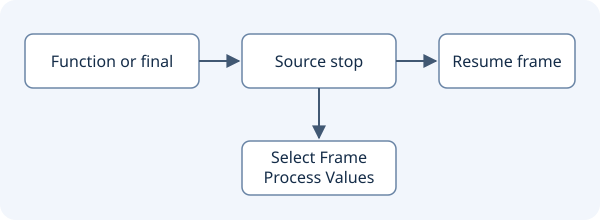
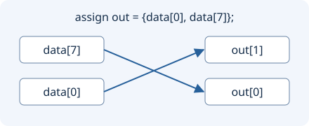
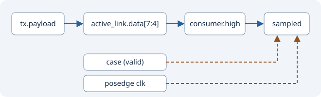

# Проверка поиска по диаграмме VCD

В Windows поставляемые с Geany процессы Icarus и Slang запускаются
в фоне без отдельных консольных окон. Вывод симуляции и команды
отладки доступны в окне **Verilog Simulation**.

Откройте `conditions.vcd` в просмотрщике диаграмм Geany Insight. Выберите
`testbench.clk`, поставьте курсор в начало и нажмите **Find Condition…**.
В режиме **Rising edge** два нажатия **Find Next** приводят к тактам 5 и 15.
Переход из неизвестного состояния в 1 на такте 25 пропускается. В режиме
**Falling edge** поиск от такта 5 приводит к такту 10.

Выберите `testbench.counter` и верните курсор в начало. Для **Exact binary
value** введите `0010`. Курсор перейдёт к такту 15. Затем введите `xxxx`,
чтобы перейти к такту 20. Вводите полную ширину шины. Значения `x` и `z`
сравниваются буквально. Поиск идёт по изменениям строго после курсора.

Можно закрепить обе дорожки через **Pin track** и сверять уровень и
значение шины на одном курсоре. Поиск работает с записанной диаграммой VCD.

## Общий шаг по дорожкам

Закрепите `testbench.clk` и `testbench.counter`, раскройте **Signal Watch**
и установите курсор на такт 10. **Next visible event** ведёт к такту 12,
где меняется только счётчик. Следующий шаг ведёт к такту 15 один раз,
хотя в этот момент меняются обе дорожки. **Previous visible event**
возвращает к такту 12. Таблица показывает значения на курсоре, такт
последнего события и отметку для сигналов с событием на текущем такте.

## Запуск тестбенча из Geany

1. Соберите и установите редактор через `build.sh` или `build.cmd`.
2. В Geany откройте **Tools → Run Verilog Testbench…** и выберите сразу
   `counter.v` и `counter_tb.v`. При открытом проекте его корень
   используется для поиска включаемых файлов.
3. После завершения симуляции диаграмма откроется автоматически.
   Закрепите `counter_tb.clk`, `counter_tb.count` и `counter_tb.odd`.
   На фронтах 5, 15 и 25 нс шина принимает значения 1, 2 и 3.
   В **Signal Watch** младший бит принимает 1, 0 и 1.
4. Для проверки диагностики запустите только `counter_tb.v`. Icarus
   должен сообщить, что модуль `counter` отсутствует.

Выбирайте сохранённые исходники. Тестбенч должен завершиться и записать
ровно один файл `.vcd` в рабочую папку запуска. Для этого используйте
относительное имя в `$dumpfile` и вызовите `$dumpvars`. Запуск
выполняется в отдельной временной папке. **Cancel** завершает запущенный
процесс. Полученная диаграмма открывается после завершения симуляции.

## Интерактивная симуляция

Выберите **Tools → Debug Verilog Testbench…**, затем `counter.v` и
`counter_debug_tb.v`. Симулятор откроет консоль на начальной паузе.

1. Нажмите **Time**. Начальное время равно нулю.
2. Нажмите **Step Event**. Это шаг планировщика, поэтому время может остаться
   тем же. **Scope** и **List** показывают область и объекты, известные vvp.
3. Нажмите **Continue**. Тестбенч выполняет `$stop` на 6 нс после первого
   фронта, когда `count` уже равен 1. Проверьте время через **Time**.
4. Нажмите **Continue** ещё раз. Тестбенч закончит работу, и Geany откроет VCD.
   Проверьте `counter_debug_tb.count` и `counter_debug_tb.odd` в Signal Watch.

**Finish** завершает симуляцию на паузе. **Cancel** завершает процесс.
Кнопки управления доступны у приглашения vvp. Остановку можно запросить через **Pause** или задать в тестбенче через `$stop`.

### Сигналы и диаграмма во время паузы

На остановке в 6 нс нажмите **List**. Если текущая область корневая, введите
`counter_debug_tb` и нажмите **Enter Scope**, затем снова **List**. Введите
`count` и нажмите **Read Signal**. Ожидается двоичное значение `0001`.
**Parent Scope** поднимается на уровень выше.

Нажмите **Preview Waveform**. Откроется снимок VCD, записанный к паузе.
Закрепите `clk`, `count` и `odd`, проверьте первый фронт на 5 нс и закройте
снимок, чтобы вернуться к консоли. После следующей паузы можно открыть новый
снимок. В начале симуляции VCD может ещё отсутствовать.

**Trace On** включает вывод исполняемых строк HDL в консоль. Выполните
**Step Event** или **Continue**, чтобы увидеть трассу. **Trace Off**
выключает её на очередной паузе.

### Точки на строках и пауза

Соберите редактор заново через `build.sh` или `build.cmd`, чтобы установленный
Icarus получил патч Geany. При первом запуске отладчика в консоли появится
`GEANY-VVP-READY`.

1. В **Debug Verilog Testbench…** выберите `counter.v` и `counter_debug_tb.v`.
   На начальной паузе выберите `counter.v` в списке исходников консоли.
2. Введите номер строки с `count <= count + 1'b1;` и нажмите
   **Set Point**. Консоль сообщит число точек.
3. Нажмите **Continue**. Ожидается остановка на фронте 5 нс, перед выполнением
   присваивания. **Open HDL Line** откроет эту строку в редакторе.
4. Удалите точку через **Remove Point** или очистите список через **Clear Points**.
   Точки восстанавливаются при выборе того же набора файлов и работают на строках, для которых Icarus
   сгенерировал исполняемые команды.
5. Чтобы проверить кнопку **Pause**, запустите тестбенч, который долго
   выполняет события. После **Continue** нажмите **Pause**. Симулятор
   остановится, когда планировщик обработает запрос. Короткий тестбенч
   может закончиться раньше. Если используется внешний vvp без патча,
   остаются штатные команды консоли и остановки через `$stop`.

### Условие, счётчик и журнальная точка

После пересборки запустите **Debug Verilog Testbench…** с файлами
`counter.v` и `counter_tb.v`. На начальной паузе выберите в списке
`counter.v` и строку с `count <= count + 1'b1;`.

1. В **Full signal name** введите `counter_tb.count`, в **Binary value**
   введите `0001`, оставьте **Hits = 1** и нажмите **Set Point**.
   После **Continue** ожидается остановка на втором фронте, в 15 нс.
   Правило читает значение до выполнения выбранного оператора.
2. Для проверки порога начните новый запуск. Оставьте поля сигнала и значения
   пустыми, задайте **Hits = 2** и снова нажмите **Set Point**. Ожидается
   остановка на втором посещении строки.
3. Для журнальной точки включите **Log and continue**. При пороге 2
   ожидаются записи для второго и третьего посещений без паузы.
4. **List Points** показывает правила и счётчики совпадений на паузе.
   Повторный **Set Point** обновляет правило этой строки. Счётчик
   неизменившегося правила сохраняется при обновлении списка.

Для условия используйте полное имя статического сигнала. Автоматические
локальные переменные доступны в инспекторе выбранной активации.
Введите полную ширину сигнала. Сравнение принимает `0`, `1`, `x` и `z`
буквально. Пустые поля сигнала и значения означают, что совпадает каждое
посещение строки. Если сигнал недоступен или ширина значения отличается,
симулятор пишет диагностику. Правила сохраняются для следующего запуска с теми же исходниками.

### Lua-сценарий живых остановок

После пересборки выберите **Debug Verilog Testbench…**, затем `counter.v`
и `counter_tb.v`. На начальной паузе загрузите `observe-hdl.lua` кнопкой
**Load Lua Observer…**. Выберите строку присваивания счётчика в `counter.v`,
оставьте сигнал и значение пустыми, задайте **Hits = 1**, включите
**Lua decides** и нажмите **Set Point**.

После **Continue** сценарий запишет первое попадание на 5 нс и продолжит.
На втором попадании, в 15 нс, симуляция останется на паузе. В консоли
ожидается `HDL hit 2 at tick 15`, а под ней — `HDL hits = 2`.
**Open HDL Line** открывает строку остановки.

Сценарий возвращает функцию `function(event)`. Она получает события
`hdl-point` только для точек **Lua decides**, после проверки условия и порога.
Доступны `event.file`, `event.line`, `event.locals.hits`, `event.locals.tick`
(точная строка), `event.locals.ticks` (целое, если помещается), а также
`event.locals.signal` и `event.locals.bits` для заданного условия.
`log()` пишет в консоль, `watch()` выводит именованное значение под ней.
`true` оставляет симуляцию на паузе, а `false` или `nil` продолжает.
Если сценарий отсутствует или завершился ошибкой, симуляция остаётся на паузе.

### Повторный запуск с сохранённой настройкой

1. Настройте условную или журнальную точку и загрузите `observe-hdl.lua`.
   Закройте отладчик и снова откройте **Debug Verilog Testbench…** в том же
   проекте с теми же файлами. Порядок выбора файлов значения не имеет.
2. На начальной паузе дождитесь сообщения о загруженных точках и нажмите
   **List Points**. Правила восстановлены, счётчики равны нулю. Если выбрать
   сохранённую пару файла и строки, её поля заполнятся автоматически.
3. Нажмите **Reload Saved Lua**, чтобы явно загрузить последнюю выбранную
   версию сценария с диска. **Disable Lua** выгружает сценарий из текущего
   сеанса и оставляет путь для повторной загрузки.
4. **Remove Point** и **Clear Points** сохраняют удаление. Новый набор
   исходников или другой проект получает отдельную конфигурацию.

Файлы настроек находятся под `insight/verilog-debug` в профиле Geany.
Сохраняются точки с контекстом исходника и путь к сценарию. Сценарий при
старте не выполняется автоматически.

### Карта сигналов

Откройте `conditions.vcd` и нажмите **Signal Map…**. В левой части
показаны области VCD и объявленные в них сигналы. Выберите
`testbench.counter`. Справа появится `testbench.dut.count_alias`:
оба имени используют одну дорожку записи. `testbench.dut.independent`
имеет свой идентификатор и в список псевдонимов не входит, даже если
в текущем такте его значение совпадает.

Верхняя строка показывает ширину и значение выбранного сигнала на курсоре.
**Select Track** выбирает дорожку, **Pin Track** закрепляет её, а
**Go to HDL** ищет объявление в открытом проекте. Карта показывает
иерархию и общие идентификаторы из VCD. Связи драйверов и потребителей
нужно получать отдельно из исходников или модели симулятора.

### Перенос точки после правки HDL

1. Сохраните точку на присваивании счётчика в `counter.v` через **Set Point**.
   Завершите запуск, вставьте несколько строк выше присваивания и сохраните файл.
2. Запустите отладку с теми же исходниками. В консоли будет число перенесённых
   точек. **List Points** покажет новый номер строки. Условие, порог и режим
   правила сохранятся.
3. Удалите строку или сделайте несколько копий строки с одинаковыми соседями.
   При новом запуске точка останется в настройках, но не загрузится в vvp.
   **Unresolved Points** покажет её прежний файл и строку. Для ручной
   перепривязки удалите старое правило через **Remove Point** и задайте новое
   на нужной строке. **Clear Points** удаляет и активные, и неразрешённые точки.

Для переноса используется текст строки и двух соседей. Старые настройки без
контекста продолжают использовать сохранённый номер до следующего **Set Point**.

## Использования сигнала в HDL

1. Добавьте `counter.v` и `counter_tb.v` в открытый проект Geany и
   запустите тестбенч из редактора.
2. Откройте **Signal Map…**. Выберите сигнал `count` в экземпляре
   `counter` под `counter_tb`. Если на одной дорожке несколько имён,
   выберите нужное имя в списке псевдонимов.
3. Нажмите **HDL Uses…**. У присваивания счётчика должна быть запись
   `write` для цели и запись `read` для правой части. Выберите запись
   и нажмите **Open Source**, чтобы перейти к её строке.
4. Повторите поиск для одноимённого сигнала в тестбенче. Список привязан
   к объявлению выбранного сигнала, поэтому состав результатов отличается.

Для составного присваивания прямой цели используется роль `read/write`.
Сложные цели и другие использования могут иметь общую роль `value` или
`member`. Именованные порты отображаются как `port`, когда индекс
связывает их с тем же объявлением. Экземпляры одного модуля могут
ссылаться на одни и те же строки исходника. Список показывает до 2000
уникальных мест и описывает обращения в исходниках.

### Связи через порты

В том же тестбенче сравните обе стороны подключения `.count(count)`.

- Для `counter_tb.count` должна появиться строка `port-source` с именем
  `dut.count`. Источник значения находится на выходе экземпляра.
- Для `counter_tb.dut.count` должна появиться строка `port-destination`
  с именем `count`. Выход экземпляра передаёт значение в тестбенч.
- Для `counter_tb.clk` и `counter_tb.dut.clk` роли меняются местами,
  поскольку `clk` является входом экземпляра.
- Во всех случаях **Open Source** открывает строку подключения в
  `counter_tb.v`. Для двунаправленных портов используется роль `port-peer`.

Поддерживаются подключения к одному сигналу, включая выбор бита или
диапазона. Для такого выбора строка указывает на объявление шины целиком.
Связи с выражениями проверяются отдельно в примере ниже. Интерфейсные порты пока не индексируются.
Список по-прежнему группирует обращения по объявлению, поэтому в нём
могут встречаться подключения нескольких экземпляров одного модуля.

### Переход по диаграмме через порт

1. Откройте **HDL Uses…** для `counter_tb.count`.
2. Выберите строку с полным именем `counter_tb.dut.count` и нажмите
   **Select Track**. На диаграмме выбирается эта дорожка, а курсор
   остаётся на прежнем такте.
3. Откройте **HDL Uses…** для выбранной дорожки и проверьте обратный
   переход к `counter_tb.count`.
4. Добавьте второй экземпляр счётчика с отдельной выходной шиной.
   У каждой шины в тестбенче должен появиться переход к её экземпляру.
   **Open Source** по-прежнему открывает строку подключения.

Для перехода связанный сигнал должен присутствовать в записи VCD под
полным именем из HDL. Если его не записали через `$dumpvars`, редактор
покажет сообщение, а текущая дорожка останется выбранной.

### Обход через несколько модулей

Добавьте `port_chain_tb.v` в проект и запустите этот файл как тестбенч.
В **HDL Uses…** для `port_chain_tb.stimulus` обе дорожки
`left_branch.sink.sample` и `right_branch.sink.sample` должны
отображаться как **Downstream** с числом переходов 2. Проверьте **Select
Track** на ненулевом такте. У выбранной конечной дорожки **Upstream**
с двумя переходами должен вести обратно к `stimulus`. Соседняя ветка
из этой конечной точки не считается продолжением потока.

**Open Source** открывает последнее подключение на кратчайшем пути.
Обход учитывает подключения портов, двунаправленные связи и непрерывные
присваивания. Колонка **Hops** показывает число звеньев. Нажмите на
заголовок колонки, чтобы отсортировать результаты.

### Выражения на входах и раздельные выходы

Запустите `port_expression_tb.v` как тестбенч и добавьте его в проект.
В **HDL Uses…** у `port_expression_tb.dut.value` должны появиться оба
источника `left_input` и `right_input`. У `dut.result` должны
появиться оба получателя `upper_output` и `lower_output`.
Для каждого проверьте **Select Track** и **Open Source**.

Связи описывают сигналы на уровне объявлений. Для разрядов и срезов
переход ведёт к целой шине. Анализ входного выражения учитывает
видимые обращения в самом выражении. Тела вызванных функций и
выбор конкретной ветви по значениям в VCD здесь не анализируются.

### Связи через непрерывное присваивание

В тестбенче `port_expression_tb.v` откройте **HDL Uses…** для
`port_expression_tb.left_input`. Дорожка `dut.value` находится в
одном переходе, `dut.result` в двух, `upper_output` и `lower_output`
в трёх. От любой выходной дорожки можно пройти обратно к обоим входам.

На прямом переходе через `assign` используются роли `assign-source`
и `assign-destination`. **Open Source** открывает соответствующее
присваивание, если оно было последним звеном маршрута. Связи считаются
по целым сигналам. Для составной левой части результат показывает
возможные зависимости между входами и целями, без разбиения по битам.
Присваивания с более чем 4096 парами входов и целей пропускаются.

### Связи через регистр

Добавьте `procedural_flow_tb.v` в проект и запустите его как тестбенч.

1. В **HDL Uses…** для `procedural_flow_tb.dut.sampled` проверьте строку
   `procedural-source` для `dut.data_in`. **Open Source** открывает
   присваивание `sampled <= data_in`.
2. От `procedural_flow_tb.stimulus` проследите путь до
   `procedural_flow_tb.result`. В пути четыре звена, включая входной
   порт, процедурное присваивание, `assign` и выходной порт.
3. На диаграмме `stimulus` меняется на 3 нс. Регистр и выход меняются
   на фронте в 5 нс. **Select Track** оставляет курсор на выбранном такте.

Рёбра показывают зависимости по данным из правых частей блокирующих и
неблокирующих присваиваний в процессах HDL. Условия `if`, выбор ветвей `case` и явные события чувствительности показаны отдельно
как управляющие связи. Задержки не создают рёбер. Граф
описывает возможные пути по исходникам. Историю значений показывает VCD.

### Вкладка Connections

В `procedural_flow_tb.v` откройте **HDL Uses…** для `dut.sampled`
и переключитесь на **Connections**. В ветке **Upstream** раскройте
`dut.data_in`, чтобы увидеть `stimulus`. В ветке **Downstream**
раскройте `dut.data_out`, чтобы увидеть `result`. Выберите
промежуточный узел и проверьте **Open Source** и **Select Track**.
Вкладка **Uses** сохраняет плоский список с чтениями и записями регистра.

В `port_chain_tb.v` проверьте, что от `stimulus` отходят две ветки.
При повторном достижении сигнала узел помечается **Already shown**
и дальше не раскрывается. Так видны сходящиеся пути без зацикливания.

В **Connections** раскройте узлы `sampled` и `data_in`. Строки
`read`, `write` и `read/write` показывают обращения к объявлениям.
**Open Source** открывает нужную строку. Для перехода к VCD выбирайте
узел сигнала и нажимайте **Select Track**. Одно объявление в исходнике
может использоваться несколькими экземплярами модуля. В дереве выводится
до 24 уникальных обращений на узел и до 2000 на весь граф.

### Шаг по исходнику, процессу и времени

Соберите редактор штатным `build.cmd` или `build.sh`, чтобы обновить
встроенный мост Icarus. В **Debug Verilog Testbench…** запустите
`procedural_flow_tb.v`.

1. На начальной паузе нажмите **Step HDL**. В консоли появятся номер
   процесса и его область. **Open Source** открывает строку остановки.
2. Нажмите **Step Current Process**. Симуляция продолжится до следующей
   точки исходника того же процесса или до другой явной остановки.
   Остальные процессы при этом продолжают выполняться. Если у выбранного
   процесса больше нет точек, выполнение может дойти до конца симуляции.
3. Нажмите **Next Tick**. Симулятор остановится в начале следующего
   такта перед активными событиями. **Time** показывает новый такт.
4. После остановки на исходнике **List** показывает содержимое области
   процесса. **Read Signal** читает доступный по имени сигнал этой
   области. **Step Event** по-прежнему выполняет шаг планировщика.

Шаг по HDL опирается на точки исходника, сгенерированные Icarus.
Точки останова и **Step HDL** работают внутри синхронных функций
и блоков `final`. На такой паузе **Select Frame** позволяет выбрать
текущий кадр (0) или вызывающий кадр (1), если он существует.
**Step Current Process** может зайти в синхронный вызов выбранного
процесса. После выхода из функции используйте **Step HDL**, чтобы
продолжить шагать по исходнику.

### Список процессов и значения задач

Запустите `process_values_tb.v` через **Debug Verilog Testbench…**.
Нажмите **Next Tick**, чтобы остановиться на 1 нс, затем **Processes**.

1. В консоли найдите два процесса задачи `worker`. У них одна область
   и разные номера. Введите номер одного в **Process ID** и нажмите
   **Select Process**. Консоль покажет цепочку родительских процессов.
2. Нажмите **Process Values**. Локальная переменная `saved` должна
   содержать значение этой активации. Выберите другой процесс и повторите.
   Ожидаются значения 3 и 9, представленные двоичными строками.
3. Нажмите **Step Current Process**. Следующая позиция исходника
   выбранной задачи наступит после её задержки. **Open Source** открывает
   строку, на которой остановилась симуляция.

В списке отображается до 256 живых процессов, цепочка ограничена 64
уровнями, список значений ограничен 128 значениями. Автоматические значения доступны при совпадающем активном
контексте чтения и записи. **Process Values** показывает также строки, вещественные значения
и размеры динамических массивов и очередей. Введите имя и индекс
(например, `samples[0]`) и нажмите **Read Memory Word**, чтобы
прочитать отдельный элемент. Для упакованных структур и перечислений
доступно двоичное представление, если Icarus выставляет их как
векторы. Имена полей, имена значений перечислений и свойства объектов
классов отдельно не раскрываются.

### Родительские кадры и память

Остановите `process_values_tb.v` на 1 нс и выберите процесс `worker`.
В **Select Frame** выберите 0, чтобы увидеть локальные значения задачи,
или 1, чтобы перейти к родительскому процессу в области модуля.
**Process Values** покажет `samples [memory]` в кадре модуля.
Введите `samples[-2]` и нажмите **Read Memory Word**. Ожидается
`10xz`. Для `samples[1]` ожидается `0110`. Индекс вне диапазона
должен дать сообщение и оставить симуляцию на паузе.
**Step Current Process** по-прежнему шагает по выбранному процессу
`worker`, даже если инспектор показывает его родительский кадр.

Чтение памяти работает с именованными одномерными массивами, которые
Icarus предоставляет как VPI memory. Объекты классов, очереди и
динамические массивы через этот инспектор не разворачиваются.

## Автоматическая проверка Windows и Linux

GitHub Actions **Verilog debugger smoke** устанавливает редактор и
симулятор через `build.cmd` и `build.sh`. По умолчанию проверка
собирает HDL-компоненты с отключённым Clang. Для полной сборки с
внутренним Clang запустите workflow вручную с `full_clang`.

После локальной установки запустите
`python3 insight/tests/waveform-debug/smoke.py PREFIX LOGS`
или `python insight/tests/waveform-debug/smoke.py PREFIX LOGS` в Windows.
`PREFIX` — папка установки редактора, `LOGS` — отдельная папка для
журналов проверки. Сценарий проверяет загрузку библиотек Geany,
разрешение имени сигнала и граф связей в установленном Slang, а также
условную остановку, путь и строку
источника, событие для Lua, VCD, шаг по HDL в выбранном процессе, шаг по времени, значения двух активаций
задачи, родительский кадр и чтение памяти.

В CI ключ `--gtk` запускает установленный Geany с отдельной
конфигурацией и проверяет открытие HDL-файла в настоящем окне GTK.
Linux использует Xvfb. На локальном рабочем столе можно добавить
`--gtk` к той же команде.

Для ручной проверки действий в интерфейсе откройте Geany и выполните разделы «Условие, счётчик и журнальная точка»,
«Lua-сценарий живых остановок» и «Родительские кадры и память».
На остановке нажмите **Open HDL Line**, затем **Preview Waveform**.
Проверьте переход к строке счётчика и появление его дорожки в окне VCD.
Автоматический сценарий проверяет открытие файла в GTK, протокол и
файлы установленного симулятора. Кнопки редактора и исполнение Lua проверяются в GTK-сеансе.

Отдельный сценарий **Exercise native debugger controls** запускает редактор
с новым профилем, выбирает тестбенч через меню и загружает
`observe-hdl.lua` через диалог. Он проверяет остановку на втором
попадании, опубликованное Lua значение, переход к строке HDL и выбор
дорожки в снимке на паузе и в итоговой диаграмме.
Журнал находится в `insight-smoke/gtk-debugger/session.log`.

### Условия и тактовые события в графе

В `procedural_flow_tb.v` откройте **Connections** для `dut.sampled`.
В ветке **Upstream** `dut.enable` отмечен как `condition-source`,
а `dut.clk` как `posedge-source`. **Open Source** открывает условие
или событие в исходнике. Из узла управляющего сигнала можно выбрать
записанную дорожку. Управляющее ребро завершает ветку обхода, поэтому
оно не превращает тактовый сигнал в источник данных. Для отрицательного
фронта отображается `negedge`. Явный переход в обе стороны помечается
`edge`, событие без указания фронта помечается `event`.

### Биты и диапазоны в связях

Запустите `slice_flow_tb.v` и откройте **Connections** для `bus`.
Колонка **Signal / peer selection** показывает `[7:4] / all` на
подключении к `dut.part`. Для связи от `dut.bit_out` к `dut.part`
в списке источников виден выбранный бит `[2]`. Знак `?` означает,
что индекс или граница не определены при построении индекса.
**Select Track** выбирает дорожку целого сигнала. При обходе известные
непересекающиеся диапазоны на одном сигнале отсекаются. При неизвестном
индексе или переходе через выражение без точного соответствия битов граф
сохраняет возможные связи.

### Перестановки битов через конкатенацию

Для `assign out = {data[0], data[7]};` граф **Connections** показывает
`out[1] → data[0]` и `out[0] → data[7]` при обходе к источникам.
Также учитывается порядок объявленных индексов, конкатенация слева
и повторение вида `{2{data[3]}}`. Точное сопоставление применяется
к присваиваниям одинаковой ширины до 256 бит. При динамическом индексе,
изменении ширины или вычисляемом операнде сохраняются возможные зависимости.

### Интерфейсы SystemVerilog

Добавьте `interface_flow_tb.sv` в проект с индексатором Slang. Граф
отличает `active_link` от `other_link`, хотя оба экземпляра имеют
один тип. Обычные члены `modport` связываются с сигналами своего
экземпляра. Для явных псевдонимов отдельные рёбра
`interface-source` и `interface-destination` показывают направление
и диапазон выражения. На схеме `valid` управляет выбором в `case`,
а `clk` задаёт событие `posedge`.

Проверка интерфейса использует индекс исходников. Для выбора дорожки
нужна запись VCD с соответствующим иерархическим именем. Динамический
выбор экземпляра через виртуальный интерфейс не разрешается.
